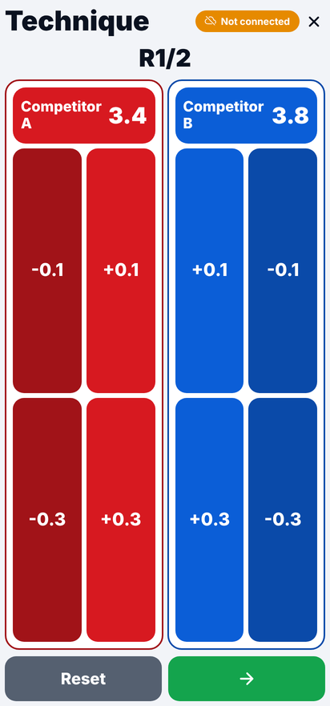
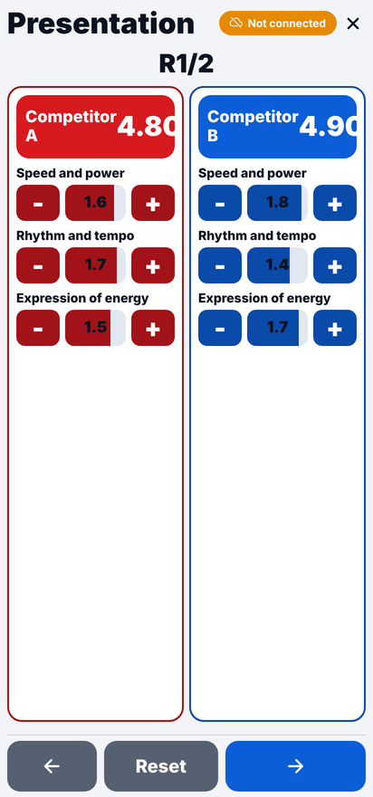
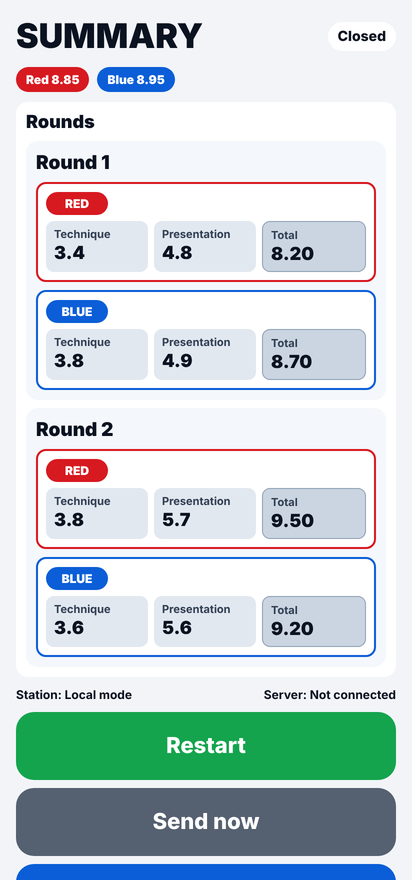
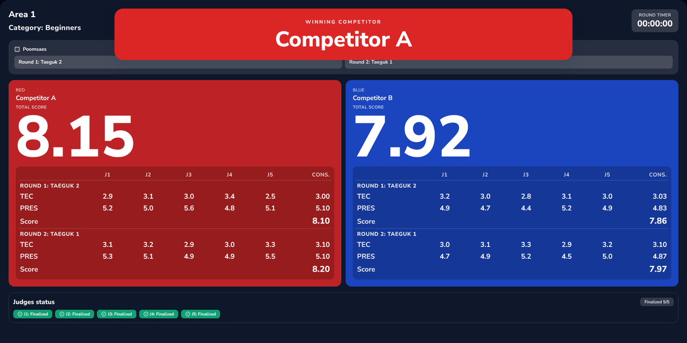
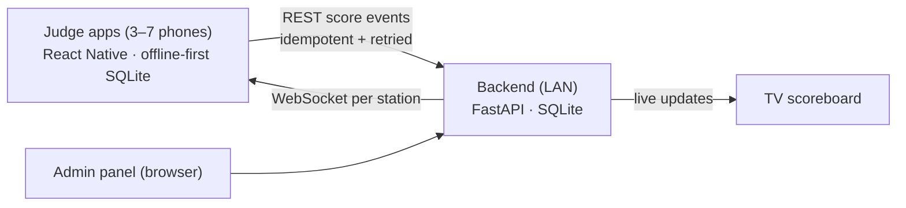

# TKD Poomsae Scorer

Offline-first scoring system for taekwondo **poomsae** competitions. Judges score from their Android
phones at the same time, a server on the local network consolidates the scores with the 3 / 5 / 7-judge
rules, and the result appears on a TV screen within seconds — without stopping the competition and
without manual transcription. It needs no internet connection.

<p>
  
  
  
</p>


## Why

In poomsae each judge scores **accuracy live** (starting at 4.0, −0.1 per minor and −0.3 per serious
mistake) and **presentation after the performance** (three criteria of up to 2.0). With 5 or 7 judges the
highest and lowest scores are discarded and the rest averaged, and athletes perform two poomsae. One
head-to-head match produces up to **56 numbers** to collect, trim and average — on paper that stops the
competition after every athlete. [Read the rules behind the system →](docs/poomsae-rules.md)

## How it works



- **Offline-first judge app:** every tap is written to SQLite before any network call; a background sync
  engine retries with exponential backoff + jitter and the UI never blocks. The app also works with no
  server at all.
- **Exactly-once scoring:** score events and finalization are idempotent (`idempotencyKey`, strictly
  increasing sequence) and the final result is reconciled with a SHA-256 checksum.
- **Real-time:** one WebSocket channel per station pushes new matches, settings and session revocation
  to the judges, and drives the admin panel and the TV screen.
- **Runs without internet:** every asset is served by the backend, which ships as a single PyInstaller
  executable for Windows and Linux.
- **English and Spanish UI:** English by default; Spanish on Spanish-language phones and with
  `TKD_UI_LANGUAGE=es` on the server. All code is in English; translations live in locale files.
- **Hexagonal architecture** in the backend (domain / application / ports / adapters / infra) and a
  layered architecture in the app (domain / application / infrastructure / UI).
- **Rule-exact consolidation:** every judge keeps an own scorecard; accuracy and presentation are trimmed
  (highest and lowest dropped with 5 or 7 judges) and averaged separately, then the poomsae are averaged.
- **Tested:** 160 backend tests (unit, integration, API, including full 3- and 5-judge matches) and 83 app
  unit tests, run in CI with ruff, ESLint and TypeScript checks. App and server share a checksum test vector.

## Repository layout

```text
backend/     FastAPI server, admin panel (Jinja2), TV scoreboard, PyInstaller packaging
judge-app/   Expo / React Native judge app (Android)
docs/        Rules, operations guide, requirements, API contract and technical references
```

## Getting started

### Backend

```bash
cd backend
python -m venv .venv && source .venv/bin/activate
pip install -e ".[dev]"
cp .env.example .env        # set TKD_JWT_SECRET_KEY, TKD_ADMIN_PASSWORD and TKD_ADMIN_BASE_PATH
python -m tkd_scorer.entry_points.runtime_server
pytest
```

The admin panel is served under `TKD_ADMIN_BASE_PATH`. See [`docs/backend.md`](docs/backend.md).

### Judge app

```bash
cd judge-app
npm ci
npm test                    # unit tests (Vitest)
npm run typecheck && npm run lint
npm start                   # Expo dev server on the LAN
```

See [`docs/judge-app.md`](docs/judge-app.md) for development builds, APK builds and E2E tests (Detox).

## Documentation

| Document | Content |
|---|---|
| [Why this system exists](docs/poomsae-rules.md) | The poomsae rules behind the project |
| [Operations guide](docs/operations.md) | Running the system on competition day |
| [Requirements](docs/requirements.md) | Scope, scoring rules, requirements, implementation status |
| [API contract](docs/api-contract.md) | REST + WebSocket contract between the app and the backend |
| [Backend](docs/backend.md) · [Judge app](docs/judge-app.md) | Technical references |
| [`docs/es/`](docs/es/README.md) | Original documentation in Spanish |

## Status

Working prototype: judge app, backend, admin panel and TV scoreboard work end to end on a LAN, verified
with full 3- and 5-judge matches, including a judge removed during the match. The known limitations that
remain (older app builds cannot reconcile, no migrations framework, in-memory login lockout, manual rematch)
are listed in [requirements, section 11](docs/requirements.md#11-implementation-status) and in the
technical references.
