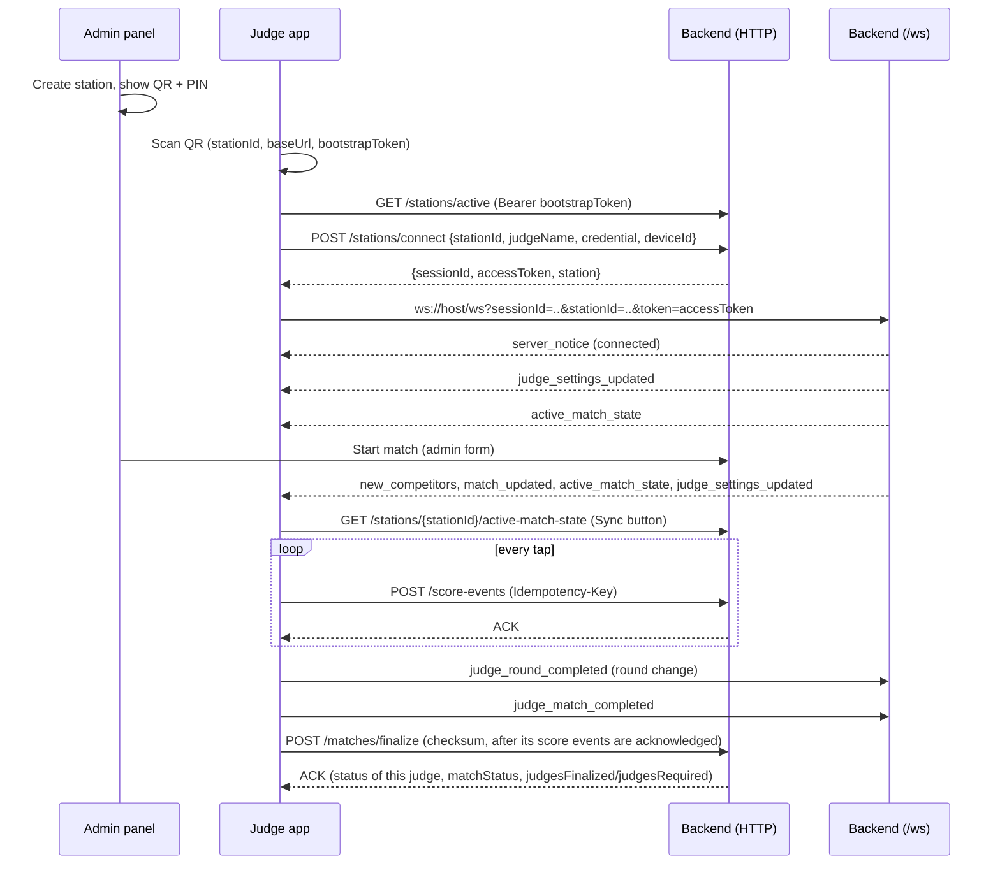

# API Contract — Backend and Judge App

Protocol version: `v1`

This document is the integration contract between the judge app (`judge-app/`) and the backend
(`backend/`). It describes the QR bootstrap payload, every HTTP endpoint, the WebSocket channel and the
error model, as implemented in the current code.

Related documents:

- [backend.md](backend.md) — backend architecture, configuration and operations
- [judge-app.md](judge-app.md) — judge app architecture, sync engine and realtime client
- [judge-app-requirements.md](judge-app-requirements.md) — judge app requirements (FR/NFR IDs)
- [requirements.md](requirements.md) — product requirements
- [poomsae-rules.md](poomsae-rules.md) — the scoring rules the system follows

Sources of truth in the code:

| Concern | File |
|---|---|
| Request schemas | `backend/src/tkd_scorer/infra/fastapi/schemas.py` |
| HTTP routes | `backend/src/tkd_scorer/infra/fastapi/routes.py` (re-exported by `entry_points/fastapi/api/routes.py`) |
| WebSocket route | `backend/src/tkd_scorer/infra/fastapi/websocket_routes.py` (re-exported by `entry_points/fastapi/websocket/routes.py`) |
| Admin routes | `backend/src/tkd_scorer/entry_points/fastapi/admin_views/routes.py` |
| Error mapping | `backend/src/tkd_scorer/infra/fastapi/error_handlers.py` |
| App HTTP client | `judge-app/src/infrastructure/network/apiClient.ts` |
| App WebSocket client | `judge-app/src/infrastructure/network/realtimeClient.ts` |
| App payload types | `judge-app/src/domain/models/contracts.ts` |
| Finalize checksum payload | `backend/src/tkd_scorer/domain/services/finalization_checksum.py`, `judge-app/src/domain/services/checksum.ts` |

---

## 1. Key rules

1. **The QR code identifies the station.** The QR payload carries `stationId`; the app connects to that
   station and never asks the judge to pick one manually.
2. **`matchId` is canonical and issued by the backend.** `POST /score-events` and `POST /matches/finalize`
   require a `matchId` that exists on the server. There is no fallback by `sessionId`, `stationId` or
   `judgeName`; a missing, empty or unknown `matchId` returns `422`.
3. **Competitors are identified by color, not by side.** The backend sends names as
   `competitorRedName` / `competitorBlueName`. Which color is shown on the left or right is a local
   preference of each judge device (`preferredRedSide`).
4. **Removing a judge is pushed over the WebSocket.** When the operator removes a judge, the backend
   revokes the session and sends `judge_kicked` followed by `session_revoked`. A removed judge that had not
   finalized the running match no longer counts as a required judge. The judge must scan the QR code and
   enter the PIN again to reconnect.
5. **HTTP is the source of record; the WebSocket is complementary.** Score events and finalization always
   go over HTTP. WebSocket messages are live hints and commands.
6. **One shared match per fight, one scorecard per judge.** Every judge of the station scores the same
   `matchId` with its own session. Sequences, running scores, reconciliation and the checksum are per judge
   (session); the server consolidates the judges' scorecards. The match closes when every required judge
   has finalized.

---

## 2. Connection flow



Step by step:

1. Scan the station QR code (it includes `stationId`).
2. Enter the station PIN / password.
3. `POST /stations/connect` with that `stationId`.
4. Store `sessionId` (SQLite) and `accessToken` (secure store).
5. Open the WebSocket with `sessionId`, `stationId` and `token`.

---

## 3. QR bootstrap payload

The admin panel renders this JSON as a QR code (station detail page, `GET /admin/stations/{station_id}/qr.png`
and the live panel). `POST /bootstrap/generate` returns the same structure.

```json
{
  "baseUrl": "http://192.168.1.20:8080",
  "stationId": "station-01",
  "stationName": "Station 1",
  "bootstrapToken": "<short-lived JWT>",
  "environment": "local",
  "tournamentId": "tkd-poomsae-local",
  "protocolVersion": "v1",
  "expiresAt": "2026-03-22T14:25:00.000Z"
}
```

| Field | Source on the server | Validation in the app (`connectionValidation.ts`) |
|---|---|---|
| `baseUrl` | `TKD_QR_SERVER_IP_OVERRIDE` when set, else the detected server LAN IPv4 when `TKD_QR_USE_SERVER_IP=true` (in both cases with the scheme/path of `TKD_PUBLIC_BASE_URL` or `TKD_BASE_URL` and `TKD_PORT`), else `TKD_PUBLIC_BASE_URL` (or `TKD_BASE_URL`) as configured. The shipped `.env.example` sets `TKD_QR_USE_SERVER_IP=false` | Required, valid URL; `localhost`, `127.0.0.1` and `::1` are rejected |
| `stationId` | Station ID | Required, at least 2 characters |
| `stationName` | Station name | Optional |
| `bootstrapToken` | JWT with `typ=bootstrap`, `tournament_id`, `exp` | Optional, at least 4 characters |
| `environment` | `TKD_ENVIRONMENT` | Optional |
| `tournamentId` | `TKD_TOURNAMENT_ID` | Optional |
| `protocolVersion` | `TKD_PROTOCOL_VERSION` | Defaults to `v1` when missing |
| `expiresAt` | now + `TKD_BOOTSTRAP_TOKEN_TTL_SECONDS` (default 180 s), ISO 8601 UTC with `Z` | Required ISO datetime; an expired QR is rejected |

The judge can also paste the QR JSON manually on the connection screen.

---

## 4. HTTP endpoints

All JSON bodies use camelCase. The server also accepts the snake_case field names (`populate_by_name=True`)
and ignores unknown fields. Many responses also repeat fields in snake_case for backward compatibility;
these are marked *legacy* below and new clients should not rely on them.

Datetimes are ISO 8601 in UTC with millisecond precision and a `Z` suffix (for example
`2026-03-22T14:22:00.000Z`).

### 4.1 Summary

| Method | Path | Auth | Used by the app | Purpose |
|---|---|---|---|---|
| `GET` | `/health` | Optional `Bearer accessToken` | Yes | Liveness; with a token it also validates the session |
| `POST` | `/bootstrap/generate` | Admin-panel guard | No | Build a QR bootstrap payload |
| `POST` | `/bootstrap/validate` | Admin-panel guard | No | Validate a bootstrap token and return its claims |
| `GET` | `/stations/active` | Optional `Bearer bootstrapToken` | Yes | List stations |
| `POST` | `/stations/connect` | Optional `Bearer bootstrapToken` | Yes | Connect a judge to a station |
| `POST` | `/sessions/restore` | Access token in body | No | Restore a session from an access token |
| `GET` | `/stations/{station_id}/active-match-state` | **Required** `Bearer accessToken` | Yes | Active match for the station (JSON) |
| `POST` | `/score-events` | **Required** `Bearer accessToken` | Yes | Ingest one score event |
| `POST` | `/matches/finalize` | **Required** `Bearer accessToken` | Yes | Finalize this judge's scorecard with checksum |
| `POST` | `/matches` | **Required** `Bearer accessToken` of the body's session | No | Create a match for one judge session (`judges_required` 1) |
| `POST` | `/matches/{match_id}/next-round` | **Required** `Bearer accessToken` of the match's station, or admin login | No | Advance the round |
| `POST` | `/matches/{match_id}/reset-round` | Admin login only (`403` for a judge token) | No | Delete the current round's events |
| `POST` | `/matches/{match_id}/reset-match` | Admin login only (`403` for a judge token) | No | Delete all events and finalizations and restart |
| `GET` | `/matches/{match_id}/summary` | **Required** `Bearer accessToken` of the match's station, or admin login | No | Server-side score summary |
| `GET` | `/stations/{station_id}/active-session` | **Required** `Bearer accessToken` of that station, or admin login | No | First active session of a station |

"Optional" means: if the header is present it must be valid, otherwise the request fails with `401`.
A malformed `Authorization` header (not `Bearer <token>`) always returns `401`.

"Admin-panel guard": the request must pass the same checks as the admin panel, that is the
`TKD_ADMIN_IP_ALLOWLIST` and, when `TKD_ADMIN_PASSWORD` is set, the admin login cookie; otherwise `403`
(`{"detail": "Administrator access required"}`). "Admin login": the administrator logged in to the panel
from an allowed IP, accepted only when `TKD_ADMIN_PASSWORD` is set and the request carries no
`Authorization` header (a request with a header is always treated as a judge request).

### 4.2 `GET /health`

Response `200`:

```json
{ "status": "ok" }
```

When `Authorization: Bearer <accessToken>` is sent, the session is restored first; an invalid, revoked or
expired session returns `401`. The app uses this to validate a stored session on startup
(`validateSession`): `401`/`403` means invalid, any network error means "offline".

### 4.3 `POST /bootstrap/generate`

Request:

```json
{ "stationId": "station-01", "stationName": "Station 1", "tournamentId": "tkd-poomsae-local" }
```

Requires the admin-panel guard (section 4.1); otherwise `403`.

Response `200`: the QR payload of section 3, plus legacy fields `base_url`, `station_id`, `station_name`,
`bootstrap_token`, `tournament_id`, `protocol_version`, `expires_at`.

### 4.4 `POST /bootstrap/validate`

Request:

```json
{ "bootstrapToken": "<JWT>" }
```

Response `200`:

```json
{ "valid": true, "claims": { "tournament_id": "tkd-poomsae-local", "typ": "bootstrap" } }
```

Requires the admin-panel guard (section 4.1); otherwise `403`. An invalid or expired token returns `401`
(`{"detail": "Invalid bootstrap token"}`).

### 4.5 `GET /stations/active`

Response `200`:

```json
[
  { "id": "station-01", "name": "Station 1", "status": "active" }
]
```

`status` is one of `active`, `occupied`, `offline`. The app calls this after reading a QR code and warns
when the QR station is not in the list.

### 4.6 `POST /stations/connect`

Headers: `Content-Type: application/json`, optional `Authorization: Bearer <bootstrapToken>`.

Request:

```json
{
  "stationId": "station-01",
  "judgeName": "Judge 1",
  "credential": "1234",
  "deviceId": "dev-3f2a9c",
  "replaceExistingJudgeSession": false
}
```

`replaceExistingJudgeSession` is optional (default `false`; `replace_existing_judge_session` also accepted).

Response `200`:

```json
{
  "connected": true,
  "sessionId": "sess-7d1e...",
  "accessToken": "<long-lived JWT>",
  "expiresAt": "2026-04-21T14:22:00.000Z",
  "station": { "id": "station-01", "name": "Station 1" },
  "session_id": "sess-7d1e...",
  "access_token": "<long-lived JWT>",
  "expires_at": "2026-04-21T14:22:00.000Z"
}
```

The last three fields are legacy duplicates. The access token lives for
`TKD_OPERATIONAL_TOKEN_TTL_SECONDS` (default 30 days).

Rules enforced by `ConnectStationUseCase`:

| Condition | Status | `detail` |
|---|---|---|
| Empty `judgeName` | `422` | `judgeName is required` |
| Unknown station | `404` | `Station not found` |
| Station credential expired | `401` | `Station credential expired` |
| Wrong PIN / password | `401` | `Invalid station credential` |
| Station has an expected judge and the name differs | `409` | `Judge does not match expected judge for station` |
| Same device already active with another judge name | `409` | `Device already connected with another judge identity` (also with `replaceExistingJudgeSession`) |
| Same judge name already active on another device, without `replaceExistingJudgeSession` | `409` | `Judge already connected with another active device` |
| Same judge name already active on another device, with `replaceExistingJudgeSession: true` | `200` | The old session is revoked and receives `judge_kicked` and then `session_revoked`, both with its `sessionId` and `reason: "replaced_by_new_device"`; a new session is issued |
| Same judge on the same device | `200` | The previous session is revoked (without notification) and a new one is issued |

Several judges may be connected to the same station at the same time.

A new session that replaced a session of the same judge (either way) inherits that judge's scorecard
identity (`device_sessions.scorecard_session_id`): the judge keeps its alias, is counted once in the shared
match, and the events of the old session keep counting in its scorecard. The new device does not hold the
events the old device sent, so when there were any, that judge's finalization does not reconcile and the
shared match ends `finalization_pending`.

> The app retries a `409` once with `replaceExistingJudgeSession: true`, so a judge who moves to another
> phone takes over its scorecard and the old phone is signed out.

### 4.7 `POST /sessions/restore`

Request:

```json
{ "accessToken": "<JWT>" }
```

Response `200`:

```json
{
  "session_id": "sess-7d1e...",
  "station_id": "station-01",
  "judge_name": "Judge 1",
  "expires_at": "2026-04-21T14:22:00.000Z",
  "status": "active",
  "sessionId": "sess-7d1e...",
  "stationId": "station-01",
  "judgeName": "Judge 1",
  "expiresAt": "2026-04-21T14:22:00.000Z"
}
```

The snake_case fields are the raw use-case output (`expires_at` uses FastAPI's default datetime format);
the camelCase fields are the normalized contract.

Errors (`401`): `Invalid access token`, `Session not found`, `Session is not active`, `Session expired`,
`Session token mismatch`.

### 4.8 `GET /stations/{station_id}/active-match-state`

The JSON source for the app's **Sync** button and for the initial load of the match setup screen.

Headers: `Authorization: Bearer <accessToken>` (required), `Accept: application/json`. The app adds a
`_ts` query parameter and no-cache headers.

Response `200` (active match):

```json
{
  "hasActiveMatch": true,
  "matchId": "match-5b0c...",
  "competitorRedName": "Competitor A",
  "competitorBlueName": "Competitor B",
  "updatedAt": "2026-03-22T14:22:00.000Z",
  "has_active_match": true,
  "match_id": "match-5b0c...",
  "competitor_red_name": "Competitor A",
  "competitor_blue_name": "Competitor B",
  "updated_at": "2026-03-22T14:22:00.000Z"
}
```

Response `200` (no active match):

```json
{
  "hasActiveMatch": false,
  "matchId": null,
  "competitorRedName": null,
  "competitorBlueName": null,
  "updatedAt": "2026-03-22T14:22:00.000Z"
}
```

(legacy snake_case duplicates omitted).

Rules:

- A match is active when it is live: its status is `in_progress` or `finalization_pending` **and** its
  reference session (the first active session when it started), any judge session of the station
  created before it started, or the session of a judge the match counts (for example one that joined later
  and scored), is still active (`Match.is_live`). A judge released after finalizing does not
  end the match for the other judges. The server looks at the most recent
  `TKD_MATCH_QUERY_LIMIT_ACTIVE_LOOKUP` matches.
- `hasActiveMatch=true` always comes with a non-empty `matchId`.
- Names are by color. If a name is `null`, the app falls back to the localized "Red" / "Blue".
- The app treats `404` as "no active match".

Errors:

| Status | When |
|---|---|
| `401` | Missing/invalid token, inactive session, or the token belongs to a different station (`Station token mismatch`) |
| `404` | Unknown station (`Station not found`) |

### 4.9 `POST /score-events`

Headers:

- `Authorization: Bearer <accessToken>` (required)
- `Content-Type: application/json`
- `Idempotency-Key: <idempotencyKey>` (optional; if present it must equal the body's `idempotencyKey`)

Request (as sent by the app's `SyncEngine`):

```json
{
  "eventId": "9a0e5c1e-...",
  "idempotencyKey": "9a0e5c1e-...",
  "sessionId": "sess-7d1e...",
  "stationId": "station-01",
  "deviceId": "dev-3f2a9c",
  "judgeName": "Judge 1",
  "matchId": "match-5b0c...",
  "roundNumber": 1,
  "athleteSide": "RED",
  "scoreTarget": "TECHNIQUE",
  "scoreDelta": -0.3,
  "scoreBefore": 4.0,
  "scoreAfter": 3.7,
  "occurredAt": "2026-03-22T14:30:00.120Z",
  "sequence": 12
}
```

| Field | Required | Notes |
|---|---|---|
| `eventId` | Yes | Unique per event (the app uses the local event ID) |
| `idempotencyKey` | Yes | The app uses the same value as `eventId` |
| `sessionId`, `stationId`, `judgeName` | Yes | Must match the claims of the access token |
| `matchId` | Yes | Canonical backend match ID; must exist, belong to the station and be `in_progress` or `finalization_pending` (`409 match_closed` when `finished` or `cancelled`) |
| `roundNumber` | Yes | Integer |
| `athleteSide` | Yes | `RED` / `BLUE` (case-insensitive) |
| `scoreTarget` | No | `TECHNIQUE`, `PRESENTATION_SPEED_POWER`, `PRESENTATION_RHYTHM_TEMPO` or `PRESENTATION_ENERGY_EXPRESSION` (case-insensitive). Missing or empty = `TECHNIQUE`; any other value → `422 Invalid scoreTarget`. Stored with the event |
| `scoreDelta` | Yes | Signed decimal, normalized to one decimal (`ROUND_HALF_UP`); negative = deduction, positive = correction |
| `occurredAt` | Yes | ISO datetime |
| `sequence` | Yes | Integer `> 0`, incremental per match on the device; unique per session (judge), not per match |
| `deviceId`, `scoreBefore`, `scoreAfter` | No | Accepted and ignored; the server computes its own `score_before` / `score_after` |

The server's `score_before` / `score_after` are the running value of **that target** for **that judge**,
round and side: the target's start (technique: the match starting score; each presentation category:
`TKD_JUDGE_PRESENTATION_CATEGORY_START_SCORE`) plus the judge's earlier deltas (lower `sequence`), clamped
after each one to `0..start` for technique and `0..2.0` for a presentation category. Events of other
judges of the shared match are never mixed in.

Response `200` (ACK):

```json
{
  "acknowledged": true,
  "eventId": "9a0e5c1e-...",
  "serverReceivedAt": "2026-03-22T14:30:00.250Z",
  "event_id": "9a0e5c1e-...",
  "idempotentReplay": false,
  "idempotent_replay": false,
  "sequence": 12,
  "score_before": "4.0",
  "score_after": "3.7",
  "received_at": "2026-03-22T14:30:00.250Z"
}
```

The app only reads `acknowledged`, `eventId` and `serverReceivedAt`.

Idempotency and ordering:

- The same idempotency key returns the stored response with `idempotentReplay: true`.
- Events may arrive out of order: `score_before` is computed from the judge's events with a lower `sequence`
  that the server already has.
- Sequence identity is per session: two judges may send the same `sequence` for the same match.
- The same `sequence` from the same session with the same round, side, target and delta is treated as a
  replay.
- The same `sequence` from the same session with a different payload returns `422`
  (`Sequence already exists for this session with a different score event payload`).

Errors:

| Status | `detail` |
|---|---|
| `401` | `Missing bearer token`, `Invalid access token`, `Session is not active` (judge released after finalizing, or removed), `Session token mismatch`, `Station token mismatch`, `Judge token mismatch`, `Match/station mismatch`, `Session/station mismatch`, `Judge name mismatch with active session` |
| `409` | `{"detail": "Match is closed and no longer accepts score events", "code": "match_closed"}`: the match is `finished` or `cancelled` (e.g. closed by the operator). Definitive: the app marks the event rejected and stops retrying it |
| `422` | `matchId is required`, `matchId must reference an existing backend match`, `Match is not in a score-accepting status` (a `pending` match), `Sequence must be greater than zero`, `Invalid scoreTarget`, `Idempotency key mismatch between header and body`, sequence conflict (above), or a FastAPI schema validation error |

After a new event is stored, the server broadcasts `match_updated` to the station (section 5.4). The first
stored event of a judge that connected after the match started adds that judge to the match's counted
judges (`judgesRequired` grows by one).

### 4.10 `POST /matches/finalize`

Headers: `Authorization: Bearer <accessToken>` (required), `Content-Type: application/json`, optional
`Idempotency-Key`.

Each judge finalizes **its own scorecard** of the shared match. The app sends it from the sync engine once
the backend has acknowledged that judge's score events for the match (see
[judge-app.md](judge-app.md#syncengine-srcapplicationservicessyncenginets)).

Request (as built by the app's `FinalizationService`):

```json
{
  "sessionId": "sess-7d1e...",
  "stationId": "station-01",
  "matchId": "match-5b0c...",
  "judgeName": "Judge 1",
  "competitorLeftName": "Competitor A",
  "competitorRightName": "Competitor B",
  "totalRounds": 2,
  "finalRound": 2,
  "finalScoreRed": 8.4,
  "finalScoreBlue": 8.95,
  "totalEvents": 14,
  "finalSequence": 14,
  "startedAt": "2026-03-22T14:20:00.000Z",
  "finishedAt": "2026-03-22T14:31:10.000Z",
  "checksum": "<sha256 hex>",
  "roundsSummary": [
    { "roundNumber": 1, "techniqueRed": 3.3, "presentationRed": 5.1, "techniqueBlue": 3.7, "presentationBlue": 5.2,
      "red": 8.4, "blue": 8.9, "negativeRed": 0.7, "negativeBlue": 0.3, "positiveRed": 0.0, "positiveBlue": 0.0 },
    { "roundNumber": 2, "techniqueRed": 3.4, "presentationRed": 5.0, "techniqueBlue": 3.6, "presentationBlue": 5.4,
      "red": 8.4, "blue": 9.0, "negativeRed": 0.7, "negativeBlue": 0.4, "positiveRed": 0.1, "positiveBlue": 0.0 }
  ]
}
```

- `finalScoreRed` / `finalScoreBlue`: this judge's final score per side = 2-decimal average of technique +
  2-decimal average of presentation over the rounds in `roundsSummary` (here `3.35 + 5.05 = 8.40` and
  `3.65 + 5.30 = 8.95`). Rounds not reached yet are left out.
- `roundsSummary[]`: per round, technique and presentation per side (`techniqueRed`, `presentationRed`,
  `techniqueBlue`, `presentationBlue`), the round totals `red` / `blue` (kept for older backends) and the
  technique deduction/correction sums.

Field aliases accepted by the server:

| Canonical | Also accepted |
|---|---|
| `finalScoreRed` | `finalScoreLeft`, `final_score_left` |
| `finalScoreBlue` | `finalScoreRight`, `final_score_right` |
| `finalSequence` | `lastSequence`, `last_sequence` |
| `roundsSummary[].roundNumber` | `round`, `round_number` |
| `roundsSummary[].techniqueRed`, `presentationRed`, `techniqueBlue`, `presentationBlue` | — (exact names) |
| `roundsSummary[].red` | `finalScoreRed`, `finalScoreLeft`, `redScore`, `red_score` |
| `roundsSummary[].blue` | `finalScoreBlue`, `finalScoreRight`, `blueScore`, `blue_score` |

Optional: `idempotencyKey` in the body. The effective idempotency key is the `Idempotency-Key` header, else
the body field, else `finalize:{sessionId}:{matchId}:{finalSequence}:{checksum}`.

#### Canonical checksum payload

`checksum` is the SHA-256 (lowercase hex) of the canonical JSON of this payload, built from the judge's
scorecard. The app builds it with `buildFinalizeChecksumPayload` + `canonicalize`
(`judge-app/src/domain/services/checksum.ts`); the server rebuilds it from the judge's stored events with
`build_finalize_checksum_payload` + `canonical_json`
(`backend/src/tkd_scorer/domain/services/finalization_checksum.py`).

| Field | Type | Value |
|---|---|---|
| `matchId`, `sessionId`, `stationId`, `judgeName` | string | As in the request |
| `totalEvents` | integer | Number of this judge's score events for the match |
| `lastSequence` | integer | Highest `sequence` of this judge's events (`0` when none) |
| `finalScoreRed`, `finalScoreBlue` | string | This judge's final score per side, 2 decimals (`"8.40"`) |
| `rounds[]` | array | Sorted by `roundNumber`: `{roundNumber` (integer), `techniqueRed`, `presentationRed`, `techniqueBlue`, `presentationBlue` (strings, 2 decimals)`}` |

Canonical form:

- object keys sorted (recursively), compact separators (`,` and `:`), no whitespace;
- non-ASCII characters kept as UTF-8 (`ensure_ascii=False`, like `JSON.stringify`);
- scores as strings with exactly 2 decimals, rounded half up (`"9.30"`, `"6.00"`); counters and round
  numbers as JSON integers.

Example (the shared test vector):

```json
{
  "matchId": "match-vector-1",
  "sessionId": "session-vector-1",
  "stationId": "station-01",
  "judgeName": "Judge É",
  "totalEvents": 7,
  "lastSequence": 9,
  "finalScoreRed": "9.30",
  "finalScoreBlue": "9.75",
  "rounds": [
    { "roundNumber": 1, "techniqueRed": "3.60", "presentationRed": "5.80", "techniqueBlue": "3.90", "presentationBlue": "6.00" },
    { "roundNumber": 2, "techniqueRed": "3.50", "presentationRed": "5.70", "techniqueBlue": "3.70", "presentationBlue": "5.90" }
  ]
}
```

Canonical string (one line):

```text
{"finalScoreBlue":"9.75","finalScoreRed":"9.30","judgeName":"Judge É","lastSequence":9,"matchId":"match-vector-1","rounds":[{"presentationBlue":"6.00","presentationRed":"5.80","roundNumber":1,"techniqueBlue":"3.90","techniqueRed":"3.60"},{"presentationBlue":"5.90","presentationRed":"5.70","roundNumber":2,"techniqueBlue":"3.70","techniqueRed":"3.50"}],"sessionId":"session-vector-1","stationId":"station-01","totalEvents":7}
```

SHA-256: `3835fc5400b88b7fdb67a709fbf3d456709fc862247d3fef7a64ec04bf5c4526`

The same vector is asserted on both sides: `backend/tests/unit/test_finalization_checksum.py` and
`judge-app/tests/unit/checksumAndFinalization.test.ts`. Any change to the payload must update both
implementations and the vector together.

#### Reconciliation

The server rebuilds **this judge's** scorecard from the events of this judge only (its session, plus the
sessions it replaced; rounds = the `roundsSummary` rounds plus the rounds where the judge has events) and
compares:

- `totalEvents` with the number of the judge's stored events for the match,
- `finalSequence` with the sequence of the judge's latest stored event (its highest sequence; after a
  session replacement, the latest session's own numbering),
- `finalScoreRed` / `finalScoreBlue` (rounded to 2 decimals) with the scorecard's final scores,
- `roundsSummary` (when sent): the same set of rounds, and per round the part fields
  (`techniqueRed`, `presentationRed`, `techniqueBlue`, `presentationBlue`) that are present; a round with
  no part fields (older apps) is compared by its totals `red` / `blue`,
- `checksum` with the SHA-256 of the canonical payload above (`checksumMode`: `canonical_scorecard` when it
  matches, otherwise `mismatch`).

Each mismatch adds a note (`totalEvents mismatch`, `lastSequence mismatch`, `finalScoreRed mismatch`,
`finalScoreBlue mismatch`, `roundsSummary mismatch`, `checksum mismatch`).

Response `200` (first of three judges, reconciled):

```json
{
  "acknowledged": true,
  "eventId": "finalize:sess-7d1e...:match-5b0c...:14:<checksum>",
  "serverReceivedAt": "2026-03-22T14:31:10.400Z",
  "status": "finished",
  "matchStatus": "in_progress",
  "judgesFinalized": 1,
  "judgesRequired": 3,
  "reconciled": true,
  "notes": "reconciled",
  "checksumVerified": true,
  "checksumMode": "canonical_scorecard",
  "reportedFinalScoreRed": "8.40",
  "reportedFinalScoreBlue": "8.95",
  "serverFinalScoreRed": "8.40",
  "serverFinalScoreBlue": "8.95",
  "match_id": "match-5b0c...",
  "idempotent_replay": false,
  "checksum_verified": true,
  "checksum_mode": "canonical_scorecard"
}
```

| Field | Meaning |
|---|---|
| `status` | This judge's finalization: `finished` (reconciled) or `finalization_pending` (any mismatch) |
| `matchStatus` | The shared match: `in_progress` until `judgesRequired` judges finalized; then `finished` (all reconciled) or `finalization_pending` (any judge not reconciled). On a finalization that arrives after the match was closed it is the closed status |
| `judgesFinalized`, `judgesRequired` | Distinct judges (scorecard identities) that finalized this match, removed judges excluded / judges required (`matches.judges_required`: the active judge sessions when the admin started the match, plus judges that joined later and scored, minus judges removed by the operator, never below 1; 1 for `POST /matches`) |
| `notes` | `reconciled` or the mismatch notes joined with `; ` |
| `reportedFinalScore*`, `serverFinalScore*` | The judge's reported and server-computed final scores (2-decimal strings) |

| Outcome | Side effects |
|---|---|
| Judge reconciled | The judge's session is revoked (released); `match_updated` to the station; `session_revoked` (`reason: match_finalized`) to the session |
| Judge not reconciled | `match_updated` to the station; the session stays active |
| This finalization completes the required judges and all reconciled | The match becomes `finished`; also `active_match_state` (`hasActiveMatch: false`) to the station |
| This finalization completes the required judges and any did not reconcile | The match becomes `finalization_pending` (the operator closes it with "Finalize active match") |
| The match was already closed (e.g. force-closed by the operator) | The finalization is recorded; the match status does not change |
| Replay: same idempotency key, or the same judge finalizing the same match again (also from a session that replaced it) | The stored response is returned (`idempotent_replay: true`); nothing changes and nothing is published |

The ACK is returned in every case: the app marks the finalization acknowledged as soon as it gets `200`,
whatever `reconciled` says. A judge whose session was revoked by its own reconciled finalization can still
replay it (the route accepts an inactive session only for that).

Errors:

| Status | `detail` |
|---|---|
| `401` | Token problems as in 4.9, `Session not found`, `Session/station mismatch`, `Judge mismatch`, `Match/station mismatch`, `Session is not active` (revoked session without a previous finalization of this match, e.g. a removed judge) |
| `422` | `matchId is required`, `matchId must reference an existing backend match`, `Match cannot be finalized from current status` (`pending` or `cancelled`), or a schema validation error |

The app refuses to send a finalization with an empty `matchId` (`errors.finalizeMatchIdRequired`).

### 4.11 Match control endpoints (not used by the app)

Authentication (section 4.1): a judge `Authorization: Bearer <accessToken>`, validated like
`/score-events`, or, without that header, the administrator logged in to the panel (only when
`TKD_ADMIN_PASSWORD` is set). Without an admin password the two resets cannot be called, since a judge
token gets `403`.

| Endpoint | Judge token | Admin login |
|---|---|---|
| `POST /matches` | Required; the body's `sessionId`, `stationId` and `judgeName` must match the token (`401 Session token mismatch` / `Station token mismatch` / `Judge token mismatch`) | Not accepted |
| `POST /matches/{id}/next-round` | Accepted when the token's station owns the match (`401 Match/station mismatch`) | Accepted |
| `POST /matches/{id}/reset-round`, `/reset-match` | `403 Judges cannot reset the shared match; only the administrator can` (a judge corrects its own scorecard with compensating score events) | Accepted |
| `GET /matches/{id}/summary` | Accepted when the token's station owns the match; a session released by its own finalization is accepted too | Accepted |
| `GET /stations/{id}/active-session` | Accepted when the token belongs to that station (`401 Station token mismatch`) | Accepted |

`POST /matches` — request:

```json
{
  "stationId": "station-01",
  "sessionId": "sess-7d1e...",
  "judgeName": "Judge 1",
  "competitorLeftName": "Competitor A",
  "competitorRightName": "Competitor B",
  "totalRounds": 2,
  "startingScore": 4.0
}
```

`startingScore` is the technique starting score; it defaults to `TKD_CREATE_MATCH_DEFAULT_STARTING_SCORE`
(4.0). A match created this way has `judges_required` 1. Response:

```json
{
  "id": "match-5b0c...",
  "stationId": "station-01",
  "sessionId": "sess-7d1e...",
  "judgeName": "Judge 1",
  "status": "in_progress",
  "currentRound": 1,
  "totalRounds": 2
}
```

`POST /matches/{match_id}/next-round`, `/reset-round`, `/reset-match` — request `{"actor": "local-admin"}`,
response `{"match_id": "...", "message": "Round advanced" | "Round reset" | "Match reset"}`. They publish
`round_changed`, `reset_round` and `reset_match` respectively. `next-round` past the last round returns
`422` (`Cannot move beyond total rounds`). `reset-round` deletes every judge's events of the current round
(`422 Match status does not allow reset` unless `in_progress` or `finalization_pending`). `reset-match`
deletes every judge's events and finalization records (so the judges finalize again), restarts the match
from round 1 and recounts as judges the judge sessions connected to the station now.

`GET /matches/{match_id}/summary` — response (snake_case):

```json
{
  "match_id": "match-5b0c...",
  "station_id": "station-01",
  "judge_name": "Judge 1",
  "status": "in_progress",
  "current_round": 1,
  "total_rounds": 2,
  "red_score": 8.15,
  "blue_score": 7.92,
  "total_events": 42
}
```

`red_score` / `blue_score` are the consolidated match scores across the judges (2 decimals, half up,
serialized as JSON numbers, so `8.10` appears as `8.1`): the official result once every required judge has finalized or the match is
closed, otherwise the live partial. They are `null` while no judge has scored or finalized the match.
`total_events` counts the events of all judges.

`GET /stations/{station_id}/active-session` — response:

```json
{
  "station_id": "station-01",
  "session_id": "sess-7d1e...",
  "judge_name": "Judge 1",
  "device_id": "dev-3f2a9c",
  "expires_at": "2026-04-21T14:22:00",
  "active_sessions_count": 3
}
```

`expires_at` here is FastAPI's default datetime serialization, not the `Z`-normalized format used elsewhere.

### 4.12 Admin panel endpoints (local operation)

These routes serve the admin panel. They take HTML form posts (`application/x-www-form-urlencoded`) and
answer with a `303` redirect or an HTML page, except `draw-preview`, which returns JSON. They require the
admin cookie when `TKD_ADMIN_PASSWORD` is set and are subject to `TKD_ADMIN_IP_ALLOWLIST`. When
`TKD_ADMIN_BASE_PATH` is not `/admin`, replace the `/admin` prefix with the configured path (the literal
`/admin/...` path then returns `404`). The full list is in [backend.md](backend.md#admin-panel-routes).

Match configuration:

| Method and path | Form fields | Notes |
|---|---|---|
| `POST /admin/stations/{station_id}/matches/save-competitors` | `competitor_left_name`, `competitor_right_name` (required) | Saves a draft of the red/blue names for the next match without touching the active one |
| `POST /admin/stations/{station_id}/matches/draw-preview` | `category_id`, `selected_poomsaes[]`, `total_rounds`, `competitor_left_name`, `competitor_right_name` | JSON: `{"categoryId", "categoryLabel", "totalRounds", "drawnPoomsaes"}`; `422 {"detail": ...}` on error |
| `POST /admin/stations/{station_id}/matches/draw` | Same as `draw-preview` | Same draw, rendered as the station page |
| `POST /admin/stations/{station_id}/matches/start` | `competitor_left_name`, `competitor_right_name`, `category_id` (required), `selected_poomsaes[]`, `drawn_poomsaes[]` (optional), `total_rounds` | Creates the active match |

`competitor_left_name` is the **red** competitor and `competitor_right_name` the **blue** competitor.

Active match control (form field `actor`, optional):

- `POST /admin/stations/{station_id}/active-match/start-round`
- `POST /admin/stations/{station_id}/active-match/stop-round`
- `POST /admin/stations/{station_id}/active-match/pause-timer`
- `POST /admin/stations/{station_id}/active-match/reset-round`
- `POST /admin/stations/{station_id}/active-match/finalize`

Operating rules:

- `total_rounds` sets the number of rounds of that match.
- Competitor names are fixed when the match starts and do not change during the match.
- The operator can save a draft for the next match without changing the active one.
- A station can have only one active match (`409 This station already has an active match`), and starting
  requires at least one active judge session (`409 An active judge session is required to start the match`).
- The started match is shared by every judge of the station. `judges_required` = the number of active judge
  sessions of the station at that moment (a judge that connects later counts from its first score event;
  a judge removed before finalizing stops counting); the technique starting score is
  `TKD_JUDGE_DEFAULT_STARTING_SCORE`.
- Starting a match publishes `new_competitors`, `match_updated`, `active_match_state` and
  `judge_settings_updated`. Admin finalize ("Finalize active match") force-closes the match as `finished`
  even if some judges have not finalized, and publishes `active_match_state` (`hasActiveMatch: false`) and
  `match_updated` (`{matchId, status}`). The round timer controls (start/stop/pause) do not publish
  WebSocket events. The panel's reset round deletes every judge's events of the current round and publishes
  `reset_round` `{matchId, round}`, so each judge app deletes the same events.
- Removing a judge (`POST /admin/stations/{station_id}/sessions/{session_id}/kick`) sends `judge_kicked` and
  `session_revoked` to its session. If the judge had not finalized the running match it stops counting;
  when every remaining judge has already finalized, the match closes and the server publishes
  `match_updated` `{matchId, status, judgesRequired}` and, when `finished`, `active_match_state`
  (`hasActiveMatch: false`).

History:

- `POST /admin/history/{match_id}/delete` — deletes one match.
- `POST /admin/history/delete-all` — deletes every match that is not protected.

A match is protected (cannot be deleted) while it is live: status `in_progress` or `finalization_pending`
**and** its reference session, or a judge session of the station created before it started, is still
active, or the session of a judge it counts (section 4.8). Other matches can be deleted. Bulk delete removes unprotected matches and skips
protected ones; the result is shown as a notice on the history page.

---

## 5. WebSocket

### 5.1 URL and binding

```
ws://<host>:<port>/ws?sessionId=<sessionId>&stationId=<stationId>&token=<accessToken>
```

(`wss://` when the base URL is `https://`. `session_id` / `station_id` are accepted as query names too, and
an optional `deviceId`.)

Binding always requires the access token. When all three query parameters are present, the server
validates the token before binding: the JWT claims must match `sessionId` and `stationId`, the session must
exist and be `active`, belong to that station, and its stored token hash must match. On failure the server
closes the socket with code `1008`. Without all three, the connection stays open but unbound
(`server_notice` `connected`, no initial events).

An unbound connection can bind later with a message, which carries the token too (`token` or
`accessToken`, also `access_token`, at the top level or in `payload`):

```json
{ "type": "bind", "sessionId": "sess-7d1e...", "stationId": "station-01", "deviceId": "dev-3f2a9c", "token": "<accessToken>" }
```

The token is validated the same way; a `bind` message without a token or with an invalid one closes the
socket with `1008`. The app always uses the query-string form.

### 5.2 Envelope

Every server message has this shape (the app reads `type`, and also accepts `event`/`name` and
`data`/`body` as fallbacks):

```json
{ "type": "event_name", "eventType": "event_name", "payload": { } }
```

Messages from the app use `{ "type": "...", "payload": { ... } }`. The server reads fields from `payload`
first and then from the top level, in camelCase or snake_case.

### 5.3 Initial events

Right after a successful query-string bind (or a `bind` message) the server sends, in order:

1. `server_notice` — `{"connectionId": "ws-...", "message": "connected", "sessionId": "...", "stationId": "..."}`
   (`"message": "bound"` after a `bind` message)
2. `judge_settings_updated`
3. `active_match_state`

### 5.4 Server-to-app events

| Type | Target | Emitted when | Payload |
|---|---|---|---|
| `server_notice` | Connection | Connect/bind, acknowledgment or failure of a judge signal, unknown message type | `{message, ...}` |
| `judge_settings_updated` | Connection / station | On bind; when a match is started from the admin panel | `{defaultRounds, defaultStartingScore, presentationCategoryStartScore, actionValue1, actionValue2, issuedAt}` |
| `active_match_state` | Connection / station | On bind; match start; admin finalize; a finalization or a judge removal that closes the shared match as `finished`; after any judge WebSocket of the station disconnects | `{hasActiveMatch, matchId, competitorRedName, competitorBlueName, issuedAt}` |
| `new_competitors` | Station | Match start | `{matchId, stationId, competitorRedName, competitorBlueName, competitorLeftName, competitorRightName, totalRounds, currentRound, categoryId, categoryLabel, drawnPoomsaes, startedAt}` |
| `match_updated` | Station | Match start (same payload as `new_competitors`); every new score event `{matchId, sessionId, judgeName, roundNumber, sequence, athleteSide, scoreTarget, scoreAfter}` (`scoreAfter` = the judge's running value of that target); every finalization `{matchId, status, sessionId, judgeName, judgeStatus, reconciled, notes, checksumMode, checksumVerified, judgesFinalized, judgesRequired}` where `status` is the **shared match** status and `judgeStatus` this judge's result (`notes` is a list here); admin finalize `{matchId, status}`; a judge removal that closes the match `{matchId, status, judgesRequired}`; judge signals `{updateType, ...signal payload, acceptedAt}` | varies |
| `round_changed` | Station | `POST /matches/{id}/next-round` | `{matchId, currentRound}` |
| `reset_round` | Station | `POST /matches/{id}/reset-round` and the admin panel's **Reset round** | `{matchId, round}` |
| `reset_match` | Station | `POST /matches/{id}/reset-match` | `{matchId}` |
| `station_disconnected` | Station | A bound WebSocket of the station disconnects or goes stale | `{stationId, sessionId, reason: "websocket_disconnected", issuedAt}` |
| `judge_kicked` | Session | Operator removes the judge; the judge connected on another device with `replaceExistingJudgeSession` (sent to the old session) | `{sessionId, stationId, reason, issuedAt}` (`reason` defaults to `operator_replaced`; `replaced_by_new_device` for a replacement) |
| `session_revoked` | Session | Right after `judge_kicked` `{sessionId, reason}`; after a reconciled finalization `{sessionId, reason: "match_finalized"}` | |
| `ping` | Connection | After `TKD_WEBSOCKET_PING_INTERVAL_SECONDS` without client messages (keep-alive; the client answers `pong`) | `{message: "ping"}` |
| `pong` | Connection | Reply to a client `ping` (exactly one) | `{message: "pong"}` |

Examples:

```json
{
  "type": "new_competitors",
  "eventType": "new_competitors",
  "payload": {
    "matchId": "match-5b0c...",
    "stationId": "station-01",
    "competitorRedName": "Competitor A",
    "competitorBlueName": "Competitor B",
    "competitorLeftName": "Competitor A",
    "competitorRightName": "Competitor B",
    "totalRounds": 2,
    "currentRound": 1,
    "categoryId": "beginners",
    "categoryLabel": "Beginners",
    "drawnPoomsaes": ["Taeguk 2", "Taeguk 4"],
    "startedAt": "2026-03-22T14:20:00.000Z"
  }
}
```

```json
{
  "type": "active_match_state",
  "eventType": "active_match_state",
  "payload": {
    "hasActiveMatch": true,
    "matchId": "match-5b0c...",
    "competitorRedName": "Competitor A",
    "competitorBlueName": "Competitor B",
    "issuedAt": "2026-03-22T14:22:00.000Z"
  }
}
```

```json
{
  "type": "judge_settings_updated",
  "eventType": "judge_settings_updated",
  "payload": {
    "defaultRounds": 2,
    "defaultStartingScore": 4.0,
    "presentationCategoryStartScore": 2.0,
    "actionValue1": 0.1,
    "actionValue2": 0.3,
    "issuedAt": "2026-03-22T14:22:10.000Z"
  }
}
```

```json
{
  "type": "judge_kicked",
  "eventType": "judge_kicked",
  "payload": {
    "sessionId": "sess-7d1e...",
    "stationId": "station-01",
    "reason": "operator_replaced",
    "issuedAt": "2026-03-22T15:00:00.000Z"
  }
}
```

`judge_settings_updated` values come from `TKD_JUDGE_*` settings. The app clamps them before saving:

| Field | Clamp in the app |
|---|---|
| `defaultRounds` | `1..10` (integer) |
| `defaultStartingScore` | `0..20` |
| `presentationCategoryStartScore` | `0..2` |
| `actionValue1` | `0.1..1` |
| `actionValue2` | `0.1..2` |

How the app reacts (`judge-app/src/application/services/realtimeService.ts`):

| Event | App behavior |
|---|---|
| `new_competitors` | Stores the server match ID and names by color; renames the local match with the same ID, mapping colors to sides with the local preference |
| `active_match_state` | Stores or clears the server active match (the "Active match" badge on match setup) |
| `match_updated` | Handled like `active_match_state`; `hasActiveMatch` is read from `hasActiveMatch`/`active`/`status`, defaulting to active. Because a finalization's `match_updated` carries the shared match status (`in_progress` while other judges are still scoring), one judge finalizing does not clear the active match on the other devices |
| `judge_settings_updated` | Updates local settings (clamped) |
| `round_changed` | Moves the local match with that ID to `currentRound` |
| `reset_round` | Deletes the local events of the round named in the payload (`round`; the match's current round when missing), the same events the server deleted |
| `reset_match` | Resets the local match with that ID |
| `session_revoked`, `judge_kicked`, `station_disconnected` | When addressed to this device's session (or without a session): clears the local session and closes the socket; the judge must reconnect with QR + PIN. Ignored when addressed to another judge's session. |
| `server_notice` | Logged only |
| `ping` | Replies with one `pong` message |
| `pong` | Nothing (never answered) |

### 5.5 App-to-server messages

| Type | Sent when | Payload |
|---|---|---|
| `judge_round_completed` | The judge moves from presentation to the next round | `{matchId, roundNumber, sessionId, stationId, judgeName, deviceId, finishedAt}` |
| `judge_match_completed` | The judge finalizes the match and a server finalization is queued | `{matchId, finalRound, checksum, sessionId, stationId, judgeName, deviceId, finishedAt}` |
| `judge_reset_requested` | The judge resets the technique or the presentation of the current round (the reset itself is sent as compensating score events over HTTP) | `{matchId, roundNumber, resetTarget: "TECHNIQUE"\|"PRESENTATION", sessionId, stationId, judgeName, deviceId, reason, requestedAt}` (the type also allows `"ROUND"` and `"MATCH"`, which no app action sends any more) |
| `pong` | Reply to a server `ping` | `{echo, serverTime, clientTime}` |

```json
{
  "type": "judge_round_completed",
  "payload": {
    "matchId": "match-5b0c...",
    "roundNumber": 1,
    "sessionId": "sess-7d1e...",
    "stationId": "station-01",
    "judgeName": "Judge 1",
    "deviceId": "dev-3f2a9c",
    "finishedAt": "2026-03-22T14:26:00.000Z"
  }
}
```

```json
{
  "type": "judge_match_completed",
  "payload": {
    "matchId": "match-5b0c...",
    "finalRound": 2,
    "checksum": "<sha256 hex>",
    "sessionId": "sess-7d1e...",
    "stationId": "station-01",
    "judgeName": "Judge 1",
    "deviceId": "dev-3f2a9c",
    "finishedAt": "2026-03-22T14:31:10.000Z"
  }
}
```

Server handling:

- Both signals are accepted only on a connection bound to a judge session whose `sessionId` and
  `stationId` equal the signal's; otherwise the socket is closed with `1008`.
- `judge_round_completed` requires `matchId`, `sessionId`, `stationId`, `judgeName` and a positive
  `roundNumber`; `judge_match_completed` also requires `checksum` and a positive `finalRound`. The session
  must exist, belong to the station and match the judge name (and the device ID when sent).
- If `matchId` is unknown, the server tries to resolve the match among the station's recent matches by
  session, then by judge name, then the single station match; otherwise it fails with `Match not found`.
- Success: an audit event, a `match_updated` broadcast to the station and a `server_notice`
  `{"message": "judge_round_completed_received" | "judge_match_completed_received", matchId, sessionId, stationId, judgeName, acceptedAt}`.
- Validation or lookup failure: `server_notice` `{"message": "judge_round_completed_failed" | "judge_match_completed_failed", "error": "..."}`.
  An authorization failure closes the socket with `1008`.
- `judge_reset_requested` has no server handler; the server answers
  `server_notice {"message": "unknown message type"}`.
- These signals do not replace `POST /matches/finalize`; they only feed the server's live state and audit log.

### 5.6 Keep-alive, timeouts and reconnection

| Side | Behavior |
|---|---|
| Server | Waits `TKD_WEBSOCKET_PING_INTERVAL_SECONDS` (default 20) for a client message; on timeout it sends `ping`. Any client message, including a `pong`, refreshes the idle timer. If nothing arrives for `TKD_WEBSOCKET_STALE_TIMEOUT_SECONDS` (default 60, at least interval + 1) it closes with code `1001` |
| Server | Answers a client `ping` with one `pong`; never answers a `pong` |
| Server | On disconnect or stale timeout of a bound connection it broadcasts `station_disconnected` and a fresh `active_match_state` to the station. The judge's session stays `active` in the database so the device can reconnect |
| App | Reconnects automatically with exponential backoff plus jitter: `min(30 s, 800 ms × 2^attempt + random(0..500 ms))`; the attempt counter resets on open |
| App | Answers every inbound `ping` with one `pong`; ignores an inbound `pong` |

So each idle `ping` gets exactly one answer and the exchange stops there. (An older app build that answers
`ping` with `ping` gets one `pong` back, which it does not answer either.)

> Interoperability note, verified in the current code:
>
> - `station_disconnected` is broadcast to every connection of the station when any one judge's socket
>   drops. It carries the `sessionId` of that judge; clients must only act on it for their own session
>   (the judge app does).

---

## 6. Errors and status codes

Domain errors are mapped to HTTP status codes with a JSON body `{"detail": "<message>"}`, plus a
machine-readable `code` when the error carries one:

| Exception | Status |
|---|---|
| `ValidationError` | `422` |
| `NotFoundError` | `404` |
| `UnauthorizedError` | `401` |
| `ForbiddenError` | `403` |
| `ConflictError` | `409` |
| `MatchClosedError` (a `ConflictError`) | `409` with `"code": "match_closed"` |
| Any other `DomainError` | `400` |

Today `match_closed` is the only `code`. FastAPI request validation failures (missing or wrongly typed
fields) also return `422`, with FastAPI's list-shaped `detail`. The JSON API returns `403` (JSON) for the
administrator-only actions: `POST /bootstrap/generate` and `/bootstrap/validate` without the admin-panel
guard, and a judge token on `reset-round` / `reset-match`. The admin panel's IP allowlist also answers
`403 Forbidden` (plain text). The admin login returns `401` for a wrong password and `429` while locked out.

How the app surfaces errors (`apiClient.ts`):

| Situation | Message key |
|---|---|
| Base URL is `localhost`/`127.0.0.1`/`::1` and the request fails | `errors.networkLocalhost` |
| `https://` to a private IP fails | `errors.networkLocalHttps` |
| Other network failure | `errors.networkGeneric` / `errors.networkGenericWithDetail` |
| `/stations/connect` not OK | `errors.connectionRejected` / `errors.connectionRejectedWithDetail` (includes the server `detail`, e.g. `Station not found`) |
| `/score-events` not OK | `errors.scoreEventSyncFailed`, carrying the HTTP `status` and the body's `code`. `400`, `404`, `409`, `410`, `422` or `code: match_closed` are definitive: the event is marked `rejected`, is not retried and does not hold the finalization. Any other failure (`401`, `403`, `408`, `429`, `5xx`, network) keeps the event queued for retry |
| `/matches/finalize` not OK | `errors.finalizeFailed` with `status` and `code` (the finalization stays queued and is retried) |
| `/stations/active` not OK | `errors.loadStationsFailed` |
| `/active-match-state` not OK (except `404`) | `errors.readActiveMatchFailed` |

---

## 7. Mock backend

Setting `EXPO_PUBLIC_USE_MOCK_BACKEND=1` (scripts `start:mock` and `test:e2e:mock`) replaces the HTTP client
with an in-memory mock: two stations (`station-01`, `station-02`), any non-empty credential connects,
score events and finalizations are acknowledged immediately, and there is never an active server match.

---

## 8. Changing the contract

1. Update this document first.
2. Change the backend and its tests (`backend/tests/api/test_fastapi_endpoints.py`).
3. Change the app: `src/domain/models/contracts.ts`, `src/infrastructure/network/apiClient.ts`,
   `src/domain/services/realtimeHandler.ts`, `src/application/services/realtimeService.ts` and their unit tests.
4. For the finalize checksum payload, change `backend/src/tkd_scorer/domain/services/finalization_checksum.py`
   and `judge-app/src/domain/services/checksum.ts` together and update the shared test vector in
   `backend/tests/unit/test_finalization_checksum.py` and `judge-app/tests/unit/checksumAndFinalization.test.ts`.
   Older app builds stop reconciling when the payload changes.
