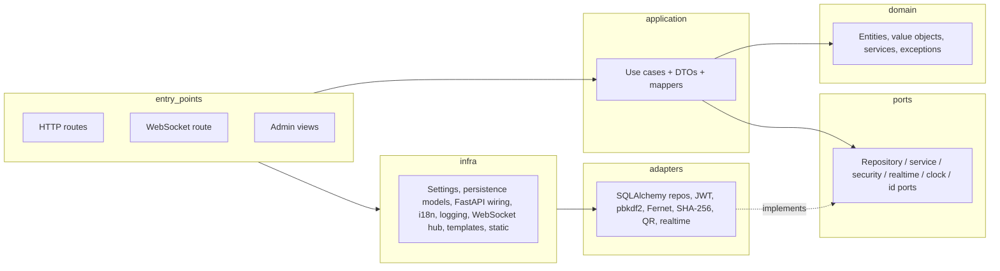
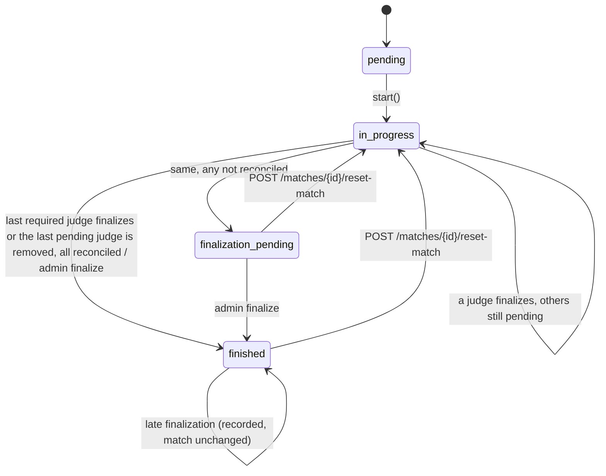
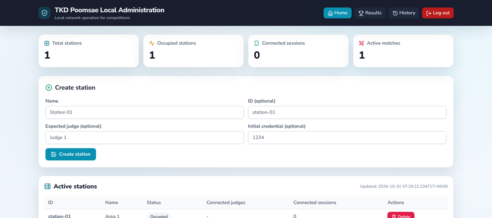
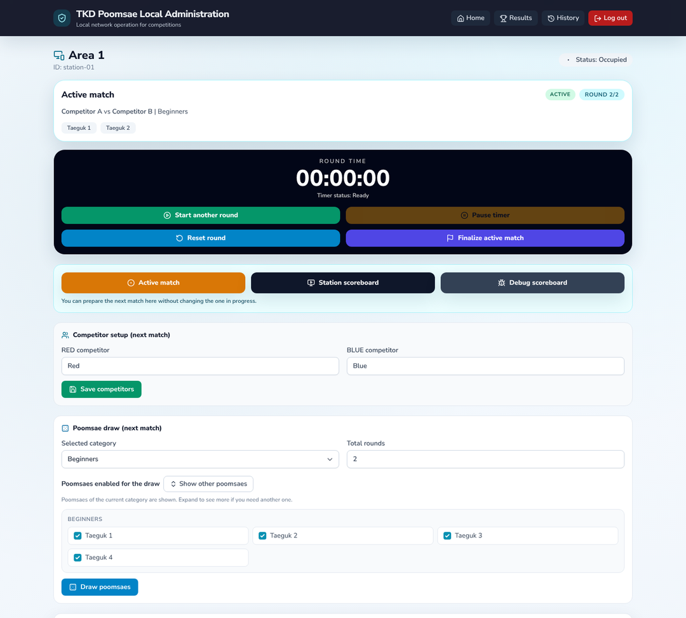
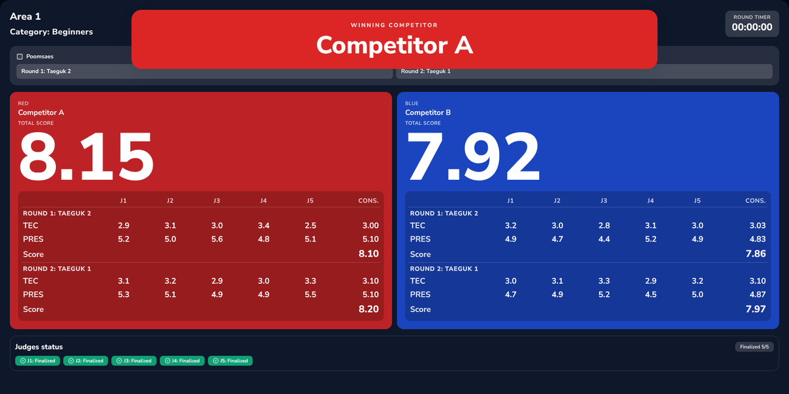

# Backend — Technical Reference

The backend (`backend/`) is a local, offline-first tournament server for taekwondo poomsae. One FastAPI
process serves:

- the JSON API used by the judge app,
- the WebSocket channel for live events,
- the server-rendered admin panel (Jinja2),
- the public TV scoreboard,
- the static assets (CSS, fonts, icons), so nothing is loaded from the internet.

It supports several stations (competition areas), several judges connected to each station scoring one
shared match per fight (one scorecard per judge), idempotent score events, per-judge finalization with
reconciliation and checksum, consolidation across judges, and PyInstaller packaging for operators.

Scope by design: poomsae only, local network (LAN), maintained by a small team; clarity and traceability
over complexity.

Related documents:

- [api-contract.md](api-contract.md) — HTTP and WebSocket contract with the judge app
- [judge-app.md](judge-app.md) — judge app technical reference
- [requirements.md](requirements.md) — product requirements and implementation status
- [poomsae-rules.md](poomsae-rules.md) — the scoring rules

---

## Contents

1. [Architecture](#architecture)
2. [Project layout](#project-layout)
3. [Domain model](#domain-model)
4. [Ports and adapters](#ports-and-adapters)
5. [Use cases](#use-cases)
6. [Persistence](#persistence)
7. [Configuration](#configuration)
8. [QR bootstrap](#qr-bootstrap)
9. [HTTP and WebSocket summary](#http-and-websocket-summary)
10. [Admin panel and TV scoreboard](#admin-panel-and-tv-scoreboard)
11. [Internationalization](#internationalization)
12. [Security](#security)
13. [Business rules](#business-rules)
14. [Logging](#logging)
15. [Offline assets](#offline-assets)
16. [Running locally](#running-locally)
17. [Packaging](#packaging)
18. [Testing](#testing)
19. [Known limitations](#known-limitations)
20. [Release checklist](#release-checklist)
21. [Key files](#key-files)

---

## Architecture

### Hexagonal layers



| Layer | Package | Responsibility |
|---|---|---|
| Domain | `tkd_scorer/domain` | Pure rules: entities, value objects, domain services, exceptions |
| Application | `tkd_scorer/application` | Use cases (orchestration), DTOs, mappers |
| Ports | `tkd_scorer/ports` | Interfaces for external dependencies |
| Adapters | `tkd_scorer/adapters` | Concrete implementations of the ports |
| Infra | `tkd_scorer/infra` | Configuration, persistence models, FastAPI dependency wiring, i18n, logging, WebSocket hub, templates and static files |
| Entry points | `tkd_scorer/entry_points` | FastAPI app factory, HTTP/WS routes, admin views, runtime server |

Rules:

- FastAPI routes only parse requests, map DTOs, call a use case and map the response. Business rules live
  in `domain` and `application/use_cases`.
- Use cases are the center of orchestration (Bisslog style); adapters sit behind ports; transport and
  persistence details do not leak into the domain.

### Request lifecycle

- `entry_points/fastapi/app.py` builds the app (`create_app`) and its `lifespan`: load settings, prepare
  the runtime folders, validate security (fail fast), configure logging, create the SQLAlchemy engine and
  schema, create the `ConnectionHub` and realtime adapter, and configure Jinja2 (translator `t`,
  `status_label` filter, `ui_language`, `admin_base_path` globals).
- An HTTP middleware rewrites the custom admin base path to the internal `/admin` prefix, applies the IP
  allowlist and the admin login redirect, and rewrites `Location` headers back to the external path.
- `infra/fastapi/dependencies.py` builds one SQLAlchemy session per request (commit on success, rollback
  on error) and instantiates the use cases with their adapters.
- `infra/fastapi/error_handlers.py` maps domain exceptions to status codes
  (`ValidationError` 422, `NotFoundError` 404, `UnauthorizedError` 401, `ForbiddenError` 403,
  `ConflictError` 409, other `DomainError` 400). The body is `{"detail": ...}`, plus a machine-readable
  `code` when the error carries one (today only `MatchClosedError`, a `ConflictError` with
  `code: "match_closed"`).

---

## Project layout

```text
backend/
  src/tkd_scorer/
    domain/          entities/, value_objects/, services/, exceptions/
    application/     dto/, mappers/, use_cases/
    ports/           repositories/, services/, security/, realtime/, clock/, id_generator/
    adapters/        repositories/, security/, qr/, checksum/, realtime/
    infra/
      config/        settings.py, runtime_paths.py, runtime_bootstrap.py, runtime_base_url.py
      fastapi/       routes.py, websocket_routes.py, schemas.py, dependencies.py, admin_auth.py, error_handlers.py
      i18n/          __init__.py, locales/en.json, locales/es.json
      persistence/   base.py, models.py, session_factory.py
      logging/       logger.py
      websocket/     connection_hub.py
      templates/admin/
      static/        admin/ (tailwind.css, admin.css), fonts/, vendor/ (lucide.min.js)
    entry_points/
      runtime_server.py
      fastapi/       app.py, main.py, api/, admin_views/, websocket/
  tests/             unit/, integration/, api/
  assets/            Tailwind build tooling (package.json, tailwind.config.js, tailwind.input.css)
  config/            poomsae_categories.yaml, poomsae_categories.example.yaml
  packaging/
    pyinstaller/PoomsaeServer.spec
    runtime/         .env.example, config/poomsae_categories.yaml, Start Admin Panel.bat,
                     start_admin_panel.sh, OPERATIONS.txt
  .env.example
  Makefile
  pyproject.toml
```

---

## Domain model

### Enumerations (`domain/entities/common.py`)

| Enum | Values |
|---|---|
| `StationStatus` | `active`, `occupied`, `offline` |
| `SessionStatus` | `active`, `revoked`, `closed` |
| `MatchStatus` | `pending`, `in_progress`, `finalization_pending`, `finished`, `cancelled` |
| `RoundStatus` | `pending`, `active`, `finished` |
| `AthleteSide` | `red`, `blue` |
| `ScoreTarget` | `TECHNIQUE`, `PRESENTATION_SPEED_POWER`, `PRESENTATION_RHYTHM_TEMPO`, `PRESENTATION_ENERGY_EXPRESSION` |

### Entities

| Entity | File | Purpose |
|---|---|---|
| `Station` | `domain/entities/station.py` | Competition area: credential (hash for verification, plus an encrypted copy for display), expiry, optional expected judge, status, reference to an active session |
| `DeviceSession` | `domain/entities/device_session.py` | Judge + device + access-token hash, status, expiry. `scorecard_session_id` is set when the session replaced another session of the same judge; `scorecard_key` (that value, or the session's own ID) is the judge's scorecard identity |
| `Match`, `MatchRound` | `domain/entities/match.py` | Match of a station, shared by every judge of the station, and its rounds. `session_id` / `judge_name` hold the first active session when it started (a reference). `judge_session_ids` are the scorecard identities counted as judges (the judges connected at the start plus the ones that joined later and scored); `removed_session_ids` are the counted judges removed by the operator before finalizing; `judges_required` = counted minus removed, never below 1 (matches stored by older versions have empty lists and only `judges_required`) |
| `ScoreEvent` | `domain/entities/score_event.py` | Auditable score delta of one judge (session) with its `score_target`; also `IdempotencyRecord` and `FinalizationRecord` (one per judge and match, with the reported `round_numbers` and the stored `response_payload`) |
| `AuditEvent` | `domain/entities/audit.py` | Cross-cutting audit entry (category, action, subject, actor, details) |

Match state machine (as implemented):



`POST /matches/{id}/reset-match` (administrator only) deletes all score events and finalization records and
restarts the match from any status; the judges counted are then the judge sessions connected to the
station at that moment (nobody is removed any more).

The match closes only when `judges_required` distinct judges have finalized, or when the operator removes
the last judge that had not finalized (see [Multi-judge finalization](#multi-judge-finalization)). `mark_finalization_pending()` raises
`Only in-progress matches can be finalized` unless the match is `in_progress` or `finalization_pending`; the
finalize use case only calls it in those statuses. `cancelled` is defined but not used by any use case.

`Match.is_live(active_sessions)` decides whether the shared match is still the station's active match: its
status is `in_progress` or `finalization_pending` **and** its bound session, any judge session of the
station that was created before the match started, or the active session of a judge the match counts
(`Match.counts_judge`, for example one that joined later and scored), is still active. A judge that finalizes (and is
released) does not end the match for the others; a match whose judges all left is no longer live. The
active-match lookup (`active-match-state`, the WebSocket `active_match_state`, the admin panel) and the
history protection use this rule.

### Value objects (`domain/value_objects/score.py`)

- `ScoreDelta`: any finite decimal, normalized to one decimal with `ROUND_HALF_UP`. Accumulated deltas
  such as `-0.8`, `-1.0` or `+0.4` are allowed, not only `±0.1` / `±0.3`.
- `Score`: normalized to one decimal; applies a delta immutably.

### Domain services

| Service | File | Behavior |
|---|---|---|
| `compute_score` | `domain/services/scoring.py` | Starting score + deltas, applied in `sequence` order, quantized to 0.1 (kept for its unit tests; the use cases use the per-judge scorecard) |
| `build_judge_scorecard` | `domain/services/judge_scorecard.py` | Scorecard of one judge per round and side, from that judge's events only. Technique starts at the match starting score and is clamped to `0..start`; each presentation category starts at the category start score and is clamped to `0..2.0`; presentation = sum of the three categories. Deltas are applied in `sequence` order, clamping after each one (like the app); events without a target count as technique; a round without events keeps the start values. A judge that replaced its session keeps one scorecard: the events of its sessions are applied session after session (connection order), each in `sequence` order, and `last_sequence` is the sequence of the latest event (the latest session's own numbering). Judge final score per side = 2-decimal average of technique + 2-decimal average of presentation over the judge's rounds |
| `judge_aliases` | `domain/services/judge_scorecard.py` | `J1`…`Jn` in the order the judges first connected to the station (creation of each judge's first session) |
| `build_finalize_checksum_payload`, `canonical_json` | `domain/services/finalization_checksum.py` | Canonical finalize payload of one judge and its JSON form (see [api-contract.md, section 4.10](api-contract.md#410-post-matchesfinalize)) |
| `consolidate_scores`, `consolidate_scorecards` | `domain/services/judge_consolidation.py` | Per round and side, technique and presentation consolidated **separately** across the judges whose scorecard contains that round: fewer than 5 judges → mean; 5, 6, 7 or more → drop one highest and one lowest and average the rest. 2 decimals, half up. Round score = consolidated TEC + consolidated PRES; match score = mean of the round scores (2 decimals, half up) |
| `resolve_winner` | `domain/services/judge_consolidation.py` | Higher match score wins; if equal, the higher consolidated presentation summed over the rounds; if still equal, the higher sum of every judge's technique + presentation over all rounds, including the highest and lowest dropped by the consolidation (`all_judges_red` / `all_judges_blue`); if still equal, `rematch` (shown as "Rematch required") |
| `consolidated_score_for_judges`, `winner_side` | `domain/services/judge_consolidation.py` | Lower-level helpers: the 3/5/7 rule on a list of scores (count normalized 1–4 → 3, 5–6 → 5, ≥ 7 → 7) and `red` / `blue` / `draw` for two scores |
| `poomsae_draw` | `domain/services/poomsae_draw.py` | Default catalog, YAML override, selection validation, draw without repetition (`SystemRandom.sample`) |

Default poomsae catalog (overridden by `config/poomsae_categories.yaml`):

| Category ID | Label | Poomsaes |
|---|---|---|
| `beginners` | Beginners | Taeguk 1–4 |
| `advanced` | Advanced | Taeguk 5–8 |
| `black_belts` | Black belts | Koryo, Keumgang, Taebaek, Pyongwon, Sipjin, Jitae |

Selection rules: every selected poomsae must exist in the catalog, at least one must belong to the chosen
category, duplicates are removed, and the selection must have at least `total_rounds` items to draw.

---

## Ports and adapters

| Port | Adapter |
|---|---|
| `StationRepositoryPort`, `SessionRepositoryPort`, `MatchRepositoryPort`, `ScoreEventRepositoryPort`, `IdempotencyRepositoryPort`, `FinalizationRepositoryPort`, `AuditRepositoryPort` | `adapters/repositories/sqlalchemy_repositories.py` |
| `TokenServicePort` | `JwtTokenService` (`adapters/security/system_services.py`) |
| `StationCredentialServicePort` | `PasswordStationCredentialService` (passlib `pbkdf2_sha256`) |
| `CredentialCipherPort` | `FernetCredentialCipher` (`adapters/security/credential_cipher.py`): Fernet with a key derived from `TKD_JWT_SECRET_KEY` (HKDF-SHA256, no salt, info `tkd-scorer/station-credential/v1`, 32 bytes, URL-safe base64); `decrypt` returns `None` when the value cannot be decrypted |
| `CredentialGeneratorPort` | `NumericCredentialGenerator` (`adapters/security/credential_generator.py`, `secrets.randbelow`) |
| `BootstrapServicePort` | `JwtBootstrapService` (`adapters/qr/bootstrap_service.py`) |
| `ChecksumServicePort` | `Sha256ChecksumService` (`adapters/checksum/sha256_checksum_service.py`, SHA-256 hex of `canonical_json`: sorted keys, compact separators, `ensure_ascii=False`) |
| `RealtimePort` | `FastApiRealtimeAdapter` over `ConnectionHub` (`adapters/realtime/fastapi_realtime_adapter.py`); `RealtimeRecorderAdapter` for tests |
| `ClockPort`, `IdGeneratorPort` | `UtcClock`, `UuidIdGenerator` (`adapters/security/system_clock_and_ids.py`) |

---

## Use cases

### Judge app API (`application/use_cases/`)

| Use case | Endpoint / trigger |
|---|---|
| `GenerateBootstrapUseCase` | `POST /bootstrap/generate` (admin-panel guard) |
| `ValidateBootstrapUseCase` | `POST /bootstrap/validate` (admin-panel guard); optional bootstrap token on `/stations/active` and `/stations/connect` |
| `ListActiveStationsUseCase` | `GET /stations/active` |
| `ConnectStationUseCase` | `POST /stations/connect`; with `replaceExistingJudgeSession` it revokes the judge's session on another device, notifies it and continues its scorecard |
| `RestoreSessionUseCase` | `POST /sessions/restore`; token check on `/health`, `/score-events`, `/matches/finalize`, `/active-match-state` and the match-control endpoints (`POST /matches`, `/matches/{id}/next-round|reset-round|reset-match`, `GET /matches/{id}/summary`, `GET /stations/{id}/active-session`) |
| `CreateMatchUseCase` | `POST /matches` |
| `IngestScoreEventUseCase` | `POST /score-events` (running scores per judge and target; counts a judge that joined after the start on its first event) |
| `FinalizeMatchUseCase` | `POST /matches/finalize` (one judge's scorecard; closes the shared match when all counted judges finalized) |
| `NextRoundUseCase`, `ResetRoundUseCase`, `ResetMatchUseCase`, `GetMatchSummaryUseCase` | `control_match_use_cases.py`; `/matches/{id}/...` (`next-round` and `summary` check that the calling judge's station owns the match) |
| `build_match_scoring` | `_match_scoring.py`: per-judge scorecards (with aliases, finalization state and the removed flag) and their consolidation for a match; used by the summary, the admin results and the scoreboards |
| `GetStationActiveSessionUseCase` | `GET /stations/{id}/active-session` |
| `GetStationActiveMatchStateUseCase` | `GET /stations/{id}/active-match-state` |
| `HandleJudgeWsSignalsUseCase` | WebSocket `judge_round_completed`, `judge_match_completed` |
| `KickJudgeSessionUseCase` | Admin "remove judge": revokes the session and removes the judge from the running match(es) it has not finalized |

### Admin panel (`AdminViewUseCases`, `application/use_cases/admin_view_use_cases.py`)

- Dashboard, station list and station detail.
- Create and delete stations; rotate the station credential.
- Save competitor names as a draft for the next match.
- Draw poomsaes (preview) and start a match.
- Active match control: start, stop and pause the round timer, reset the round (deletes the round's events
  on the server only), finalize (force-close) the match.
- QR / credential snapshot for the live panel (the PIN is decrypted for display; an undecryptable PIN is
  reported so the operator rotates it).
- Public and debug scoreboards.
- Results and history, including history deletion.
- WebSocket publication of administrative events (`new_competitors`, `match_updated`,
  `active_match_state`, `judge_settings_updated`).

---

## Persistence

- SQLAlchemy 2.x; SQLite by default (`TKD_DATABASE_URL`, relative SQLite paths resolved against the
  runtime root).
- The schema is created at startup with `Base.metadata.create_all` (no migration tool). `create_all` does
  not alter existing tables, so `create_schema` (`infra/persistence/session_factory.py`) then runs an
  idempotent add-column step: for each column added after the first release (`stations.credential_encrypted`,
  `device_sessions.scorecard_session_id`, `matches.judges_required`, `matches.judge_session_ids`,
  `matches.removed_session_ids`, `score_events.score_target`, `finalization_records.round_numbers`,
  `finalization_records.response_payload`) it runs `ALTER TABLE ... ADD COLUMN` only when the column is
  missing. It is safe on every start.
- Plain-PIN migration (same `create_schema` call, `_encrypt_plain_station_credentials`): a database from an
  older version still has `stations.credential_plain`; every non-empty value is encrypted into
  `credential_encrypted` and the plain column is set to `NULL`. Idempotent; databases created by the current
  version do not have the column.
- Files: `infra/persistence/models.py`, `infra/persistence/session_factory.py`,
  `adapters/repositories/sqlalchemy_repositories.py`.

| Table | Content | Key constraints |
|---|---|---|
| `stations` | ID, name, status, `credential_hash`, `credential_encrypted` (Fernet token of the PIN), `credential_expires_at`, `expected_judge_name`, `active_session_id`, `updated_at` | PK `id` |
| `device_sessions` | Station, judge name, device ID, `token_hash`, status, created/expires/revoked timestamps, `scorecard_session_id` (set when the session replaced another one of the same judge) | `token_hash` unique |
| `matches` | Station, reference session and judge name, red (`competitor_left_name`) and blue (`competitor_right_name`) names, rounds, current round, starting score, status, timestamps, `judges_required` (default 1), `judge_session_ids` and `removed_session_ids` (JSON lists of scorecard identities, default `[]`) | FKs to `stations`, `device_sessions` |
| `match_rounds` | Match, round number, status, start/end | Unique `(match_id, round_number)` |
| `score_events` | Idempotency key, event ID, session, station, match, round, side, `score_target` (NULL for older rows = technique), delta, before/after, occurred/received/processed, sequence, judge | Unique `idempotency_key`, unique `event_id` |
| `idempotency_records` | Key, operation, stored response | Unique `key` |
| `finalization_records` | Idempotency key, session, station, match, checksum, status (this judge: `finished` or `finalization_pending`), reconciliation notes, `round_numbers` (JSON list), `response_payload` (JSON, replayed on retries) | Unique `idempotency_key` |
| `audit_events` | Category, action, subject, actor, details (JSON text), timestamp | — |

The audit log also stores operational state: round timer state, draw previews, pending competitor drafts,
match metadata (category, drawn poomsaes) and the reported scores of each finalization.

---

## Configuration

### Loading

- `infra/config/settings.py` uses `pydantic-settings` with prefix `TKD_` and reads the runtime `.env`.
- `TKD_REQUIRE_ENV_FILE` (read directly from the process environment, default `true`): when true and the
  `.env` file does not exist, startup fails with `Runtime .env file not found. Expected path: ...`.
- Process environment variables override values from `.env`.
- Invalid values (bad URL, port out of range, unknown log level or language, non-positive limits) fail at
  startup with a clear message.

### Runtime paths (`infra/config/runtime_paths.py`)

- `TKD_RUNTIME_ROOT` forces the runtime root.
- Packaged (PyInstaller, `sys.frozen`): the executable folder, or its parent if that is where `.env` or
  `config/` is found.
- Development: the `backend/` folder.
- `.env`, `config/`, `data/` and `logs/` are resolved relative to the runtime root.

`infra/config/runtime_bootstrap.py` (`prepare_runtime`) creates `data/` and `logs/`, validates the poomsae
YAML when required, resolves the SQLite path to an absolute writable path and builds the log file path.

### Environment variables

Defaults are the code defaults in `Settings`. `backend/.env.example` (and the identical
`packaging/runtime/.env.example`) sets some values differently, noted in the last column.

**Server and URLs**

| Variable | Default | Meaning | `.env.example` |
|---|---|---|---|
| `TKD_APP_NAME` | `tkd-poomsae-scorer` | FastAPI application title | `Poomsae Local Server` |
| `TKD_ENVIRONMENT` | `local` | Environment label, sent in the QR payload | `local` |
| `TKD_HOST` | `0.0.0.0` | Bind address (must not be empty) | `0.0.0.0` |
| `TKD_PORT` | `8080` | Port (1–65535); also used as the port of the QR `baseUrl` | `8080` |
| `TKD_PUBLIC_BASE_URL` | unset | Public URL; the QR `baseUrl` as configured, or the scheme and path combined with the server IP (see [QR bootstrap](#qr-bootstrap)) | `http://192.168.1.20:8080` |
| `TKD_BASE_URL` | `http://127.0.0.1:8080` | Fallback when `TKD_PUBLIC_BASE_URL` is unset; must be a valid http(s) URL | `http://127.0.0.1:8080` |
| `TKD_QR_USE_SERVER_IP` | `true` | `true`: the QR uses the auto-detected server IP; `false`: the QR uses `TKD_PUBLIC_BASE_URL` (or `TKD_BASE_URL`) exactly as configured | `false` |
| `TKD_QR_SERVER_IP_OVERRIDE` | unset | When set, the QR uses this IP, whatever `TKD_QR_USE_SERVER_IP` says | empty |
| `TKD_PROTOCOL_VERSION` | `v1` | Protocol version in the QR payload | `v1` |
| `TKD_TOURNAMENT_ID` | `tkd-poomsae-local` | Tournament ID in the QR payload and bootstrap token | `tkd-poomsae-local` |

**Runtime files and logging**

| Variable | Default | Meaning |
|---|---|---|
| `TKD_RUNTIME_ROOT` | unset | Forces the runtime root folder (read from the process environment; the launchers set it) |
| `TKD_REQUIRE_ENV_FILE` | `true` | Fail at startup if `.env` is missing (read from the process environment) |
| `TKD_DATABASE_URL` | `sqlite:///./data/tkd_scorer.db` | SQLAlchemy URL |
| `TKD_DATA_DIR` | `data` | Data folder (created at startup) |
| `TKD_LOGS_DIR` | `logs` | Logs folder (created at startup) |
| `TKD_LOG_FILE_NAME` | `tkd_server.log` | Log file name inside the logs folder |
| `TKD_LOG_LEVEL` | `INFO` | `CRITICAL`, `ERROR`, `WARNING`, `INFO` or `DEBUG` |
| `TKD_REQUIRE_POOMSAE_CATALOG_FILE` | `true` | Fail at startup if the poomsae YAML is missing or invalid |
| `TKD_POOMSAE_CATALOG_PATH` | `config/poomsae_categories.yaml` | Poomsae catalog path |
| `TKD_UI_LANGUAGE` | `en` | Admin panel and TV scoreboard language: `en` or `es` |

**Security, tokens and credentials**

| Variable | Default | Meaning | `.env.example` |
|---|---|---|---|
| `TKD_JWT_SECRET_KEY` | `change-me-in-production` | Secret for access and bootstrap JWTs, for the admin cookie value and for the key that encrypts the station PINs (changing it makes stored PINs unreadable: rotate them) | placeholder, must be changed |
| `TKD_JWT_ALGORITHM` | `HS256` | JWT algorithm | `HS256` |
| `TKD_BOOTSTRAP_TOKEN_TTL_SECONDS` | `180` | Lifetime of the QR bootstrap token and `expiresAt` | `180` |
| `TKD_OPERATIONAL_TOKEN_TTL_SECONDS` | `2592000` (30 days) | Lifetime of the judge access token and session | `2592000` |
| `TKD_STATION_CREDENTIAL_TTL_SECONDS` | `28800` (8 h) | Lifetime of a rotated station credential | `28800` |
| `TKD_STATION_CREDENTIAL_ROTATION_SECONDS` | `20` | Minimum age before the live panel auto-rotates the credential | `20` |
| `TKD_STATION_CREDENTIAL_CREATE_LENGTH` | `4` | Digits of the credential generated when a station is created | `4` |
| `TKD_STATION_CREDENTIAL_ROTATE_LENGTH` | `6` | Digits of a rotated credential | `6` |

**Admin panel**

| Variable | Default | Meaning | `.env.example` |
|---|---|---|---|
| `TKD_ADMIN_BASE_PATH` | `/admin` | External path of the admin panel (normalized to a leading `/`, no trailing `/`) | `/secure-panel-change-me` |
| `TKD_ADMIN_PASSWORD` | empty | Admin password; empty disables admin login | placeholder, must be changed |
| `TKD_ADMIN_AUTH_COOKIE_NAME` | `tkd_admin_auth` | Admin cookie name | same |
| `TKD_ADMIN_AUTH_COOKIE_TTL_SECONDS` | `86400` | Admin cookie `max-age` | same |
| `TKD_ADMIN_COOKIE_SECURE` | `false` | Sets the cookie `Secure` flag (needs HTTPS) | same |
| `TKD_ADMIN_IP_ALLOWLIST` | empty | Comma-separated IPs/CIDRs allowed to reach admin routes; empty allows all | `0.0.0.0/0,::/0` |
| `TKD_ADMIN_TRUST_PROXY_HEADERS` | `false` | Use `X-Forwarded-For` for the client IP; also passed to uvicorn as `proxy_headers` | same |
| `TKD_ADMIN_LOGIN_MAX_ATTEMPTS` | `5` | Failed logins within the window before lockout | same |
| `TKD_ADMIN_LOGIN_WINDOW_SECONDS` | `300` | Window for counting failed logins | same |
| `TKD_ADMIN_LOGIN_LOCKOUT_SECONDS` | `300` | Lockout duration | same |
| `TKD_ADMIN_MIN_PASSWORD_LENGTH` | `10` | Minimum password length checked in fail-fast mode | same |
| `TKD_ADMIN_SECURITY_FAIL_FAST` | `true` | Refuse to start with an insecure configuration (see [Security](#security)) | same |
| `TKD_ADMIN_LIVE_REFRESH_SECONDS` | `20` | Polling interval of station panels; the TV polls every half of it (minimum 1 s) | not set |
| `TKD_ADMIN_LIVE_WINNER_OVERLAY_SECONDS` | `12` | How long the TV winner overlay stays visible (≥ 1) | not set |
| `TKD_LIVE_MIN_WIDTH_PX` | `768` | Minimum viewport width for the TV scoreboard; narrower or portrait screens get a notice | `768` |

**Judging and queries**

| Variable | Default | Meaning |
|---|---|---|
| `TKD_JUDGE_DEFAULT_ROUNDS` | `2` | `defaultRounds` pushed to judges |
| `TKD_JUDGE_DEFAULT_STARTING_SCORE` | `4.0` | `defaultStartingScore` (technique start) pushed to judges; also the technique starting score of admin-started matches |
| `TKD_JUDGE_PRESENTATION_CATEGORY_START_SCORE` | `2.0` | `presentationCategoryStartScore` pushed to judges; also the category start used by the server's per-judge scorecards |
| `TKD_JUDGE_ACTION_VALUE_1` | `0.1` | `actionValue1` (short deduction) pushed to judges |
| `TKD_JUDGE_ACTION_VALUE_2` | `0.3` | `actionValue2` (long deduction) pushed to judges |
| `TKD_JUDGE_OFFICIAL_COUNTS` | `3,5,7` | Judge counts considered official; other counts are shown as test mode |
| `TKD_CREATE_MATCH_DEFAULT_STARTING_SCORE` | `4.0` | Technique starting score for `POST /matches` when the request omits it (admin-started matches use `TKD_JUDGE_DEFAULT_STARTING_SCORE`) |
| `TKD_HISTORY_RETENTION_MATCHES` | `100` | Number of recent matches listed on the results and history pages |
| `TKD_HISTORY_DELETE_BULK_SCAN_LIMIT` | `100000` | Maximum matches scanned by "delete all" |
| `TKD_MATCH_QUERY_LIMIT_ACTIVE_LOOKUP` | `50` | Recent matches scanned to find a station's active match |
| `TKD_MATCH_QUERY_LIMIT_SCOREBOARD` | `300` | Recent matches scanned to build a scoreboard |
| `TKD_WEBSOCKET_PING_INTERVAL_SECONDS` | `20` | Idle time before the server sends `ping` |
| `TKD_WEBSOCKET_STALE_TIMEOUT_SECONDS` | `60` | Idle time before the server closes a connection (at least interval + 1) |

The poomsae catalog YAML has this shape:

```yaml
categories:
  beginners:
    label: Beginners
    poomsaes:
      - Taeguk 1
      - Taeguk 2
```

---

## QR bootstrap

- `POST /bootstrap/generate` and the admin station page build the payload: `baseUrl`, `stationId`,
  `stationName`, `bootstrapToken`, `environment`, `tournamentId`, `protocolVersion`, `expiresAt`
  (ISO UTC with `Z`). See [api-contract.md, section 3](api-contract.md#3-qr-bootstrap-payload).
- `POST /bootstrap/validate` decodes the bootstrap JWT and returns its claims.
- Both endpoints use the admin-panel guard (`is_admin_request`: the IP allowlist and, when
  `TKD_ADMIN_PASSWORD` is set, the admin login cookie); otherwise `403 Administrator access required`.
- Base URL resolution (`resolve_settings_qr_base_url` in `infra/fastapi/dependencies.py` +
  `infra/config/runtime_base_url.py`), in this order:
  1. `TKD_QR_SERVER_IP_OVERRIDE` set: that IP, combined with the scheme and path of `TKD_PUBLIC_BASE_URL`
     (or `TKD_BASE_URL`) and the port `TKD_PORT`. It wins over everything else.
  2. Otherwise `TKD_QR_USE_SERVER_IP=true` (the code default): the same combination with the server's
     detected LAN IPv4 (the address of the default outbound interface, else the host name's address, else
     `127.0.0.1`).
  3. Otherwise: `TKD_PUBLIC_BASE_URL` (or `TKD_BASE_URL` when unset) exactly as configured, without a
     trailing `/`. The shipped `.env.example` sets `TKD_QR_USE_SERVER_IP=false`, so this is the default for
     a new installation.
- The QR image is available at `GET /admin/stations/{station_id}/qr.png`.

---

## HTTP and WebSocket summary

Full details, payloads and status codes: [api-contract.md](api-contract.md).

| Group | Routes |
|---|---|
| Judge API | `GET /health`, `GET /stations/active`, `POST /stations/connect`, `GET /stations/{id}/active-match-state`, `POST /score-events`, `POST /matches/finalize` |
| Bootstrap and sessions | `POST /bootstrap/generate`, `POST /bootstrap/validate`, `POST /sessions/restore` |
| Match control | `POST /matches`, `POST /matches/{id}/next-round`, `POST /matches/{id}/reset-round`, `POST /matches/{id}/reset-match`, `GET /matches/{id}/summary`, `GET /stations/{id}/active-session` |
| WebSocket | `WS /ws` (bind by query string or `bind` message, always with the access token) |

Authentication of the match-control group: a judge `Bearer` access token is required (same validation as
`/score-events`). `POST /matches` also requires the body's `sessionId`, `stationId` and `judgeName` to match
the token's session (`401` otherwise). On the other routes the token's station must own the match or be the
requested station (`401 Match/station mismatch` / `Station token mismatch`); `summary` also accepts a
session released by its own finalization. Instead of a token, an administrator logged in to the panel is
accepted (only when `TKD_ADMIN_PASSWORD` is set, from an allowed IP, and with no `Authorization` header).
`reset-round` and `reset-match` are administrator-only: a judge token gets `403` (a judge corrects its own
scorecard with compensating score events).

Critical rules of `POST /score-events`: bearer token required; token claims must match `sessionId`,
`stationId` and `judgeName`; `matchId` required and canonical, no fallback, `422` when missing or unknown;
a match that is `finished` or `cancelled` returns `409` with `code: "match_closed"` (definitive, the app
stops retrying), any other status that does not accept events `422`; idempotency by key (body or header);
sequence identity and the running `score_before` / `score_after` are per session (judge) and per target, so
the judges of a shared match never collide; out-of-order arrival accepted; same session + same sequence +
same payload is a replay, a different payload is `422`.

Critical rules of `POST /matches/finalize`: same token checks (a session already released by its own
reconciled finalization may still replay it); `matchId` required and canonical, `422` otherwise;
idempotency by key (or a computed key) and one finalization per judge and match (a second one replays the
first, also from a session that replaced it); the server rebuilds that judge's scorecard from that judge's
events (of all its sessions after a replacement) and reconciles `totalEvents`, `lastSequence`, red/blue
final scores, `roundsSummary` and the canonical checksum; the response adds the shared `matchStatus`,
`judgesFinalized` and `judgesRequired`.

WebSocket events sent by the server: `server_notice`, `judge_settings_updated`, `active_match_state`,
`match_updated`, `round_changed`, `reset_round`, `reset_match`, `new_competitors`, `station_disconnected`,
`judge_kicked`, `session_revoked`, `ping`, `pong`. Envelope: `{"type", "eventType", "payload"}`. Binding
always validates the access token (query string `token`, or `token` / `accessToken` in the `bind`
message); a `bind` message without a valid token closes the socket with `1008`. Signals from the app:
`judge_round_completed`, `judge_match_completed` (optional; scoring and finalization stay on HTTP), only
accepted on a connection bound to the same session and station (otherwise `1008`). Keep-alive: the server
sends `ping` after an idle interval and answers a client `ping` with one `pong`; a `pong` is never
answered.

`ConnectionHub` (`infra/websocket/connection_hub.py`) indexes connections by session and by station. A
judge counts as **connected** in the admin panel only while a WebSocket is bound to its session; a
persisted active session without a socket is shown as not connected.

---

## Admin panel and TV scoreboard

There is no separate frontend. The same FastAPI app serves Jinja2 templates
(`infra/templates/admin/`), local static assets (Tailwind CSS build, `admin.css`, Nunito Sans fonts,
Lucide icons) and small in-template scripts for polling and timers.

<p>
  
  
</p>

*Dashboard (stations, sessions, active matches) and station page (QR + PIN, judges, match setup and
controls).*

### Admin panel routes

All `/admin/...` paths below use the internal prefix; with a custom `TKD_ADMIN_BASE_PATH` the browser uses
that prefix instead.

| Area | Method and path | Purpose |
|---|---|---|
| Login | `GET /admin/login`, `POST /admin/login`, `POST /admin/logout` | Password login and logout |
| Dashboard | `GET /admin` | Totals and station list, create-station form |
| Stations | `GET /admin/stations` | Redirects to `/admin` |
| Stations | `POST /admin/stations/create` | Create a station (name, optional ID, expected judge, initial credential) |
| Stations | `GET /admin/stations/{station_id}` | Station page (`?reveal=1` shows the credential) |
| Stations | `POST /admin/stations/{station_id}/rotate-credential` | New random credential |
| Stations | `POST /admin/stations/{station_id}/delete` | Delete (refused while occupied, with an active match, or with history) |
| Stations | `POST /admin/stations/{station_id}/sessions/{session_id}/kick` | Remove a judge (`judge_kicked` + `session_revoked`); a judge that has not finalized the running match stops counting (see [Multi-judge finalization](#multi-judge-finalization)) |
| Stations | `GET /admin/stations/{station_id}/live-panel` | QR + credential fragment; `auto_rotate=1` rotates the credential when older than `TKD_STATION_CREDENTIAL_ROTATION_SECONDS`. When the stored PIN cannot be decrypted (the server key changed) it shows "Cannot be shown (server key changed): rotate the credential" |
| Stations | `GET /admin/stations/{station_id}/qr.png` | QR image of the bootstrap payload |
| Match setup | `POST /admin/stations/{station_id}/matches/save-competitors` | Save red/blue names as a draft |
| Match setup | `POST /admin/stations/{station_id}/matches/draw` | Draw poomsaes (HTML) |
| Match setup | `POST /admin/stations/{station_id}/matches/draw-preview` | Draw poomsaes (JSON) |
| Match setup | `POST /admin/stations/{station_id}/matches/start` | Start the active match |
| Match setup | `GET /admin/stations/{station_id}/match-admin` | Redirects to the station page (`#start-match`) |
| Active match | `GET /admin/stations/{station_id}/active-match` | Redirects to the station page (`#active-match`) |
| Active match | `GET /admin/stations/{station_id}/active-match/panel` | Active match fragment (polled) |
| Active match | `POST /admin/stations/{station_id}/active-match/start-round` | Start or resume the round timer |
| Active match | `POST /admin/stations/{station_id}/active-match/stop-round` | Finish the round; move to the next one or mark the match complete |
| Active match | `POST /admin/stations/{station_id}/active-match/pause-timer` | Pause a running timer |
| Active match | `POST /admin/stations/{station_id}/active-match/reset-round` | Delete the round's score events (every judge), reset its timer and publish `reset_round` so the judges' phones delete the same round |
| Active match | `POST /admin/stations/{station_id}/active-match/finalize` | "Finalize active match": force-close the shared match as `finished`, whether or not every judge finalized |
| Scoreboards | `GET /admin/stations/{station_id}/scoreboard` | Redirects to `/scoreboard/{station_id}` |
| Scoreboards | `GET /admin/stations/{station_id}/scoreboard/live` | Scoreboard fragment |
| Scoreboards | `GET /admin/stations/{station_id}/scoreboard/debug`, `.../scoreboard/debug/live` | Debug scoreboard with per-judge deltas (protected) |
| Reports | `GET /admin/matches/{match_id}` | Match detail (consolidated TEC, PRES and score per round, match score, judges with aliases, judges finalized, winner) |
| Reports | `GET /admin/results` | Recent results (same consolidated table) |
| Reports | `GET /admin/history` | History |
| Reports | `POST /admin/history/{match_id}/delete`, `POST /admin/history/delete-all` | Delete history (protected matches are skipped) |
| TV (public) | `GET /scoreboard/{station_id}`, `GET /scoreboard/{station_id}/live` | Public TV scoreboard and its fragment |

Errors from match controls are shown on the station page with status `422`.

### TV scoreboard



*Example with 5 judges, both rounds finalized by every judge.*

- Public (no login) so a TV browser can open it: `/scoreboard/{station_id}`.
- Full-screen layout; viewports narrower than `TKD_LIVE_MIN_WIDTH_PX` or in portrait show a notice instead.
- Header: station, category, drawn poomsaes, round and round timer (rendered in the browser from the
  server's reference time).
- One card per side (red, blue) with the competitor name and the total score (match score, 2 decimals).
  Inside, a grid per round (`Round N: <poomsae>`): a **TEC** row and a **PRES** row with one column per
  judge alias (`J1`…`Jn`) and a consolidated column (`Cons.`), then the round **Score** (consolidated TEC +
  consolidated PRES).
- Until every required judge has finalized, the grid and the totals are a live partial built from the events
  received so far (a judge without events in an open round counts with the start values) and the TV says so.
  The official result uses the finalized scorecards.
- Winner banner (red, blue, or "Rematch required" when every tie-break step is equal) once the official
  result exists (every required judge finalized, or the match was closed by the operator); it closes
  automatically after `TKD_ADMIN_LIVE_WINNER_OVERLAY_SECONDS`.
- Judges status strip: one chip per alias, **finalized**, **finalized, reconciliation pending**,
  **connected** (still scoring), **disconnected** or **removed** (removed by the operator before
  finalizing: not counted and left out of the consolidation), plus `Finalized X/Y`. A judge with a
  replaced session keeps one alias and counts as connected while any of its sessions has a WebSocket.
- With no active match and no saved draft, the TV shows the last closed match of the station (result screen).
- A non-official judge count (not in `TKD_JUDGE_OFFICIAL_COUNTS`) is shown with a warning.
- It refreshes by polling the `/live` fragment every `TKD_ADMIN_LIVE_REFRESH_SECONDS / 2` seconds.
- The debug variant (admin only) also shows the judge names, the consolidated block and each judge's deltas
  (alias, round, side, target, delta and the value after it).

---

## Internationalization

- Catalogs: `infra/i18n/locales/en.json` and `infra/i18n/locales/es.json`, flat `{key: text}` maps with
  `{name}` placeholders. Both files must have the same keys and placeholders
  (`tests/unit/test_i18n_catalogs.py`).
- `TKD_UI_LANGUAGE` (`en` default, `es`) selects the language of the admin panel and the TV scoreboard.
  Missing keys fall back to English, then to the key itself (logged as `i18n_missing_key`).
- Templates call `t('key', name=value)`; statuses go through the `status_label` filter
  (`entry_points/fastapi/admin_views/labels.py`, keys `status.<value>`).
- API error messages (`detail`) are English and are not translated.

---

## Security

### Judge API

- Access tokens are JWTs (`TKD_JWT_SECRET_KEY`, `TKD_JWT_ALGORITHM`) with `session_id`, `station_id`,
  `judge_name`, `exp` and `typ=access`.
- Only the SHA-256 hash of each access token is stored (`device_sessions.token_hash`); restore and the
  WebSocket check the claims and the stored hash.
- Station credentials are verified against a passlib `pbkdf2_sha256` hash. So the operator can display
  the PIN, it is also stored encrypted (`stations.credential_encrypted`, Fernet with a key derived from
  `TKD_JWT_SECRET_KEY` by HKDF-SHA256 with info `tkd-scorer/station-credential/v1`); no plain copy is kept,
  and plain values left by older versions are encrypted and cleared on startup. If the secret changes, the
  stored PIN cannot be decrypted and the panel asks to rotate it. A rotated credential expires after
  `TKD_STATION_CREDENTIAL_TTL_SECONDS`.
- Bootstrap tokens are short-lived JWTs (`typ=bootstrap`).
- The match-control endpoints require a judge token or the logged-in administrator; `reset-round` and
  `reset-match` are administrator-only (`403` for a judge token). `POST /bootstrap/generate` and
  `/bootstrap/validate` use the admin-panel guard (`403` otherwise). The WebSocket `bind` always validates
  the token and judge signals must come from a connection bound to that session and station.

### Admin panel

Implemented by the middleware in `entry_points/fastapi/app.py` and helpers in `infra/fastapi/admin_auth.py`:

- **Password**: `TKD_ADMIN_PASSWORD` from `.env`. When empty, admin login is disabled.
- **Cookie**: after login an `HttpOnly`, `SameSite=Lax` cookie (`TKD_ADMIN_AUTH_COOKIE_NAME`, `max-age`
  `TKD_ADMIN_AUTH_COOKIE_TTL_SECONDS`, `Secure` when `TKD_ADMIN_COOKIE_SECURE=true`) holds
  `SHA-256(password::secret::admin)`, compared in constant time. Changing the password or the JWT secret
  invalidates existing cookies.
- **Custom base path**: with `TKD_ADMIN_BASE_PATH` set, the panel is only reachable under that path and the
  literal `/admin` paths return `404`.
- **IP allowlist**: `TKD_ADMIN_IP_ALLOWLIST` (IPs and CIDRs) applies to every admin path except the
  `.../scoreboard` and `.../scoreboard/live` aliases; a denied client gets `403 Forbidden`. The client IP
  comes from `X-Forwarded-For` only when `TKD_ADMIN_TRUST_PROXY_HEADERS=true`.
- **Lockout**: `TKD_ADMIN_LOGIN_MAX_ATTEMPTS` failures within `TKD_ADMIN_LOGIN_WINDOW_SECONDS` lock the
  client IP for `TKD_ADMIN_LOGIN_LOCKOUT_SECONDS` (`429`); a wrong password returns `401` with the remaining
  attempts. The counters are in memory and per process.
- **Login redirect**: unauthenticated admin requests get `303` to `<base>/login?next=...`; `next` is only
  honored when it points inside the admin base path.

### Fail-fast rules

With `TKD_ADMIN_SECURITY_FAIL_FAST=true` (default) the server refuses to start
(`Invalid security configuration: ...`) when any of these holds:

| Rule | Error |
|---|---|
| `TKD_ADMIN_PASSWORD` empty | `TKD_ADMIN_PASSWORD is required when TKD_ADMIN_SECURITY_FAIL_FAST=true` |
| Password shorter than `TKD_ADMIN_MIN_PASSWORD_LENGTH` | `TKD_ADMIN_PASSWORD must be at least N characters long` |
| `TKD_ADMIN_BASE_PATH` is `/admin` | `TKD_ADMIN_BASE_PATH must not be /admin in fail-fast mode` |
| `TKD_ADMIN_IP_ALLOWLIST` empty | `TKD_ADMIN_IP_ALLOWLIST is required in fail-fast mode` |
| `TKD_JWT_SECRET_KEY` is `change-me-in-production` | `TKD_JWT_SECRET_KEY must not use the default value in fail-fast mode` |

### Public and protected routes

- Public by design: the judge API (protected by tokens where noted), `/scoreboard/{station_id}` and
  `/scoreboard/{station_id}/live` (for the TV), `/static/...`, and `<base>/login`, `<base>/logout`.
  Without a token: `GET /health`, `GET /stations/active` and `POST /stations/connect` (an optional bootstrap
  token is validated when sent).
- Protected: every other admin route, including the debug scoreboard.
- The match-control endpoints (`POST /matches`, `/matches/{id}/next-round|reset-round|reset-match`,
  `GET /matches/{id}/summary`, `GET /stations/{id}/active-session`) need a judge `Bearer` token of the same
  station or, when `TKD_ADMIN_PASSWORD` is set, the admin login (not accepted on `POST /matches`); without
  an admin password the two resets cannot be called at all, since judges get `403`.
  `POST /bootstrap/generate` and `POST /bootstrap/validate` need the admin-panel guard.

---

## Business rules

### Judge connectivity

- Several active judges per station are allowed.
- Not allowed: the same device with two judge names (`409`), or the same judge name on two active devices
  (`409`) unless the request asks for `replaceExistingJudgeSession` (camelCase or snake_case).
- Session replacement: the same judge on the same device always replaces its previous session silently.
  From another device with `replaceExistingJudgeSession: true` (the app retries a `409` this way), the old
  session is revoked, audited (`session` / `replace`) and told so: `judge_kicked` and then `session_revoked`,
  both with its `sessionId` and `reason: replaced_by_new_device`. In both cases the new session inherits the
  judge's scorecard identity (`device_sessions.scorecard_session_id`), so the judge keeps its alias, is
  counted once and its earlier events keep counting. The new device does not hold the events the old one
  sent, so that judge's finalization will not reconcile when the old device had sent events (the shared
  match ends `finalization_pending`; the operator decides).
- An optional expected judge name per station restricts who can connect.
- A persisted session can stay active while its WebSocket is closed (designed for offline/retry); the
  "connected" state in the panel depends on a live WebSocket.

### Idempotency and audit

- Score events and finalizations are idempotent by key (`idempotency_records`, `finalization_records`).
- Critical actions are recorded in `audit_events` (connect, match create/start, score ingest, finalization,
  round control, kick, credential rotation, history deletion, WebSocket signals).

### Consolidation of results

Every computation is per judge (session) first, then consolidated (`application/use_cases/_match_scoring.py`):

1. Each judge's scorecard is rebuilt from that judge's own events: technique and presentation per round and
   side (see `build_judge_scorecard` in [Domain services](#domain-services)). A judge that finalized covers
   the rounds it reported plus the rounds where it has events; a judge that has not finalized yet covers
   every round opened so far.
2. Per round and side, technique and presentation are consolidated **separately** across the judges that
   have that round: 3 judges (any count below 5) → mean; 5 or 7 judges (any count of 5 or more) → drop one
   highest and one lowest, mean of the rest. 2 decimals, half up.
3. Round (poomsae) score = consolidated TEC + consolidated PRES. Match score = mean of the round scores,
   2 decimals, half up.
4. Winner: the higher match score; if equal, the higher consolidated presentation summed over the rounds;
   if still equal, the higher sum of all judges' technique + presentation over the rounds, including the
   highest and lowest dropped in step 2; if still equal, `rematch` ("Rematch required"). The rematch itself
   is run manually.

Judges removed by the operator are left out of every step (their partial scorecard is shown, marked
removed, but not consolidated).

- The official result uses the finalized scorecards once `judges_required` judges have finalized (or the
  operator closed the match: the judges that finalized, or the live data when none did). Before that the
  scoreboard shows a live partial.
- Judge count shown for official / test mode: the match's `judges_required` when a match is shown,
  otherwise the judges connected over WebSocket (3 when none). 3, 5 and 7 are official by default
  (`TKD_JUDGE_OFFICIAL_COUNTS`); other counts run in test mode with a warning.
- Judges are labelled `J1`…`Jn` in the order they first connected to the station.
- See [requirements.md, section 4](requirements.md#4-scoring-rules).

### Active match

- One active match per station, shared by every judge connected to it. Starting requires at least one
  active judge session; the counted judges (`judge_session_ids`) are the active judge sessions of the
  station at that moment (sessions, whether or not their WebSocket is open), and `judges_required` is their
  number. The first active session is stored as the match's reference session.
- A judge that connects after the start is counted from its first score event of the match
  (`judges_required` grows by one); connecting alone does not make it a required judge.
- Admin-started matches use `TKD_JUDGE_DEFAULT_STARTING_SCORE` as the technique start.
- The match stays the station's active match while it is live (`Match.is_live`, see
  [Domain model](#entities)).
- Round timer state is persisted in the audit log (`idle`, `running`, `paused`, `completed`).
- Starting a match publishes `new_competitors`, `match_updated`, `active_match_state` and
  `judge_settings_updated`.
- "Finalize active match" force-closes it as `finished` whatever the judges' state; this publishes
  `active_match_state` (`hasActiveMatch: false`) and `match_updated` (`{matchId, status}`).

### Multi-judge finalization

- Each judge finalizes its own scorecard with `POST /matches/finalize`; one finalization record per judge and
  match. A replay (same idempotency key, or the same judge finalizing the same match again) returns the
  stored response and changes nothing.
- The judge's own result is `finished` when everything reconciles, otherwise `finalization_pending` with the
  mismatch notes. A reconciled judge is released: its session is revoked and it receives `session_revoked`
  (`reason: match_finalized`); the other judges keep scoring.
- The shared match stays `in_progress` until `judges_required` distinct judges have finalized. Then it becomes
  `finished` when every judge reconciled, or `finalization_pending` when any did not (the operator closes it
  with "Finalize active match"). Judges are counted by scorecard identity, so a judge that replaced its
  session counts once, and its second finalization (from either session) replays the first.
- Removing a judge (admin "remove judge") that has not finalized a running (`in_progress`) match of its
  station adds it to `removed_session_ids`: it no longer counts (`judges_required` drops by one, never
  below 1) and its scorecard is left out of the consolidation; the TV and the debug scoreboard show it as
  "Removed". If every remaining judge has already finalized, the match closes right away (as on a normal
  finalization) and the server publishes `match_updated` `{matchId, status, judgesRequired}` and, when
  `finished`, `active_match_state` (`hasActiveMatch: false`). Removing a judge that already finalized
  changes nothing in the match.
- A judge that never finalizes and is not removed still counts; the operator removes it or closes the match
  with "Finalize active match".
- A finalization arriving after the match was closed (for example after a force-close) is recorded, but the
  match status does not change.
- `POST /matches/{id}/reset-match` (administrator) deletes the match's events and finalization records, so
  every judge finalizes again, and recounts as judges the judge sessions connected to the station now
  (matches stored by older versions, without `judge_session_ids`, keep their `judges_required`).
- Every finalization publishes `match_updated` to the station with the shared match `status` and the judge's
  `judgeStatus`; when the match closes as `finished` the server also publishes `active_match_state`
  (`hasActiveMatch: false`).

### History

- Individual and bulk deletion are allowed.
- A match is protected while it is live: status `in_progress` or `finalization_pending` **and** its
  reference session, a judge session created before it started, or the session of a judge it counts, is
  still active (`Match.is_live`). Other matches can be deleted.
- Bulk deletion removes unprotected matches and skips protected ones.

---

## Logging

`infra/logging/logger.py`:

- JSON lines: `timestamp`, `level`, `logger`, `message` (and `exc_info`).
- Output to the console and to `<logs>/<TKD_LOG_FILE_NAME>` (default `logs/tkd_server.log`).
- Level from `TKD_LOG_LEVEL`.
- Notable messages: `score_event_ingest_received|ok|failed`, `finalize_match_received|processed|failed`,
  `score_event_sequence_replay_detected`, `ws_connection_unauthorized`, `ws_connection_stale_timeout`,
  `ws_disconnect_connection_removed`, `ws_judge_round_completed_failed`, `ws_judge_match_completed_failed`,
  `ws_signal_match_fallback_*`, `i18n_missing_key`, `poomsae_catalog_yaml_*`.

---

## Offline assets

The system runs on a LAN without internet, so every asset is served locally from
`src/tkd_scorer/infra/static/`:

| Asset | Path |
|---|---|
| Tailwind CSS build | `static/admin/tailwind.css` |
| Custom styles | `static/admin/admin.css` |
| Lucide icons | `static/vendor/lucide.min.js` (+ license) |
| Nunito Sans fonts | `static/fonts/*.woff2` (+ OFL license) |

`tests/unit/test_offline_assets.py` fails if any template loads `http...` URLs and checks that the assets
exist.

Rebuilding the CSS (needs Node.js) after changing classes in templates:

```bash
cd backend
make css   # runs npm install + npm run build:css in backend/assets/
```

`backend/assets/` holds `package.json` (Tailwind 3.4 with the forms and typography plugins),
`tailwind.config.js` and `tailwind.input.css`; the build writes the minified CSS to
`src/tkd_scorer/infra/static/admin/tailwind.css`.

---

## Running locally

Requirements: Python 3.11+, `pip`, a virtual environment.

```bash
cd backend
python3 -m venv .venv
. .venv/bin/activate
pip install -e '.[dev,packaging]'
cp .env.example .env
```

Edit `.env`: at least `TKD_JWT_SECRET_KEY`, `TKD_ADMIN_PASSWORD` (10+ characters),
`TKD_ADMIN_BASE_PATH`, `TKD_PUBLIC_BASE_URL`, and check that `config/poomsae_categories.yaml` exists.

Start:

```bash
uvicorn tkd_scorer.entry_points.fastapi.app:app --host 0.0.0.0 --port 8080 --reload
# or, honoring TKD_HOST / TKD_PORT / TKD_LOG_LEVEL from .env:
python -m tkd_scorer.entry_points.fastapi.main
```

Typical URLs:

| What | URL |
|---|---|
| Health | `http://<LAN_IP>:8080/health` |
| Admin panel | `http://<LAN_IP>:8080<TKD_ADMIN_BASE_PATH>` |
| TV scoreboard | `http://<LAN_IP>:8080/scoreboard/<station_id>` |
| Judge WebSocket | `ws://<LAN_IP>:8080/ws?sessionId=...&stationId=...&token=...` |

---

## Packaging

### Strategy

PyInstaller in **onedir** mode (not onefile): more robust for templates and static files, easier to debug,
no temporary extraction at every start.

### Spec file

`packaging/pyinstaller/PoomsaeServer.spec`:

- entry point `src/tkd_scorer/entry_points/runtime_server.py`;
- data files: `infra/templates/**/*.html`, `infra/static/**/*`, `infra/i18n/locales/*.json`;
- hidden imports: all `tkd_scorer`, `uvicorn` and `passlib.handlers` submodules;
- console executable named `PoomsaeServer`.

### Makefile targets

| Target | Purpose |
|---|---|
| `make help` | List targets |
| `make css` | Rebuild the offline Tailwind CSS |
| `make clean` | Remove `build/`, `dist/` and caches |
| `make package-linux` | Build the Linux bundle (must run on Linux) |
| `make package-windows` | Build the Windows bundle (must run on Windows/MSYS) |
| `make package-all` | Try both; PyInstaller does not cross-compile, so build on each target OS |

The Makefile uses `./venv/bin/python` or `./.venv/bin/python` when present.

### Delivery bundle

```text
dist/linux/PoomsaeServer/            (dist/windows/PoomsaeServer/ on Windows)
  PoomsaeServer/
    PoomsaeServer(.exe)
    _internal/...
  .env                               copied from packaging/runtime/.env.example
  config/poomsae_categories.yaml
  data/
  logs/
  start_admin_panel.sh               (Start Admin Panel.bat on Windows)
  OPERATIONS.txt
```

### Runtime

- `entry_points/runtime_server.py` loads the settings, imports the app and runs uvicorn with `TKD_HOST`,
  `TKD_PORT`, `TKD_LOG_LEVEL` and `proxy_headers=TKD_ADMIN_TRUST_PROXY_HEADERS`. Startup failures print
  `SERVER STARTUP ERROR` with a readable message and exit with code 1.
- In packaged mode the runtime root is the folder of the executable (or its parent, where `.env` lives).
- The launchers (`packaging/runtime/start_admin_panel.sh`, `packaging/runtime/Start Admin Panel.bat`) set
  `TKD_RUNTIME_ROOT` to their own folder, start the executable, read `TKD_PORT` and `TKD_ADMIN_BASE_PATH`
  from `.env` and open `http://127.0.0.1:<port><admin path>` in the browser.

```bash
cd dist/linux/PoomsaeServer
./start_admin_panel.sh
```

---

## Testing

```bash
cd backend
pytest                 # all tests (pyproject sets pythonpath=src and -q)
pytest tests/unit      # one folder
ruff check src tests   # lint (rules E, F, I, N; line length 100)
```

`tests/conftest.py` sets `TKD_REQUIRE_ENV_FILE=false`, so no `.env` is needed for tests. The suite has 160
tests.

| Folder | Coverage |
|---|---|
| `tests/unit/` | Score calculation and sequence order; station connection and identity conflicts; session restore and token checks; score-event idempotency; round and reset rules; finalization, reconciliation and WebSocket events; judge kick; poomsae draw and YAML override; runtime base URL; runtime bootstrap; settings from `.env`; admin match start, active match controls, live snapshot and history deletion; WebSocket hub; i18n catalog parity; offline assets |
| `tests/unit/test_judge_scorecard.py` | Per-judge scorecard: technique and each presentation category kept apart, cumulative clamping in sequence order, other judges ignored, start values for rounds without events, 2-decimal final score, events without target as technique, `J1`…`Jn` aliases in connection order |
| `tests/unit/test_judge_consolidation.py` | 3/5/7 rules and test counts, TEC and PRES trimmed separately (the worked example of [requirements.md, section 4.2](requirements.md#42-consolidation-across-judges)), match score as the mean of rounds, rounds consolidated with the judges that scored them, the tie-break order (score, presentation, all judges' scores including the dropped ones, rematch) and the rematch label |
| `tests/unit/test_finalization_checksum.py` | Canonical checksum payload: the shared test vector (canonical string and SHA-256, also checked by the app) and 2-decimal score strings |
| `tests/unit/test_multi_judge_finalization.py` | Running scores per judge and target, the shared match closing only after every judge finalized, replay of a judge's second finalization, a released session cannot finalize without a previous finalization, an unreconciled judge leaving the match `finalization_pending` |
| `tests/unit/test_judge_removal_and_replacement.py` | A removed judge stops counting and the match closes when the rest finalized; removing a judge that already finalized changes nothing; `judges_required` never below 1; a late judge counts from its first score event; a replacement session continues the scorecard; reset-match clears the finalizations |
| `tests/unit/test_station_credential_encryption.py`, `test_station_connection.py`, `test_runtime_base_url.py`, `test_idempotency_score_event.py` | Fernet round trip and another key; encrypted create / rotate and the "rotate" state; the startup migration of plain PINs; session replacement on another device (revoke + notify) and on the same device (silent); the QR address order (override, detected IP, configured URL); `409 match_closed` on a closed match |
| `tests/integration/` | SQLAlchemy repository round trip on a real SQLite database, shared-match fields, judge tracking, replacement and encrypted credential columns, and the add-column step on a database created by an older version |
| `tests/api/` | Bootstrap/connect/restore flow; `/score-events` idempotency; finalize with an unknown `matchId` → `422`; active-match-state JSON, auth and `404`; initial WebSocket events on bind; judge WebSocket signals; admin routes and authentication |
| `tests/api/test_judge_endpoint_auth.py` | Judge token of the same station on the match endpoints; resets for the administrator only; admin guard on the bootstrap endpoints; WebSocket bind token and judge signals on a bound connection; one `pong` per `ping` and no answer to `pong`; session replacement over HTTP; `409 match_closed` |
| `tests/api/test_multi_judge_flow.py` | End to end over HTTP: 3 judges score and finalize one shared match; 5 judges with highest and lowest trimmed per part; a removed judge shown as removed while the match closes with the others |

---

## Known limitations

These are verified against the current code. They are gaps, not design decisions (see also
[requirements.md, section 11](requirements.md#11-implementation-status)).

1. **A replacement device cannot reproduce the old device's events.** After a session replacement the server
   keeps one scorecard with the events of both sessions, but the new device only holds its own. When the old
   device had sent events, that judge's finalization does not reconcile and the shared match ends
   `finalization_pending`; the operator decides how to close it.
2. **The rematch is run manually.** The tie-break is automated up to `rematch` ("Rematch required"); the
   competitors' new performance is organized by the officials (for example as a new match).
3. **Older app builds cannot reconcile.** Builds from before the canonical checksum hash a different
   snapshot and report 1-decimal round totals, so their finalizations end with `checksum mismatch` and the
   shared match becomes `finalization_pending`.
4. **No migrations framework.** The schema is created with `create_all` plus the idempotent add-column step
   in `infra/persistence/session_factory.py` (which also adds `stations.credential_encrypted`,
   `device_sessions.scorecard_session_id`, `matches.judge_session_ids` and `matches.removed_session_ids`)
   and the one-off plain-PIN encryption; it only adds missing columns, so any other schema change on an
   existing database (type change, rename, new constraint) needs a manual migration (no Alembic). The old
   `stations.credential_plain` column stays in upgraded databases, emptied.
5. **Lockout state is in memory** and per process; it resets on restart.
6. **The TV scoreboard is public** by operational requirement (TVs cannot log in).

---

## Release checklist

- `.env` exists and does not use default secrets; fail-fast passes.
- `config/poomsae_categories.yaml` is valid.
- `GET /health` returns `200`.
- End-to-end flow: create a station → connect the judges (3 or 5) → start a match → send score events from
  every judge → watch the TV scoreboard → finalize on every judge → check that each finalization reconciles,
  the match closes as `finished` and the TV shows the winner.
- `/score-events` and `/matches/finalize` reject an invalid `matchId` with `422`.
- The WebSocket delivers `judge_settings_updated` and `active_match_state` on bind.
- `pytest` and `ruff check src tests` pass.
- `make package-linux` / `make package-windows` produce a working delivery folder.

---

## Key files

| What | File |
|---|---|
| App factory and middleware | `src/tkd_scorer/entry_points/fastapi/app.py` |
| Runtime server | `src/tkd_scorer/entry_points/runtime_server.py` |
| API routes | `src/tkd_scorer/infra/fastapi/routes.py` |
| WebSocket route | `src/tkd_scorer/infra/fastapi/websocket_routes.py` |
| Request schemas | `src/tkd_scorer/infra/fastapi/schemas.py` |
| Dependency wiring | `src/tkd_scorer/infra/fastapi/dependencies.py` |
| Admin auth | `src/tkd_scorer/infra/fastapi/admin_auth.py` |
| Station PIN encryption | `src/tkd_scorer/adapters/security/credential_cipher.py`, `src/tkd_scorer/ports/security/credential_cipher_port.py` |
| Admin routes | `src/tkd_scorer/entry_points/fastapi/admin_views/routes.py` |
| Admin use cases | `src/tkd_scorer/application/use_cases/admin_view_use_cases.py` |
| Score ingestion | `src/tkd_scorer/application/use_cases/ingest_score_event_use_case.py` |
| Finalization | `src/tkd_scorer/application/use_cases/finalize_match_use_case.py` |
| Session replacement and judge removal | `src/tkd_scorer/application/use_cases/connect_station_use_case.py`, `kick_judge_session_use_case.py` |
| Match scoring (per judge + consolidation) | `src/tkd_scorer/application/use_cases/_match_scoring.py` |
| Scoring domain services | `src/tkd_scorer/domain/services/judge_scorecard.py`, `judge_consolidation.py`, `finalization_checksum.py` |
| Schema creation, add-column step and plain-PIN migration | `src/tkd_scorer/infra/persistence/session_factory.py` |
| Settings | `src/tkd_scorer/infra/config/settings.py` |
| Runtime bootstrap and paths | `src/tkd_scorer/infra/config/runtime_bootstrap.py`, `runtime_paths.py`, `runtime_base_url.py` |
| Repositories | `src/tkd_scorer/adapters/repositories/sqlalchemy_repositories.py` |
| ORM models | `src/tkd_scorer/infra/persistence/models.py` |
| i18n | `src/tkd_scorer/infra/i18n/__init__.py`, `locales/en.json`, `locales/es.json` |
| PyInstaller spec | `packaging/pyinstaller/PoomsaeServer.spec` |
| Makefile | `Makefile` |
| Contract | [`docs/api-contract.md`](api-contract.md) |
