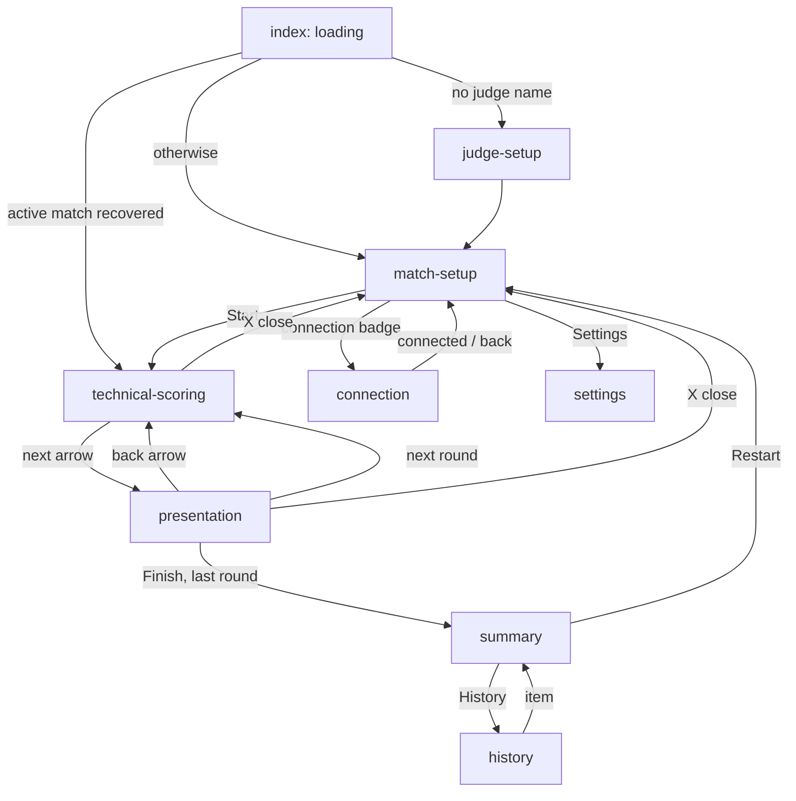
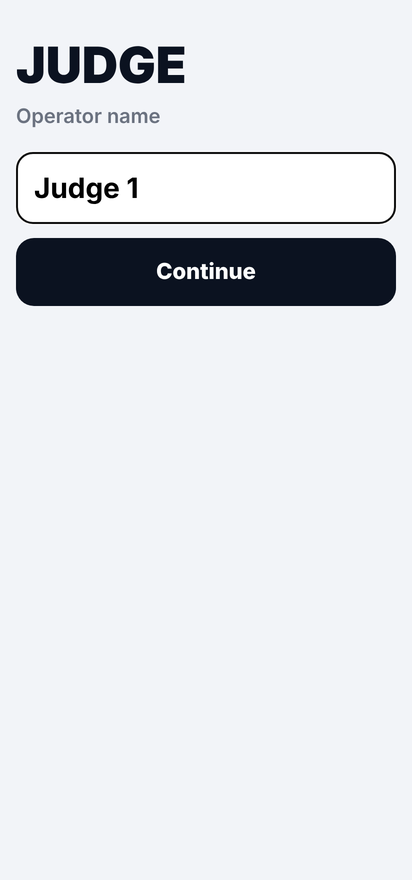
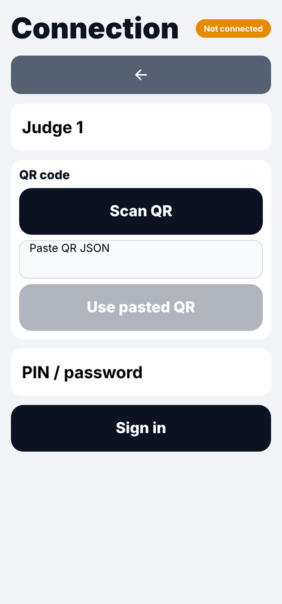
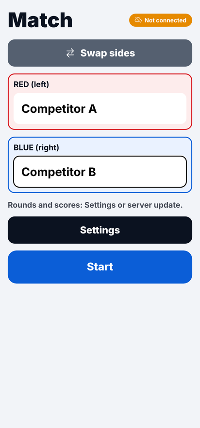
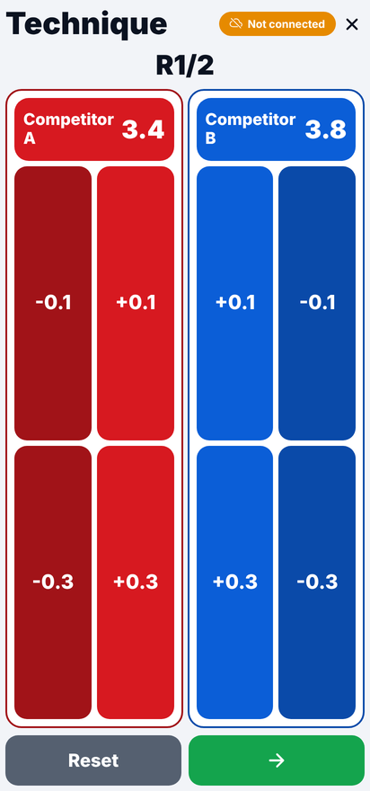
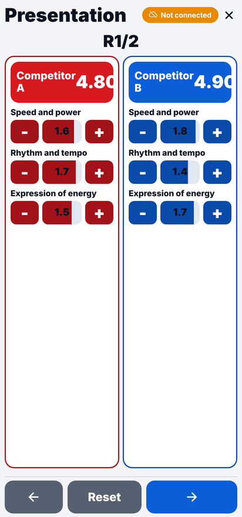
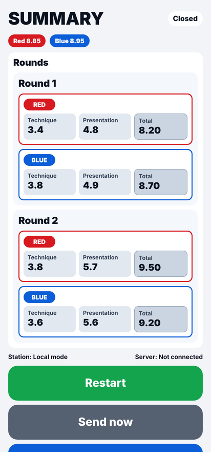
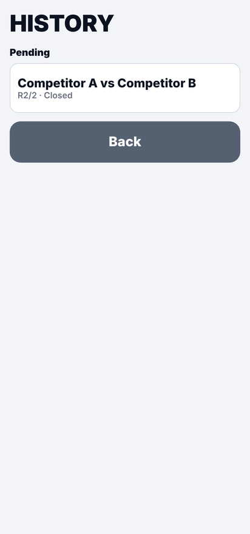
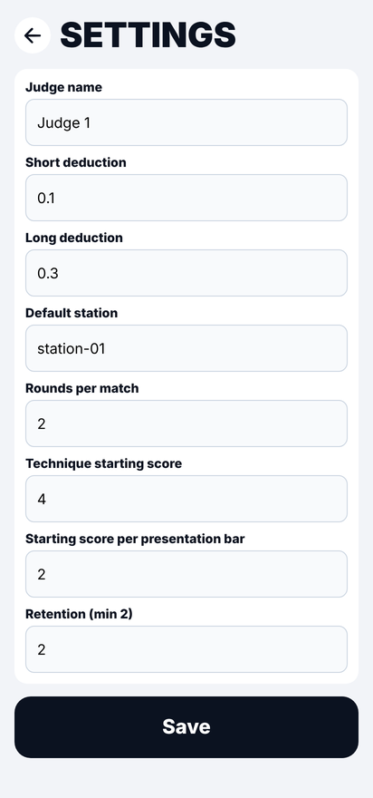
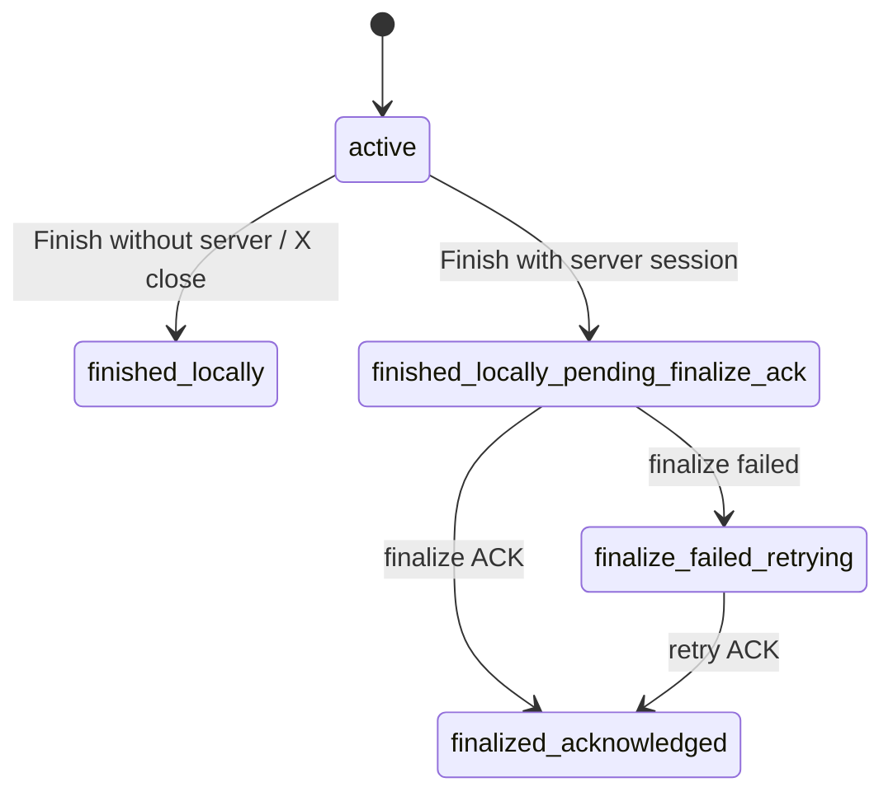

# Judge App — Technical Reference

Project: `tkd-poomsae-scorer`
Path: `judge-app/`

The judge app is an Expo / React Native app (Android first) that a poomsae judge uses to score technique
and presentation. Its priorities:

- work even when the backend is unavailable;
- store every scoring action locally first (SQLite);
- synchronize later without blocking the judge;
- use the WebSocket to complement live operation (it never replaces offline-first HTTP);
- a fast UI with large buttons and minimal text.

The app does not contain the backend; it consumes the HTTP/WebSocket contract described in
[api-contract.md](api-contract.md). The backend is documented in [backend.md](backend.md), the app
requirements (FR/NFR IDs) in [judge-app-requirements.md](judge-app-requirements.md), and the scoring rules
in [poomsae-rules.md](poomsae-rules.md) and [requirements.md](requirements.md).

---

## Contents

1. [Screens and navigation](#screens-and-navigation)
2. [UX decisions](#ux-decisions)
3. [Stack](#stack)
4. [Architecture](#architecture)
5. [Local data model (SQLite)](#local-data-model-sqlite)
6. [Scoring rules](#scoring-rules)
7. [Offline-first sync](#offline-first-sync)
8. [Finalization and checksum](#finalization-and-checksum)
9. [Realtime (WebSocket)](#realtime-websocket)
10. [Session persistence and security](#session-persistence-and-security)
11. [Settings](#settings)
12. [Internationalization](#internationalization)
13. [Scripts](#scripts)
14. [Building the APK](#building-the-apk)
15. [Tests](#tests)
16. [Troubleshooting and past fixes](#troubleshooting-and-past-fixes)
17. [Known limitations](#known-limitations)
18. [Key files](#key-files)

---

## Screens and navigation

All screens are Expo Router routes in `app/` (`app/_layout.tsx` declares a header-less stack and calls
`appFacade.init()` on mount and `appFacade.shutdown()` on unmount).



There is no "Home" hub screen. `index` decides the start route:

- no judge name → `judge-setup`;
- an active match (status `active`) → `technical-scoring`;
- otherwise → `match-setup`.

### judge-setup



- Asks for the judge's name (at least 2 letters); placeholder `e.g. Judge 1`.
- Stored in `app_settings.judge_name`, then opens `match-setup`.

### connection



- Judge name field.
- QR scanning with the camera (main path) and pasting the QR JSON (fallback).
- After a valid QR, a modal asks for the station PIN / password.
- Connects to the QR's station (`stationId`) with the judge name; after connecting it returns to the
  screen it came from (`returnTo`) or to `technical-scoring` when a match is active.
- Badge `Connected` / `Not connected`.
- Red `Disconnect` button, only while a remote session is active, with confirmation.
- After reading a QR the app calls `GET /stations/active` and warns if the QR station is not listed.

There is no manual "server URL" field on this screen.

### match-setup



- Names by color (red / blue), with localized defaults "Red" / "Blue".
- `Swap sides`, persisted as `preferredRedSide`.
- Connection badge (`Connected`, `Reconnecting`, `Not connected`); tapping it opens `connection`.
- While the WebSocket is connected: the `Active match` badge (with the server match ID) or
  `No active match`, and a `Sync` button that forces a sync, reconnects the WebSocket if needed and reloads
  `GET /stations/{station_id}/active-match-state`.
- Names are prefilled from the server's active match; the screen reloads when WebSocket events change the
  stored match or settings.
- If there is no session at all, the screen starts a local session automatically (local mode).
- `Settings` and `Start`. `Start` creates the local match and opens `technical-scoring`:
  - local mode: a new `local-<id>` match;
  - remote session with the WebSocket connected: the server's active `matchId`; if the server has no
    active match, an error asks the judge to sync;
  - remote session without the WebSocket connected: a `local-<id>` match.

  Events of `local-` matches (and of a local session) are never sent to a server
  (`src/domain/services/localMode.ts`).

### technical-scoring



- Two panels (left/right according to the local side preference), each with the name and the current
  technique score.
- Per side: deduction buttons on the outer edge and correction buttons on the inner edge:
  `-0.1`, `-0.3`, `+0.1`, `+0.3` (values configurable).
- `Reset` (gray) returns the round's technique to its start value after confirmation (recorded as
  compensating score events, see [Resets](#resets)).
- Green arrow to `presentation`.
- `X` closes the match after confirmation (local close, no server finalization).
- Connection badge with icon.

### presentation



- Three categories per competitor: *Speed and power*, *Rhythm and tempo*, *Expression of energy*.
- Each category has an interactive bar (tap or drag) plus `-` and `+` buttons.
- Category limits `0..2`; presentation total per side = sum of the three (`0..6`).
- Bottom controls: back arrow to technique, reset of the round's presentation (with confirmation, recorded
  as compensating score events), next-round arrow, or `Finish` on the last round (with confirmation).

### summary



- Rounds first (`Round 1`, `Round 2`, ...). For each round, a RED and a BLUE section with technique,
  presentation and total.
- Small overall total per color at the top (2 decimals).
- Match status, station and server metadata.
- With a connected remote session it shows "Waiting for a new match" instead of `Restart`.
- Actions: `Restart` (or the waiting state), `Send now`, `History`, `Back`.

### history



- Sections by status: **Active** (`active`), **Pending** (`finished_locally`,
  `finished_locally_pending_finalize_ack`, `finalize_failed_retrying`) and **Finalized**
  (`finalized_acknowledged`).
- Each item shows the names, `R<current>/<total>` and the status, and opens its summary.

### settings



See [Settings](#settings). `Save` validates with Zod, shows an alert and returns to the previous screen on
`OK`. Server fields and the "reset active match" action are not on this screen.

---

## UX decisions

- Large type and wide buttons; portrait-first with landscape adaptation (`app.json` uses
  `orientation: "default"`, so orientation is not locked).
- Strong color separation (RED / BLUE); colors, not sides, carry the sport logic.
- Minimal technical text for non-technical users.
- Critical actions ask for confirmation (reset, finish, close, disconnect).
- Icons on navigation and status (arrows, wifi / cloud-offline, close, swap).
- Score buttons react on `onPressIn` for immediate response.
- An anti-double-tap guard (`lockRef`, about 180 ms) protects critical commands.
- Score taps are queued (`scoreQueueRef`) so rapid taps are not lost; the score is updated optimistically
  and refreshed from SQLite after each write.
- Simultaneous multi-touch is not guaranteed on every device (touch dispatch and `Pressable` limitations);
  taps are serialized instead.

---

## Stack

From `judge-app/package.json`:

| Area | Package | Version |
|---|---|---|
| Runtime | `expo` | `^55.0.8` |
| | `react-native` | `0.83.2` |
| | `react` | `19.2.4` |
| | `expo-router` | `~55.0.7` |
| Persistence | `expo-sqlite` | `~55.0.11` |
| | `expo-secure-store` | `~55.0.9` |
| | `@react-native-async-storage/async-storage` | `2.2.0` (device ID) |
| Device | `expo-camera` | `~55.0.10` |
| | `expo-crypto` | `~55.0.10` (SHA-256) |
| | `@react-native-community/netinfo` | `11.5.2` |
| State / validation | `zustand` | `^5.0.8` |
| | `zod` | `^4.1.5` |
| Language | `typescript` | `~5.9.2` |
| Unit tests | `vitest` | `^4.0.3` |
| E2E tests | `detox` | `^20.47.0` |

The `start*` scripts set `EXPO_UNSTABLE_HEADLESS=1` to avoid React Native DevTools problems on Linux
(`chrome-sandbox`).

---

## Architecture

### Layers

| Folder | Responsibility |
|---|---|
| `app/` | Expo Router screens: UI, navigation and calls to `appFacade` only |
| `src/domain/` | Pure rules (no UI, SQLite or network) |
| `src/application/` | Use cases and orchestration |
| `src/infrastructure/` | SQLite, network, security |
| `src/components/` | Reusable UI (`ScreenContainer`, `PrimaryButton`, `StatusBadge`, `ScoreSidePanel`, `PresentationSidePanel`) |
| `src/store/` | Lightweight UI state (Zustand), a projection of SQLite |
| `src/i18n/` | Translations and `LocalizedError` |
| `src/constants/` | Colors and defaults |

`src/application/container.ts` wires the repositories, the API client (HTTP or mock), the realtime client
and the services. Interfaces live in `src/application/ports/repositories.ts`.

### Domain (`src/domain/services/`)

| Module | Purpose |
|---|---|
| `scoreCalculator.ts` | Technique and presentation totals from events (by `sequence`), per-side score by target, negative/positive classification (technique only) |
| `matchAggregation.ts` | Match totals = average of the non-pending rounds (2 decimals, half up, on integer hundredths: `divideHalfUp2`); `judgeFinalScore` (average technique + average presentation); `addScores2` |
| `roundRules.ts` | `canMoveToNextRound`, `nextRoundNumber`, `isValidRoundCount` (1–10) |
| `retryPolicy.ts` | Backoff with jitter, retry eligibility, and `isTerminalSyncError` (definitive sync failures) |
| `localMode.ts` | `isLocalOnlyMatchId` (`local-` match IDs), `isLocalSession` (station `local-offline` or a `local-` session ID), `isLocalOnlyScoreEvent` |
| `checksum.ts` | Canonical serialization (sorted keys) + SHA-256; `buildFinalizeChecksumPayload` (the canonical finalize payload shared with the backend) and `formatScore2` |
| `connectionValidation.ts` | Zod schemas for the QR payload and the connect request |
| `settingsValidation.ts` | Zod schema for settings |
| `realtimeHandler.ts` | Maps a WebSocket event to an action and a dedupe key |
| `retentionPolicy.ts` | Selects matches to delete |

### Application (`src/application/`)

| Module | Purpose |
|---|---|
| `AppFacade` (`appFacade.ts`) | High-level API for screens; startup (`init`) and shutdown |
| `SessionService` | QR, station connection, local/remote session, snapshot refresh, restore |
| `MatchService` | Scoring, resets (as compensating events), rounds, local close, summaries |
| `FinalizationService` | This judge's finalize payload (per-round technique and presentation, 2-decimal final scores), canonical checksum, queueing the finalization |
| `SyncEngine` | HTTP sending with queue, retry and idempotency; marks definitively refused events `rejected`; holds a finalization until the match's score events are acknowledged; never sends local-mode items |
| `RealtimeService` | Consumes WebSocket events idempotently, persists them, sends judge signals |
| `RetentionService` | Safe cleanup by retention |
| `RecoveryService` | Runs migrations and loads settings and the active match |
| `HistoryQueryService` | Lazy history headers and summaries |

Startup (`AppFacade.init`): run migrations and load state → restore and validate the session → connect the
WebSocket when there is a remote session → start the sync timer → start the connectivity monitor →
publish boot state to the store → enforce retention.

### Infrastructure (`src/infrastructure/`)

- SQLite repositories: `SettingsRepositorySqlite`, `ConnectionRepositorySqlite`, `SessionRepositorySqlite`,
  `MatchRepositorySqlite`, `ScoreEventRepositorySqlite`, `FinalizationRepositorySqlite`,
  `HistoryRepositorySqlite`, `InboundServerEventRepositorySqlite`.
- `db/client.ts` opens `tkd_scorer.db`; `db/migrations.ts` creates and upgrades the schema.
- `network/apiClient.ts`: HTTP client (`HttpApiClient`) or `MockApiClient` when
  `EXPO_PUBLIC_USE_MOCK_BACKEND=1`.
- `network/realtimeClient.ts`: WebSocket with reconnection.
- `network/connectivityMonitor.ts`: triggers a sync when the device comes online or the app returns to
  the foreground.
- `security/tokenVault.ts`: access token in `expo-secure-store` (key `tkd.access_token`).
- `security/deviceIdentity.ts`: device ID `dev-<uuid>` in AsyncStorage (key `tkd.device_id`).

---

## Local data model (SQLite)

SQLite (`expo-sqlite`, database `tkd_scorer.db`) is the persistent source of truth. Schema in
`src/infrastructure/db/migrations.ts`.

| Table | Content |
|---|---|
| `app_settings` | Single row (`id = 1`): judge name, deduction values, default station, rounds, starting scores, retention, `preferred_red_side`, server active-match snapshot (`server_has_active_match`, `server_active_match_id`, `server_competitor_red_name`, `server_competitor_blue_name`, `server_match_updated_at`), `remote_base_url`, `bootstrap_token` |
| `backend_server` | Base URL, bootstrap token, environment, tournament, protocol version, expiry, `active` |
| `station` | Stations returned by `/stations/active` |
| `operator_session` | Backend, station ID/name, judge, device ID, server `session_id`, token expiry, last validation, `connection_status` (`connected`/`disconnected`/`revoked`), `active` |
| `match` | Left/right names and colors (`left_side_color`, `right_side_color`), rounds, current round, technique starting score, presentation category start, status, timestamps, `retention_priority` |
| `round` | Match, round number, status (`pending`/`active`/`completed`), start/end |
| `score_event` | Unique `idempotency_key`, session, station, device, judge, match, round, side, `score_target`, delta, before/after, `occurred_at`, `sequence`, `sync_status`, `retry_count`, `last_error`, `last_attempt_at`, `server_ack_at` |
| `finalization_event` | Match, session, station, checksum, `payload_snapshot`, sync fields as above |
| `inbound_server_event_log` | Event type, unique `dedupe_key`, payload, received/processed timestamps; also stores local audit entries (`local_reset_technique_round` / `local_reset_presentation_round` with the IDs of the compensating events, `local_close_match`) |

Indexes: `idx_score_event_match_sequence (match_id, sequence)`, `idx_score_event_sync (sync_status, occurred_at)`,
`idx_finalization_sync (sync_status, created_at)`.

### Migrations

`runMigrations()` runs on every startup (`RecoveryService.bootstrap`):

1. `CREATE TABLE IF NOT EXISTS` / `CREATE INDEX IF NOT EXISTS` for the whole schema.
2. A list of `ALTER TABLE ... ADD COLUMN` statements for columns added after the first release
   (`match.updated_at`, `match.presentation_category_start_score`,
   `app_settings.presentation_category_start_score`, `app_settings.default_station_id`,
   `score_event.score_target`, `app_settings.preferred_red_side` and the five `server_*` snapshot
   columns). Each one is wrapped in `try/catch` and ignored when the column already exists.
3. `INSERT OR IGNORE` of the default `app_settings` row.

There is no version table; new columns are added by appending another guarded `ALTER TABLE`.

### Statuses

| Entity | Values |
|---|---|
| Match | `active`, `finished_locally`, `finished_locally_pending_finalize_ack`, `finalized_acknowledged`, `finalize_failed_retrying` |
| Sync (`score_event`, `finalization_event`) | `pending` → `syncing` → `acknowledged`, or `failed` (retried); score events also `rejected` (refused definitively by the server, never retried) |
| Score target | `TECHNIQUE`, `PRESENTATION_SPEED_POWER`, `PRESENTATION_RHYTHM_TEMPO`, `PRESENTATION_ENERGY_EXPRESSION` |

---

## Scoring rules

### Technique

- Configurable start (`defaultStartingScore`, default 4).
- Events with a signed `scoreDelta`: negative deductions, positive corrections.
- Bounds enforced in the app: `0..startingScore`. The stored delta is the *effective* delta after
  clamping; a tap that would not change the score (less than 0.05) creates no event.
- Configurable action values (`actionValue1`, `actionValue2`; defaults 0.1 and 0.3).

### Presentation

- Three categories per side.
- Configurable start per category (`presentationCategoryStartScore`, default 2).
- Bounds per category: `0..2` (`PRESENTATION_CATEGORY_MAX_SCORE`).
- Presentation total per side: sum of the categories (`0..6`).

### Round and match totals

- Total per side and round in the summary = technique + presentation; with the defaults a perfect round
  is `4 + 6 = 10`.
- Match totals average the non-pending rounds, rounded to 2 decimals half up (for example
  `(8.2 + 9.5) / 2 = 8.85`). The division works on integer hundredths (`divideHalfUp2`), so it matches the
  backend's `Decimal` `ROUND_HALF_UP` (`32.7 / 4 = 8.18`, where float rounding would give `8.17`).
- This judge's final score per side (`judgeFinalScore`) = 2-decimal average of technique + 2-decimal
  average of presentation over the non-pending rounds. The backend rebuilds the same value from the judge's
  events when it reconciles the finalization.
- These are one judge's scores. The consolidation across judges (trimming, round and match score, winner)
  is done by the backend and shown on the TV; the app does not show it.
- The same events replayed in `sequence` order always give the same result.

### Resets

The technique reset (technical scoring screen) and the presentation reset (presentation screen) of the
current round never delete events, because some may already be synced. `MatchService` records
**compensating score events** instead: for each side (and, for presentation, each of the three
categories) whose value differs from the start, one event with the inverse delta (`start - current`) and a
new sequence number. They are queued and synced like any other event (a sync is triggered right away), so
the server's scorecard of this judge and the device stay equal and the finalization reconciles. Sequences
are never reused: `getNextSequence` is `MAX(sequence) + 1` and the judge's own corrections never delete
rows. A local audit entry lists the compensating event IDs, and `judge_reset_requested` is sent as a hint.

Events are deleted only to mirror a server-side reset (`reset_round`, `reset_match` over the WebSocket),
where the server deleted the same events. The former undo and round / match resets (`undoLast`,
`resetRound`, `resetMatch` in `AppFacade`, unused by the screens) were removed together with the repository
methods that deleted rows (`undoLastEvent`, `resetCurrentRoundByTargets`).

---

## Offline-first sync

### Principle

Every scoring tap:

1. updates the screen immediately (optimistic);
2. is persisted in SQLite (`score_event`) with `sync_status = 'pending'`;
3. triggers an asynchronous HTTP sync attempt;
4. never blocks the UI on the network.

Events of `local-` matches and of a local session (station `local-offline` or a `local-` session ID) are
stored as `acknowledged` immediately and are never sent; `listPendingEvents` leaves them out and the sync
engine skips any older pending row of that kind, so they never hold a server finalization. Finalizations
of `local-` matches are skipped too.

### SyncEngine (`src/application/services/syncEngine.ts`)

- A 5-second timer (`setInterval`) runs a sync cycle; `triggerSync()` also runs one on demand (after each
  tap, on finalization, on **Sync** / **Send now**, when the device comes online and when the app
  returns to the foreground).
- Cycles never overlap: a trigger during a running cycle schedules exactly one more cycle.
- A cycle does nothing without an active backend and an access token.
- Per cycle: up to 100 score events and 20 finalizations with status `pending`, `failed` or `syncing`,
  oldest first; each one is skipped if it is not yet eligible for retry.
- Each event is marked `syncing`, posted to `POST /score-events` with `Idempotency-Key` = the event's
  `idempotencyKey` (equal to the local event ID), then marked `acknowledged` (with `server_ack_at`),
  `rejected` or `failed` (each failure: `retry_count + 1`, `last_error`, `last_attempt_at`).
- `rejected` is for definitive refusals (`isTerminalSyncError`): HTTP `400`, `404`, `409`, `410`, `422`, or
  the body's `code: "match_closed"` (the operator closed the match). The event leaves the queue, is never
  retried and does not hold the finalization. Every other failure (`401`, `403`, `408`, `429`, `5xx`,
  network errors) is `failed` and retried.
- Acknowledged and rejected events are never resent.
- Finalizations are held while the backend has not acknowledged the match's score events: a finalization is
  skipped in a cycle when any pending event of the same match was not sent or failed in that cycle and has
  fewer than 5 failed attempts, or when the pending-event batch was full (100 events, so more may be
  waiting). The backend rebuilds this judge's scorecard from the events it received, so finalizing first
  would not reconcile. After an event has failed 5 times (a retryable failure) the finalization is sent
  anyway.
- Finalizations are posted to `POST /matches/finalize` from `payload_snapshot` (the snapshot's `matchId`,
  or the row's `match_id` if empty). On ACK the finalization is `acknowledged` and the match
  `finalized_acknowledged`, whatever `reconciled` says; on failure the finalization is `failed` and the match
  `finalize_failed_retrying`.

### Retry policy (`src/domain/services/retryPolicy.ts`)

```
delay(retryCount, seed) = e + e × (0.2 + 0.4 × seed),   e = min(60 000 ms, 800 ms × 2^retryCount)
```

Eligibility uses `seed = 0.5`, so an item is retried when at least `1.4 × e` has passed since
`last_attempt_at`. `retry_count` is incremented on each failure, so the waits after consecutive failures
are about 2.2 s, 4.5 s, 9 s, 18 s ... capped at 84 s. Items never attempted are always eligible.

### Match states



---

## Finalization and checksum

`FinalizationService.finalizeActiveMatch()` (triggered by **Finish** on the last round):

1. Loads the active match, the session, the backend and the token; builds the summary from SQLite.
2. Keeps the scored rounds (status not `pending`) and computes this judge's `finalScoreRed/Blue` with
   `judgeFinalScore` (2-decimal average technique + 2-decimal average presentation), `finalSequence` = last
   event sequence, `totalEvents`, and `roundsSummary[]` with `roundNumber`, `techniqueRed`,
   `presentationRed`, `techniqueBlue`, `presentationBlue`, the round totals `red` / `blue` (2 decimals,
   kept for older backends), `negativeRed`, `negativeBlue`, `positiveRed`, `positiveBlue`.
3. Builds the canonical finalize payload with `buildFinalizeChecksumPayload`: `matchId`, `sessionId`,
   `stationId`, `judgeName`, `totalEvents`, `lastSequence`, `finalScoreRed`, `finalScoreBlue` and `rounds[]`
   (`roundNumber`, `techniqueRed`, `presentationRed`, `techniqueBlue`, `presentationBlue`), sorted by round,
   with scores as strings with exactly 2 decimals (`formatScore2`).
4. `checksum` = SHA-256 (hex, `expo-crypto`) of `canonicalize(payload)`: JSON with object keys sorted
   recursively and no whitespace. The backend rebuilds the same payload from the judge's stored events
   (`backend/src/tkd_scorer/domain/services/finalization_checksum.py`); a shared test vector in both test
   suites keeps the two in sync.
5. If there is no backend, no token, the session is a local session (`local-offline` station or `local-`
   session ID), or the match ID starts with `local-`:
   the match becomes `finished_locally` and the summary is shown (`mode: offline_local`).
6. Otherwise a `finalization_event` is saved with the request payload (`payloadSnapshot`), the match becomes
   `finished_locally_pending_finalize_ack` (`mode: pending_remote_ack`), the WebSocket signal
   `judge_match_completed` is sent, retention runs and a sync is triggered. The sync engine sends the
   finalization once the match's score events are acknowledged (see [SyncEngine](#syncengine-srcapplicationservicessyncenginets)).

On the server each judge finalizes its own scorecard of the shared match; the response `status` is this
judge's result and `matchStatus` the shared match, which closes when every required judge has finalized. A
reconciled judge receives `session_revoked` (`reason: match_finalized`) and the app clears its session.

The HTTP client refuses to send a finalization with an empty `matchId`. Payload details, the canonical
payload and the test vector: [api-contract.md, section 4.10](api-contract.md#410-post-matchesfinalize).

---

## Realtime (WebSocket)

### Client (`src/infrastructure/network/realtimeClient.ts`)

- URL: the base URL with `http` → `ws` (`https` → `wss`) plus
  `/ws?sessionId=...&stationId=...&token=<accessToken>`.
- Status callback: `connecting`, `connected`, `disconnected` (stored as `wsStatus` in the Zustand store and
  shown by the connection badges).
- Reconnection after any close while enabled:
  `wait = min(30 000 ms, 800 ms × 2^attempts + random(0..500 ms))`; `attempts` resets on open.
- `disconnect()` disables reconnection.
- `sendEvent(type, payload)` sends `{type, payload}` only while the socket is open (signals are best effort).

### Service (`src/application/services/realtimeService.ts`)

Inbound messages are normalized (`type` / `event` / `name`; `payload` / `data` / `body`), mapped by
`realtimeHandler.ts`, de-duplicated by a persisted `dedupe_key` in `inbound_server_event_log`, logged, then
applied:

| Event | Action |
|---|---|
| `new_competitors` | Store server match ID and names by color in `app_settings`; rename the local match with that ID (color → side by its stored colors) |
| `active_match_state` | Store or clear the server active-match snapshot; rename the local match when active |
| `match_updated` | Same as `active_match_state` (active unless `hasActiveMatch`/`active`/`status` says otherwise) |
| `judge_settings_updated` | Update settings with clamps: rounds `1..10`, technique start `0..20`, presentation start `0..2`, `actionValue1` `0.1..1`, `actionValue2` `0.1..2` |
| `round_changed` | Move the local match to the given round |
| `reset_round` | Delete the local events of the round named in the payload (`round` / `roundNumber` / `round_number`; the match's current round when missing), the same events the server deleted |
| `reset_match` | Reset the local match |
| `session_revoked`, `judge_kicked`, `station_disconnected` | If the event names this device's session (or no session): clear the local session and disconnect the WebSocket. Events for another judge's session are ignored. |
| `server_notice` | Logged only |
| `ping` | Reply once with `pong` `{echo, serverTime, clientTime}` (`sendPong`; not logged) |
| `pong` | Nothing: never answered, not logged |

Names are expected by color (`competitorRedName`, `competitorBlueName`). The handler also accepts
`redName`, `red`, nested `competitors` / `match` objects and, for backward compatibility, the old
`competitorLeftName` / `competitorRightName`. Missing names fall back to the localized "Red" / "Blue".
The app maps colors to left/right with the judge's local preference.

Outbound signals (only with a remote session): `judge_round_completed` (on next round),
`judge_match_completed` (on finish with a server session), `judge_reset_requested` (on a technique or
presentation reset, with `resetTarget` `TECHNIQUE` or `PRESENTATION`; the server has no handler for it).
The server accepts the two `judge_*_completed` signals only on the connection bound to the same session and
station, which is how the app sends them.

Example payloads: [api-contract.md, section 5](api-contract.md#5-websocket).

---

## Session persistence and security

Persisted: the active backend (`backend_server`), station ID and name, judge name, server `sessionId`, token
expiry metadata and connection status (`operator_session`); the access token in the secure store.

Restore on startup (`SessionService.restoreValidatedSession`):

| Situation | Result |
|---|---|
| No session | `missing` |
| Session `revoked` or `disconnected` | Cleared → `invalid` |
| Local mode (`local-offline`) | `valid` |
| No backend or token | `missing` |
| `GET /health` with the token returns `401`/`403` | Marked `revoked` → `invalid` (reconnect required) |
| Network error | `offline` (the session is kept, no forced re-authentication) |
| Otherwise | `valid` |

- The access token is stored in `expo-secure-store`, never in plain SQLite.
- A persistent device identity (`dev-<uuid>`) is generated once and sent on connect.
- Connecting from a new QR clears the previous session; disconnecting clears the session, the token and the
  server active-match snapshot.
- When the backend answers `409` because this judge name is already active on another device,
  `SessionService` retries once with `replaceExistingJudgeSession: true`: the server revokes the other
  device's session (that device receives `judge_kicked` and `session_revoked` with
  `reason: replaced_by_new_device` and clears its session) and the new session continues the judge's
  scorecard on the server. The new device does not have the old device's events (see
  [Known limitations](#known-limitations)).

---

## Settings

Settings screen fields (validated by `settingsValidation.ts`):

| Field | Key | Rule | Default |
|---|---|---|---|
| Judge name | `judgeName` | 2–80 characters | empty (asked on first run) |
| Short deduction | `actionValue1` | `> 0`, `≤ 1` | `0.1` |
| Long deduction | `actionValue2` | `> 0`, `≤ 2` | `0.3` |
| Default station | `defaultStationId` | 2–50 characters | `station-01` |
| Rounds per match | `defaultRounds` | integer `1..10` | `2` |
| Technique starting score | `defaultStartingScore` | `0..20` | `4` |
| Starting score per presentation bar | `presentationCategoryStartScore` | `0..2` | `2` |
| Retention (min 2) | `retainedMatchesCount` | integer `2..50` | `2` |

Other stored settings: `preferredRedSide` (`LEFT`/`RIGHT`, set from match setup) and the server snapshot.
The backend can push rounds, starting scores and action values with `judge_settings_updated`.
New matches take rounds and starting scores from the settings at creation time.

Retention (`RetentionService`, `retentionPolicy.ts`): matches are sorted by creation date; active matches are
always kept; the newest ones are kept up to `retainedMatchesCount`; older matches are deleted together with
their rounds, events and finalizations. It runs at startup, after closing a match and after finalizing.

---

## Internationalization

- `src/i18n/index.ts` exposes `t(key, params)`, `translate`, `resolveLanguage`, `setLocale`, `getLanguage`.
- The UI language follows the device locale read through `Intl.DateTimeFormat().resolvedOptions().locale`:
  `es`, `es-*` or `es_*` → Spanish; anything else → English (default).
- Strings live in `src/i18n/locales/en.ts` (reference, defines `TranslationKey`) and
  `src/i18n/locales/es.ts`; missing keys fall back to English, then to the key. Placeholders use `{name}`.
- Services throw `LocalizedError(key, params)`; its `message` is always English (for logs and tests) and
  screens show `errorMessage(error)` in the current language.
- `tests/unit/i18n.test.ts` checks that both locales have the same keys.

---

## Scripts

From `judge-app/package.json`:

| Script | Command / purpose |
|---|---|
| `npm run start` | Expo Go, LAN, clean cache, headless |
| `npm run start:go` | Same as `start` |
| `npm run start:go:tunnel` | Expo Go through a tunnel |
| `npm run start:dev-client` | Development client, LAN, clean cache |
| `npm run start:mock` | Development client with the mock backend (`EXPO_PUBLIC_USE_MOCK_BACKEND=1`) |
| `npm run start:tunnel` | Development client through a tunnel |
| `npm run start:phone` | Frees port 8081 and starts Expo Go bound to this machine's LAN IP |
| `npm run android` / `npm run ios` | `expo run:android` / `expo run:ios` (native build and run) |
| `npm run web` | Web target |
| `npm run typecheck` | `tsc --noEmit` |
| `npm run lint` | ESLint |
| `npm run test` / `npm run test:watch` | Vitest (single run / watch) |
| `npm run test:e2e:build` | Detox build (`android.emu.debug`) |
| `npm run test:e2e` | Detox tests (`android.emu.debug`) |
| `npm run test:e2e:mock` | Detox tests with the mock backend |
| `npm run build:apk` | `eas build -p android --profile preview` |

`judge-app/.env.example` contains `EXPO_PUBLIC_USE_MOCK_BACKEND=1` for mock development.

---

## Building the APK

Testing on a device without Expo Go is more stable.

### Option A: local build

Requirements: JDK 17, Android SDK + `adb`, `JAVA_HOME` and `ANDROID_HOME` set. The `android/` folder is not
committed; generate it first.

```bash
cd judge-app
npm install
npx expo prebuild            # or: npm run android (builds, installs and runs)
cd android
./gradlew assembleDebug      # or assembleRelease
adb install -r app/build/outputs/apk/debug/app-debug.apk
```

### Option B: EAS cloud build

```bash
npx eas-cli login
npx eas-cli build -p android --profile preview   # same as npm run build:apk when the eas CLI is installed
```

`eas.json` sets `preview.android.buildType = apk` and `production.android.buildType = app-bundle`.

Native configuration in `app.json`: package / bundle ID `com.tkd.scorer`, camera permission,
`usesCleartextTraffic: true` (LAN HTTP without TLS), iOS `NSCameraUsageDescription` and
`NSLocalNetworkUsageDescription`.

---

## Tests

### Unit (Vitest)

```bash
cd judge-app
npm run test
npm run typecheck
```

`vitest.config.ts` runs `tests/unit/**/*.test.ts` in a Node environment with the `@` alias to `src/`. The
suite has 83 tests.

| Test file | Covers |
|---|---|
| `scoreCalculator.test.ts` | Score calculation by events and targets |
| `matchAggregation.test.ts` | Match totals and rounding (2 decimals, half up on exact hundredths), pending rounds ignored, judge final score = average technique + average presentation |
| `roundRules.test.ts` | Round transitions |
| `retryPolicy.test.ts` | Backoff and eligibility; definitive 4xx answers as terminal, the others retried |
| `checksumAndFinalization.test.ts` | The shared checksum test vector (same canonical string and SHA-256 as `backend/tests/unit/test_finalization_checksum.py`), 2-decimal score strings, finalization with per-round parts and the canonical checksum of the scored rounds, local-only finalization |
| `connectionValidation.test.ts`, `settingsValidation.test.ts` | QR / connection and settings validation |
| `syncEngine.test.ts` | Sync idempotency and statuses; a finalization held until the match's score events are acknowledged, and released once an event keeps failing; a definitively refused event rejected without holding the finalization; local-mode events never sent and never holding server finalizations |
| `matchServiceReset.test.ts` | Technique and presentation resets as compensating events without deleting synced events, no sequence reuse, nothing recorded at start values, local-only matches |
| `realtimeHandler.test.ts`, `realtimeService.test.ts` | WebSocket mapping, application and persistence; one `pong` per `ping` and no answer to `pong`; `reset_round` deletes the round the server named |
| `apiClient.test.ts` | Active match snapshot retrieval; HTTP status and server error `code` kept on failures |
| `retentionPolicy.test.ts`, `recoveryService.test.ts` | Retention and recovery after restart |
| `sessionService.test.ts` | Session restore and judge replacement |
| `historyQueryService.test.ts` | Lazy history queries |
| `i18n.test.ts` | Locale key parity and English fallback |

### E2E (Detox)

`detox.config.ts` defines configuration `android.emu.debug`: emulator AVD `Pixel_7_API_35` and the debug APK
`android/app/build/outputs/apk/debug/app-debug.apk` (built with
`cd android && ./gradlew assembleDebug assembleAndroidTest -DtestBuildType=debug`).

```bash
npx expo prebuild
npm run test:e2e:build
npm run test:e2e          # or npm run test:e2e:mock
```

Specs (`tests/e2e/`, Jest runner `tests/e2e/jest.e2e.config.js`):

- `first-run.e2e.js` — judge setup, landing on match setup in local mode, pasting a QR and cancelling the
  PIN prompt.
- `scoring.e2e.js` — start a match, score and correct technique, presentation categories, restart the app,
  next round, cancel a reset, finish, summary and history.

The specs select elements by `testID` and match native alert buttons by their English text, so the emulator
must use an English device locale.

---

## Troubleshooting and past fixes

| Problem | Fix in the code |
|---|---|
| `expo-router/babel` is deprecated | `babel.config.js` uses `babel-preset-expo` (plus `module-resolver` for `@`) without the deprecated plugin |
| React Native DevTools fails on Linux (`chrome-sandbox`) | Scripts set `EXPO_UNSTABLE_HEADLESS=1` |
| `ExpoKeepAwake.activate rejected` | Shim `src/shims/expo-keep-awake.ts`, aliased in `metro.config.js` |
| `SafeAreaView` deprecated | `ScreenContainer` uses `react-native-safe-area-context` |
| Inflated match totals | Aggregation in `HistoryRepositorySqlite` uses `aggregateMatchTotals` |
| `getSnapshot should be cached` (Zustand object selector) | Screens select store fields one by one |
| Connection `404` for a station | The API client shows the backend `detail` in the error message |
| `Failed to download remote update` in Expo Go | Same Wi-Fi for phone and computer, free port 8081, `npm run start:phone`, or `npm run start:go:tunnel` |

---

## Queued items and sessions

The sync engine compares every queued score event and finalization with the session signed in now:
same session — sent as is; **previous session of the same judge at the same station** (for example after a
reconnection) — sent with the current session (the finalization checksum, which covers the session ID, is
rebuilt); **another judge or station** — never sent (score events are marked `rejected`).

## Known limitations

Verified in the current code:

1. **Orientation is not locked** (`orientation: "default"`); the UI is designed portrait-first.
2. **The server active-match snapshot lives in `app_settings`.** It works for the current flow; it may
   become its own entity if remote state grows.
3. **`build:apk` calls `eas` directly**; it needs the `eas` CLI on the `PATH` (or use `npx eas-cli`).
4. **A replacement device cannot reproduce the old device's events.** When a judge moves to another phone
   (`replaceExistingJudgeSession`), the server keeps one scorecard with the events of both sessions, but the
   new phone only has its own. If the old phone had sent events, the new phone's finalization does not
   reconcile and the shared match ends `finalization_pending`; the operator decides how to close it.
5. **The rematch is organized manually.** The backend's tie-break ends in "Rematch required"; the app does
   not show the consolidated result, and the officials organize the new performance (for example as a new
   match).
6. **Older app builds cannot reconcile.** Builds from before the canonical checksum hash a different
   snapshot (with `orderedEvents` and numeric scores) and send 1-decimal totals; the backend reports
   `checksum mismatch` and the shared match ends `finalization_pending`. Every judge device must run a build
   that includes `buildFinalizeChecksumPayload`.
7. **Inbound log is never pruned.** Revocation events are deduplicated by session and issue time, so
   they apply to every new session, but the inbound log grows with each event.

---

## Key files

| Area | Files |
|---|---|
| Screens | `app/judge-setup.tsx`, `app/connection.tsx`, `app/match-setup.tsx`, `app/technical-scoring.tsx`, `app/presentation.tsx`, `app/summary.tsx`, `app/history.tsx`, `app/settings.tsx` |
| Orchestration | `src/application/appFacade.ts`, `src/application/container.ts`, `src/application/services/*.ts` |
| Domain | `src/domain/services/scoreCalculator.ts`, `realtimeHandler.ts`, `retryPolicy.ts`, `checksum.ts`, `settingsValidation.ts`, `matchAggregation.ts` |
| Contracts | `src/domain/models/contracts.ts`, `src/domain/models/entities.ts` |
| Persistence and network | `src/infrastructure/db/migrations.ts`, `src/infrastructure/repositories/*.ts`, `src/infrastructure/network/apiClient.ts`, `src/infrastructure/network/realtimeClient.ts` |
| i18n | `src/i18n/index.ts`, `src/i18n/locales/en.ts`, `src/i18n/locales/es.ts` |
| Contract | [`docs/api-contract.md`](api-contract.md) |

When the backend contract changes, update together: [api-contract.md](api-contract.md),
`src/domain/models/contracts.ts`, `src/infrastructure/network/apiClient.ts`,
`src/domain/services/realtimeHandler.ts`, `src/application/services/realtimeService.ts` and the related
unit tests.
