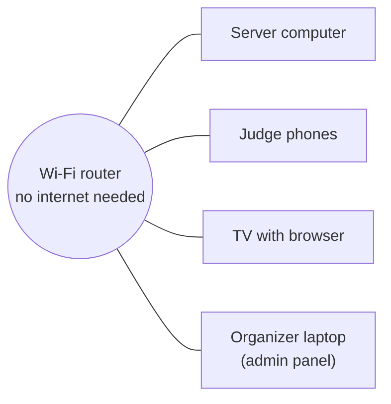
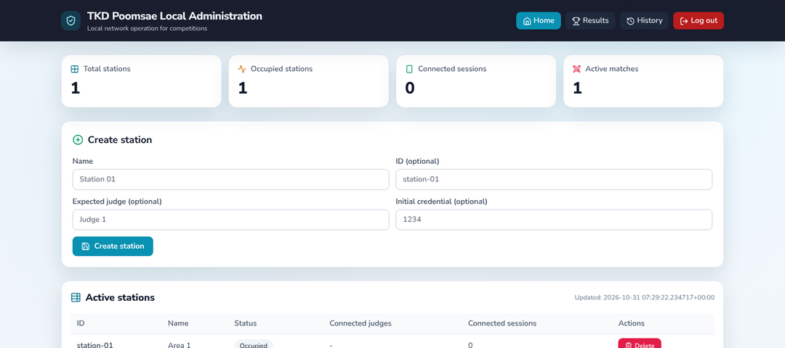
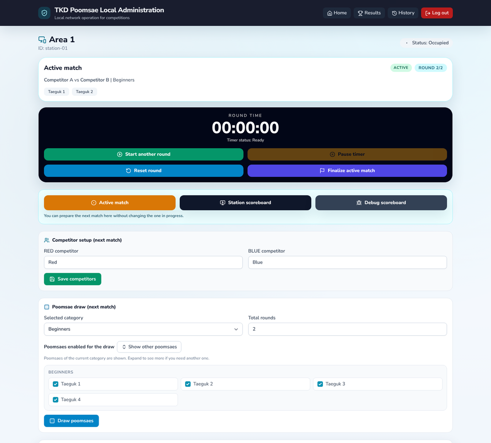
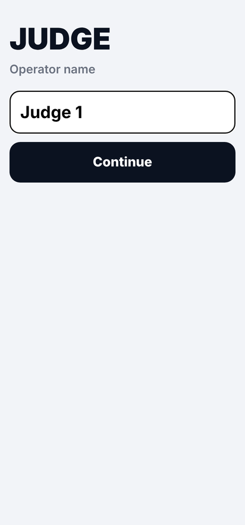
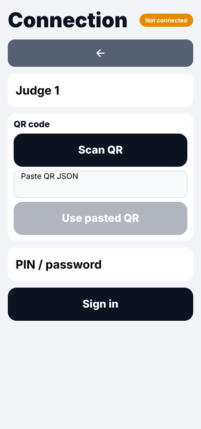
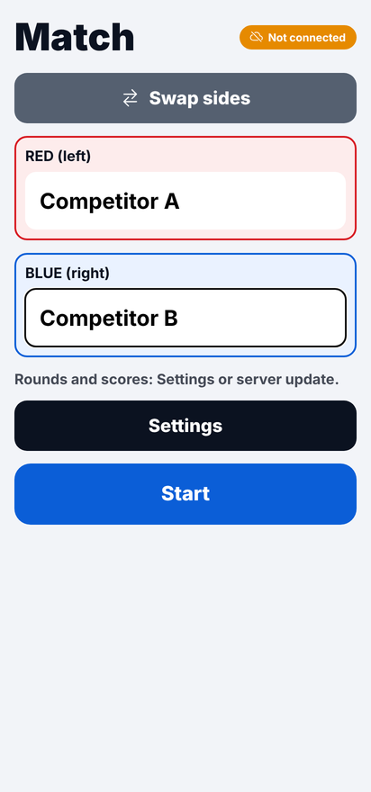
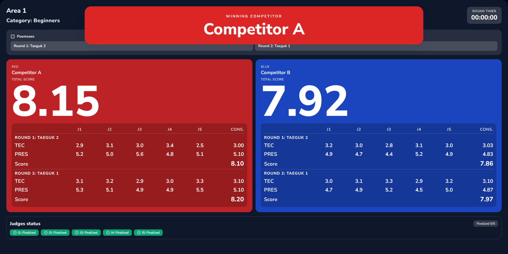

# Operations guide: running a tournament

Step-by-step guide for the organizer on competition day. No programming knowledge is needed.

## What you need

| Item | Notes |
|---|---|
| One computer per server | Windows or Linux. One server can manage several areas (stations). |
| A Wi-Fi router | A closed local network is enough; **no internet is required**. |
| One Android phone per judge | Android 8.0 or newer, with the judge app (APK) installed. |
| One TV or monitor per area | Connected to any computer or smart TV with a browser on the same network. |

## 1. Install and configure the server (once)

1. Copy the `PoomsaeServer` folder to the server computer.
2. Open the `.env` file with a text editor and change at least:

   | Setting | What to put |
   |---|---|
   | `TKD_PUBLIC_BASE_URL` | Address of this computer on the Wi-Fi, e.g. `http://192.168.1.20:8080`. The QR code uses this address as written (with the shipped `TKD_QR_USE_SERVER_IP=false`) |
   | `TKD_ADMIN_PASSWORD` | A strong password for the admin panel |
   | `TKD_JWT_SECRET_KEY` | A long random text (40+ characters) |
   | `TKD_ADMIN_BASE_PATH` | A private path for the panel, e.g. `/control-panel` (not `/admin`) |
   | `TKD_UI_LANGUAGE` | `en` (default) or `es` for the panel and TV screen |

3. Optionally edit `config/poomsae_categories.yaml` to change the poomsae of each category.

The full list of settings is in [backend.md](backend.md).

## 2. Start the server

- **Windows:** double-click `Start Admin Panel.bat`.
- **Linux:** run `./start_admin_panel.sh`.

A console window opens (keep it open) and the browser opens the admin panel. Log in with the password.

## 3. Create one station per area

In **Create station**, enter a name (for example *Area 1*) and, optionally, an ID and an initial PIN.
Each station gets its own QR code and PIN, shown on the station page.

## 4. Connect the judges

On each judge phone:

1. Open the app and enter the judge name the first time.
2. Tap **Scan QR** and scan the station QR shown in the admin panel.
3. Enter the station **PIN**.

  
  
  

The connected judges appear in the **Active judges** table of the station. A judge who loses the
connection keeps scoring on the phone; the scores are sent automatically when the network comes back.

## 5. Show the scoreboard on the TV

Open `http://SERVER_IP:PORT/scoreboard/STATION_ID` in the TV browser (for example
`http://192.168.1.20:8080/scoreboard/station-01`). The page updates by itself; it needs a screen at least
768 px wide in landscape.

## 6. Run a match

1. In the station page, enter the **red** and **blue** competitors and the **category**.
2. Press **Draw poomsaes** (or select them) and then **Start match**. The judges' phones receive the match.
3. Press **Start round**. Judges tap accuracy deductions during the performance and set presentation after it.
4. Judges move to the next round on their phones; on the last round they press **Finish**.
5. When all judges have finished, the TV shows the consolidated result.

The scoring rules applied are explained in [poomsae-rules.md](poomsae-rules.md).

## 7. During the tournament

| Situation | What to do |
|---|---|
| A judge's phone restarts | Open the app: the session and the match in progress are restored. |
| A judge has to be replaced | In **Active judges**, press **Remove judge** (**Delete connection** when the phone is not connected). If that judge had not finished the match, it stops counting and its scores are left out of the result (the TV shows it as **Removed**); if every other judge has already finished, the match closes. The new judge scans the QR and counts from its first score. |
| A judge's phone has to be changed | On the new phone, scan the QR and enter the PIN with the **same judge name**: the old phone is signed out and the judge keeps its place (same alias). If the old phone had already sent scores, they stay on the server but are not on the new phone, so that judge's result is marked *reconciliation pending*; decide whether to close the match with **Finalize active match**. |
| The PIN may have been seen by others | Press **Rotate credential**: a new PIN and QR are generated. |
| The panel says the credential "Cannot be shown (server key changed)" | `TKD_JWT_SECRET_KEY` was changed after the PIN was saved. Press **Rotate credential** to get a new PIN. |
| **Reset round** in the panel | It deletes the round's scores on the server and on every judge's phone; the judges score the round again. |
| The TV shows **Rematch required** | Every tie-break step is equal; run the rematch. |
| Results of previous matches | **Results** and **History** in the top menu. |

## 8. Shut down and back up

- Close the server console window to stop the server.
- The results database is in `data/` and the logs in `logs/tkd_server.log`. Copy the `data/` folder to keep a backup.

## Troubleshooting

| Problem | Check |
|---|---|
| The server does not start | `logs/tkd_server.log`; the `.env` file exists; `config/poomsae_categories.yaml` is valid; the port is free. |
| "Invalid security configuration" | Change the default password and secret, and do not use `/admin` as `TKD_ADMIN_BASE_PATH`. |
| Phones cannot connect | Phones and server are on the same Wi-Fi; `TKD_PUBLIC_BASE_URL` uses the server's real IP (not `localhost`); the firewall allows the port. To let the server put its detected IP in the QR, set `TKD_QR_USE_SERVER_IP=true`; to force an IP (for example on a computer with several networks), set `TKD_QR_SERVER_IP_OVERRIDE`, which wins over both. Restart the server after changing `.env`. |
| The QR is rejected as expired | Refresh the station page to get a new QR. |
| The TV says "Display locked" | Use a wider screen or landscape orientation (minimum 768 px wide). |
