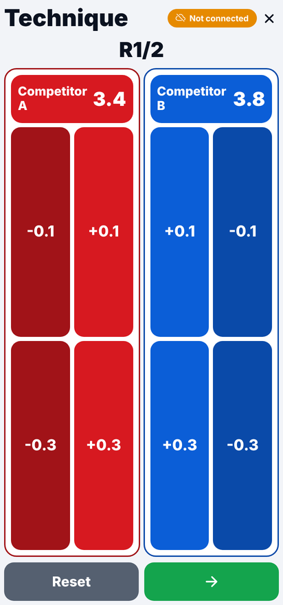
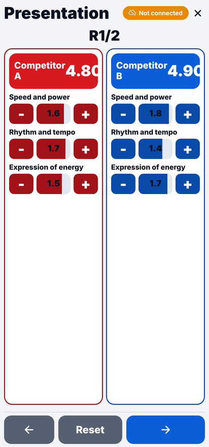
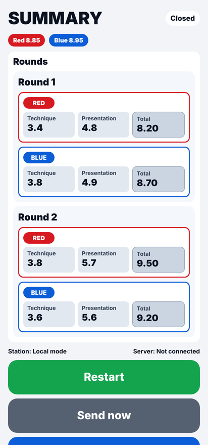
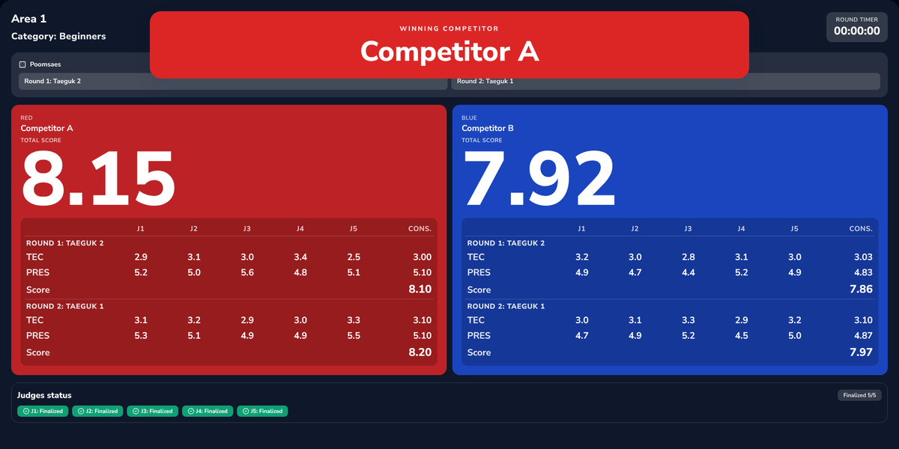

# Why this system exists: the poomsae scoring rules

If you have judged or organized a poomsae tournament, you already know the problem. This page explains
which competition rules create it and how the system follows each one.

## The rules a judge applies

In a recognized poomsae competition each judge gives every performance a score out of **10.0**, made of
two parts that are scored at different moments:

| Part | Maximum | How it is scored | When |
|---|---|---|---|
| **Accuracy** | 4.0 | The judge starts at 4.0 and deducts **0.1 for each minor mistake** and **0.3 for each serious mistake** (wrong stance, wrong technique, loss of balance…). | **Live**, while the athlete is performing |
| **Presentation** | 6.0 | Three criteria worth up to **2.0 each**: **speed and power**, **rhythm and tempo**, **expression of energy**. | **After** the performance ends |

## The rules the organizers apply

| Rule | What it means |
|---|---|
| Panel of **3, 5 or 7 judges** | Large events use 7 judges; regional events often use 5 or 3. |
| **Drop the extremes** | With 5 or 7 judges, the highest and the lowest scores are discarded and the remaining ones are averaged. With 3 judges the three scores are averaged. |
| **Accuracy and presentation are averaged separately** | The trimming and averaging is done once for accuracy and once for presentation, then the two are added. |
| **Two poomsae per round** | Athletes usually perform two poomsae (a drawn pair from their category); the round score is the average of the two. |
| **Ties** | The higher total wins; if tied, the higher presentation score; if still tied, the total of all judges' scores including the dropped ones; then a rematch. |
| **Head-to-head matches** | Two athletes (red and blue) perform; the higher score wins. |

## Why doing this by hand stops the competition

Count the numbers that must be collected for **one** head-to-head match with 7 judges and 2 poomsae:

> 7 judges × 2 parts (accuracy, presentation) × 2 poomsae × 2 athletes = **56 numbers**

Each set of 7 numbers then has to be sorted, trimmed, averaged and rounded, and the results added and
averaged again. On paper or in a spreadsheet this means:

- **The competition stops** after every athlete while the scorers collect the judges' sheets.
- **Transcription errors**: a 3.4 copied as 3.1 changes which score is "highest" and can change the winner.
- **Accuracy is a live count**: the judge tracks deductions mentally during a 1–2 minute performance and
  has to remember the final number until it is collected.
- **The audience waits** without seeing anything, and judges and athletes cannot verify the result.

## How the system follows each rule

  
  
  

*Left to right: accuracy is tapped live (−0.1 / −0.3), presentation is set after the performance with the
three criteria, and the summary shows each round.*

| Rule | In the system |
|---|---|
| Accuracy starts at 4.0, −0.1 / −0.3 | The **technical scoring screen** shows a large 4.0 per athlete and big −0.1 / −0.3 buttons (plus +0.1 / +0.3 to correct a wrong tap). The judge taps during the performance; the number is never written down. |
| Presentation 3 × 2.0 after the performance | The **presentation screen** has the three criteria with a slider and −/+ buttons, limited to 0–2.0 each. |
| 3 / 5 / 7 judges, drop the extremes | The server consolidates automatically: average for 3, trimmed average for 5 and 7 (see [requirements, section 4](requirements.md#4-scoring-rules)). |
| Accuracy and presentation averaged separately | Each part is trimmed and averaged on its own across the judges, then the two are added. |
| Two poomsae, averaged | Rounds are configurable (default 2) and the match score is the average of the rounds. Poomsae are drawn per category from a configurable catalog. |
| Ties | Resolved automatically in the rule's order: the higher total, then the higher presentation score, then the higher total of all judges' scores including the dropped highest and lowest. If everything is still equal the TV shows **Rematch required**; the officials then run the rematch. |
| Results visible immediately | The **TV scoreboard** shows each judge's accuracy and presentation (J1…J7), the consolidated values, each poomsae score, the total and the winner as soon as the judges submit. |
| No stops between athletes | Judges submit from their phones; nothing has to be collected or typed. If the Wi-Fi drops, the phone keeps the scores and sends them when the network returns. |

## Sources

The rules above are common to World Taekwondo-based poomsae rulebooks. Check the current rulebook of
your federation for the exact edition in force:

- USA Taekwondo, [Poomsae Competition Rules & Interpretation, effective January 1, 2026](https://assets.contentstack.io/v3/assets/blteb7d012fc7ebef7f/blt2103cb6e4ad9cd42/69417ee5d9ae217354c1771c/2026_USATKD_Poomsae_Rules_1_1_26.pdf) — accuracy scored in real time and presentation after the performance; trimmed averaging per criterion.
- AAU Taekwondo, [Poomsae General Competition Rules & Regulations (2025)](https://image.aausports.org/dnn/tw/2025/SportPoomsae/25AAUTKD-RulesRegulations.pdf) — 0.1 / 0.3 accuracy deductions; presentation criteria of 2.0 each; no trimming with 3 judges.
- British Taekwondo, [Poomsae Competition Rules 2024](https://www.britishtaekwondo.org.uk/wp-content/uploads/2024/08/British-Taekwondo-Poomsae-Competition-Rules-2024-approved-27062024.pdf).
- World Taekwondo, [World Para Taekwondo Poomsae Competition Rules (2024)](https://www.worldtaekwondo.org/att_file/documents/World%20Para%20Taekwondo%20Poomsae%20Competition%20Rules%2020240930.pdf) — tie-break order.
- [Taekwondo at the 2022 Asian Games – Women's individual poomsae](https://en.wikipedia.org/wiki/Taekwondo_at_the_2022_Asian_Games_%E2%80%93_Women%27s_individual_poomsae) — 7 judges, average of the 5 middle scores.

---

*The TV scoreboard with 5 judges: each judge's accuracy (TEC) and presentation (PRES), the consolidated
values after dropping the highest and lowest, each poomsae score and the total.*
