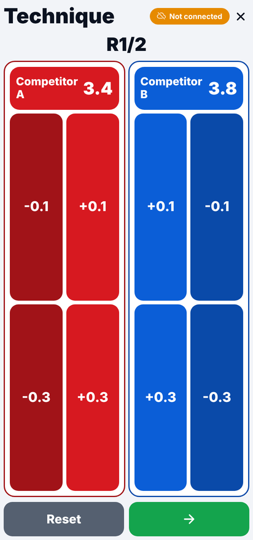
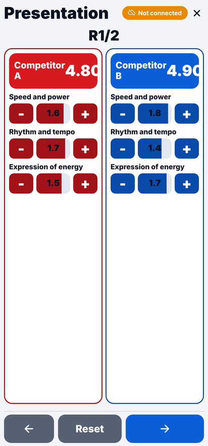
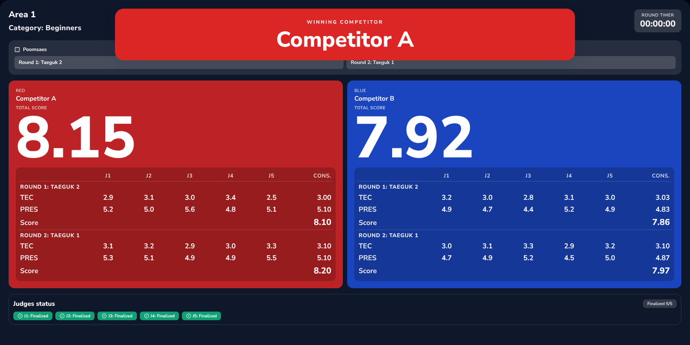
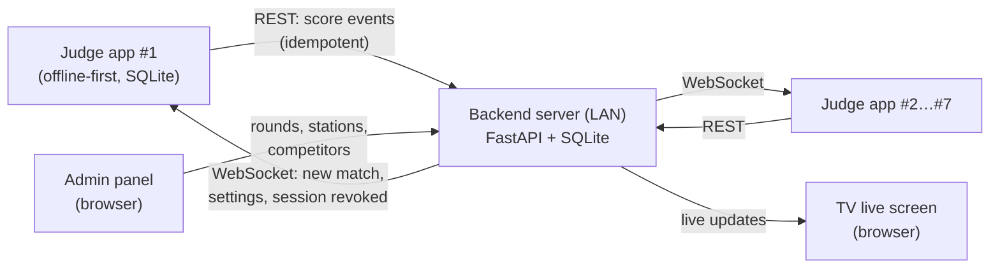

# Requirements — TKD Poomsae Scorer

System-level requirements for a digital, multi-judge scoring system for taekwondo **poomsae** competitions.
This document consolidates every requirement gathered for the product: scope, scoring rules, functional
requirements per component, operational clarifications, non-functional requirements and acceptance criteria.

Start with [**why this system exists**](poomsae-rules.md): the poomsae rules that make manual scoring slow
and error-prone. Component-level specifications live next to this file:

| Document | Content |
|---|---|
| [`judge-app-requirements.md`](judge-app-requirements.md) | Judge app requirements with IDs (`FR-001`…`FR-172`, `NFR-010`…) and acceptance criteria |
| [`api-contract.md`](api-contract.md) | REST + WebSocket contract shared by the backend and the judge app |
| [`backend.md`](backend.md) | Backend architecture, use cases, configuration and operation |
| [`judge-app.md`](judge-app.md) | Judge app architecture, data model, sync engine and screens |

The original Spanish documents are kept in [`es/`](es/).

---

## 1. Problem and goal

In a traditional poomsae competition each judge writes down a score and the organizers consolidate the
scores by hand (often in a spreadsheet). The competition has to stop every time scores are collected,
transcription errors are common, and athletes and spectators wait for results.

**Goal:** judges score simultaneously and independently from their phones without interrupting the
competition. The system consolidates the scores, discards the extremes according to the rules and shows
the result on a TV screen within seconds — with no manual transcription and no waiting between athletes.

  
  
  

## 2. Actors

| Actor | Device | Responsibilities |
|---|---|---|
| **Judge** | Android phone running the judge app | Scores technical accuracy and presentation for each competitor, closes rounds, finalizes the match |
| **Administrator / organizer** | Laptop with a browser on the LAN | Creates stations (areas), shares QR + PIN, registers competitors, draws poomsaes, controls rounds and timer, supervises judges |
| **Audience and referees** | TV connected to a browser | Watch the live scoreboard of an area |

## 3. System overview

- One **server instance** manages one or more **stations** (competition areas / tables). Several server
  instances can run in the same competition, each on its own computer, to scale to more areas.
- The whole system runs on a **closed local network without internet access**.
- The admin panel and the TV screen are served by the backend and open in any browser on the same network.

## 4. Scoring rules

These rules replace the manual spreadsheet used before the system and follow World Taekwondo poomsae
rules for recognized poomsae.

### 4.1 Per judge

| Component | Rule |
|---|---|
| **Technical accuracy (TEC)** | Starts at **4.0**. Deduction buttons **−0.1** (minor) and **−0.3** (major); correction buttons **+0.1** / **+0.3** to undo a mistake. Range **0 … starting score**. Starting score and button values are configurable. |
| **Presentation (PRES)** | Three categories — *Speed and power*, *Rhythm and tempo*, *Expression of energy* — each in the range **0 … 2**. Presentation = sum of the three categories (**0 … 6**). |
| **Judge score per poomsae** | TEC + PRES (maximum 10.0). |

Every judge action is stored as an event with a signed `scoreDelta` (negative = deduction,
positive = correction). Replaying the same events in `sequence` order always yields the same score.

### 4.2 Consolidation across judges

Applied separately to TEC and to PRES of each poomsae:

| Judges in the station | Rule |
|---|---|
| **3** | Simple average of the 3 scores |
| **5** | Discard the highest and the lowest score, average the remaining 3 |
| **7** | Discard the highest and the lowest score, average the remaining 5 |
| 1, 2 or 4 (non-official) | Simple average, with a warning in the admin panel |
| 6 (non-official) | Same as 5 / 7: discard highest and lowest, average the rest |

- **Poomsae score** = consolidated TEC + consolidated PRES.
- **Match score** (2 rounds / 2 poomsaes) = average of the two poomsae scores. With a single round the
  match score is the poomsae score.
- All results are rounded to **2 decimals, half up**.
- Winner: the side with the higher match score; if equal, the higher consolidated presentation; if still
  equal, the higher total of all judges' scores including the discarded highest and lowest; if still equal,
  a rematch is required (shown as "Rematch required").

**Example (5 judges, one poomsae):** TEC = 2.9, 3.1, 3.0, 3.4, 2.5 → discard 3.4 and 2.5 →
(2.9 + 3.1 + 3.0) / 3 = **3.00**. PRES = 5.2, 5.0, 5.6, 4.8, 5.1 → discard 5.6 and 4.8 →
(5.2 + 5.0 + 5.1) / 3 = **5.10**. Poomsae score = **8.10**.

### 4.3 Competition structure

- Each match has two competitors identified by color: **red** and **blue**; the red side can be swapped on each device.
- Default **2 rounds** (poomsae 1 and poomsae 2), configurable by the administrator.
- Poomsaes are **drawn per category** from a configurable YAML catalog. Default catalog:

| Category | Poomsaes |
|---|---|
| Beginners (`beginners`) | Taeguk 1 – 4 |
| Advanced (`advanced`) | Taeguk 5 – 8 |
| Black belts (`black_belts`) | Koryo, Keumgang, Taebaek, Pyongwon, Sipjin, Jitae |

## 5. Functional requirements

### 5.1 Judge app (Android)

The full list with IDs and acceptance criteria is in [`judge-app-requirements.md`](judge-app-requirements.md).

| ID | Requirement |
|---|---|
| APP-01 | First-run setup: the judge enters a name, stored on the device and reused across restarts. |
| APP-02 | Connect to a station by scanning the **QR code** generated by the admin panel, then entering the station **PIN**. Reject expired QRs and `localhost` addresses. |
| APP-03 | **Offline mode**: the app works without any server; matches can be created, scored and finalized locally. |
| APP-04 | Technical scoring screen with two large panels (red / blue) and the −v1, −v2, +v1, +v2 buttons. Reset of the round with confirmation. |
| APP-05 | Presentation scoring screen with the 3 categories per competitor, editable with a slider and with − / + buttons. |
| APP-06 | Multiple rounds; on the last round the **Finalize** action is shown. |
| APP-07 | **Offline-first**: every tap is persisted in SQLite before any network call; synchronization runs in the background and never blocks the UI. |
| APP-08 | Retry queue with **exponential backoff + jitter**; retries on a timer, when the network comes back, when the app returns to the foreground and on demand. Duplicates prevented by `idempotencyKey`. |
| APP-09 | Finalization builds the consolidated payload from local data and signs it with a **SHA-256 checksum**; it is retried until the server acknowledges it. |
| APP-10 | Round summary (TEC, PRES and total per competitor and round) and local **history** of previous matches with a configurable retention (minimum 2). |
| APP-11 | Settings: judge name, deduction values, starting scores, default rounds, history retention (validated). |
| APP-12 | Automatic session restore after a device restart or a temporary server outage. |
| APP-13 | WebSocket channel to receive server events: new competitors, active match state, settings updates, session revoked / judge kicked. Reconnects automatically. |
| APP-14 | UI in English by default and in Spanish on Spanish-language devices; large touch targets, portrait and landscape layouts, confirmation on critical actions. |

### 5.2 Backend and admin panel

| ID | Requirement |
|---|---|
| BE-01 | Deployable on one or several local servers; each instance manages one or more stations independently. |
| BE-02 | Admin web panel protected by password: create / delete stations, **rotate station credentials**, generate a **QR per station**, kick judge sessions, live view of each station. |
| BE-03 | Match management: register competitors by color (red / blue), **draw poomsaes** by category, start the match. |
| BE-04 | Round control from the panel: start, stop, reset round, round **timer** with pause, finalize the match. |
| BE-05 | REST API for the judge app: session bootstrap, station connection, score events with **guaranteed idempotency** and strictly increasing sequence per match, finalization with checksum reconciliation. |
| BE-06 | One real-time **WebSocket** channel per station for two-way communication with the judges' devices. |
| BE-07 | Consolidation engine for 3, 5 or 7 judges per station, following section 4. |
| BE-08 | Scoring engine: TEC + PRES per round, final score per round and average across rounds for the match. |
| BE-09 | **Debug screen** for the administrator with the per-judge deltas, to verify results. |
| BE-10 | Results **history** and lookup of previous matches; delete one or all matches from the history. |
| BE-11 | Poomsae catalog configurable through a **YAML** file. |
| BE-12 | Every score event and administrative action is auditable and traceable to judge, session and station. |
| BE-13 | Admin panel and TV screen in English or Spanish (`TKD_UI_LANGUAGE`). All assets (CSS, fonts, icons) are served by the backend, so nothing is loaded from the internet. |

### 5.3 TV live screen

| ID | Requirement |
|---|---|
| TV-01 | Public screen per station, designed to be projected on a TV, that updates in real time without reloading the page. |
| TV-02 | Header: area name, category, current round and round timer. |
| TV-03 | Two side-by-side panels, one per competitor color. For each poomsae: a **TEC** row and a **PRES** row with the score of every judge (J1 … J7), the consolidated partial score of each row and the final poomsae score. |
| TV-04 | A large **total score** per competitor (average of the poomsaes). |
| TV-05 | A judges status bar showing which judges are connected and which have closed the round. |

## 6. Operational clarifications

Agreed after the first version of the scope:

1. **Judge aliases:** during a session judges are shown with an alias following the pattern `J#`
   (for example `J3`), independent of the name entered on the device, and listed in order in the results.
2. **A closed round is final:** once a judge closes a round it cannot be reopened or modified.
3. **Finalize is definitive:** the Finalize button consolidates the score permanently; no changes are
   accepted afterwards.
4. **Single admin screen:** the administration of a station is concentrated on one screen to avoid
   navigating between pages during the competition.
5. **Simple UI, no animations:** interfaces are intentionally simple so they run smoothly on low-end devices.
6. **Detailed TV screen:** the live screen follows the layout described in section 5.3.

## 7. Non-functional requirements

| Area | Requirement |
|---|---|
| Availability | Judges can always keep scoring: the app never depends on the server or the network to register a score. |
| Network | Runs on a closed LAN with no internet. HTTP between phones and servers must be allowed; HTTPS is optional and requires a certificate provided by the operator. |
| Data | **SQLite** is the source of truth on both sides (backend, and app for scoring and the sync queue). No database server to install. |
| Portability | The backend is distributed as a self-contained executable for Windows and Linux (PyInstaller) with an `.env` file and the YAML catalog; it can be copied between computers. |
| Mobile platform | Android 8.0+ (API 26). Distributed as an APK, outside the app stores. |
| Security | Short-lived JWTs, hashed station credentials, admin login lockout after failed attempts, configurable IP allowlist, fail-fast checks for insecure default secrets. |
| Integrity | Idempotent score events and finalization; SHA-256 checksum reconciliation between app and server. |
| Observability | Structured JSON logging for traceability of events. |
| Performance | Only the active match is kept in memory on the phone; history queries are lazy and light. |
| Usability | English and Spanish UI, large buttons, no animations, confirmation on critical actions. |
| Architecture | Hexagonal architecture (ports and adapters) in the backend; domain / application / infrastructure / UI layers in the app. |

## 8. Out of scope

- Publishing to Google Play or the App Store; iOS version.
- Integration with third-party tournament systems or federation systems; exporting results to external systems.
- Athlete registration, brackets, online payments.
- Push notifications; PDF reports from the judge app.
- High availability or clustering (each server is a single instance) and multiple tournaments per instance.
- Multiple admin users with granular roles (one administrator per instance).
- Web app for judges (Android only).
- Automatic cloud backups.
- Combat (kyorugi) scoring.

## 9. Technology stack

| Judge app | Backend |
|---|---|
| React Native + Expo SDK 55, TypeScript | Python 3.11+, FastAPI, Uvicorn |
| Expo Router, Zustand, Zod | SQLAlchemy 2 + SQLite |
| expo-sqlite, expo-secure-store, NetInfo | JWT (python-jose), passlib (bcrypt) |
| expo-camera (QR) | Native FastAPI WebSockets |
| Vitest (unit), Detox (E2E) | Jinja2 admin templates, Tailwind |
| | pytest, ruff, PyInstaller |

## 10. Acceptance checklist

- [ ] A judge can install the APK, enter a name and score a full match **without a server**.
- [ ] Scanning a station QR and entering the PIN connects the judge; restarting the app restores the session.
- [ ] Turning off the Wi-Fi while scoring loses no event; events sync when the network returns.
- [ ] With 3, 5 and 7 judges the consolidated result matches section 4 (including the worked example).
- [ ] Sending the same score event twice does not change the result (idempotency).
- [ ] Finalization reconciles the checksum; a mismatch leaves the match as *finalization pending* with notes.
- [ ] The TV screen updates in real time and shows the layout of section 5.3.
- [ ] Kicking a judge from the panel disconnects the device and revokes its session.
- [ ] The backend executable starts on a clean Windows and Linux machine with only the `.env` and YAML files.

## 11. Implementation status

What works end to end today and what is still open. Each open item is a known gap, not a design decision.

| Area | Status |
|---|---|
| Judge app: offline scoring, sync queue, finalization with checksum, history, settings, EN/ES UI | Done |
| Backend: stations, QR + PIN, sessions, idempotent score events, WebSocket, admin panel, TV screen, EN/ES UI, offline assets | Done |
| Multi-judge scoring: one scorecard per judge, finalization per judge, match closes when all judges finished | Done — verified end to end with 3 and 5 judges |
| Consolidation of accuracy and presentation separately (section 4.2) | Done — includes the worked example as a test |
| TV per-judge grid (TV-03) and judge status (TV-05), judge aliases `J1`…`J7` (section 6.1) | Done |
| Finalization checksum shared by app and server | Done — one canonical payload with a shared test vector |
| Tie-break | Done — higher score, then higher presentation, then the total of all judges' scores including the discarded ones, then "Rematch required". The rematch itself is organized manually. |
| Judge corrections after syncing | Done — the app's technique / presentation resets record compensating score events instead of deleting events, so the server and the device stay equal; sequences are never reused. |
| Judge removed during a match | Done — a removed judge that had not finalized stops counting and is left out of the consolidation (shown "Removed"); the match closes when the remaining judges have finalized. A judge that joins late counts from its first score. |
| Authentication on every endpoint | Done — the match-control endpoints need a judge token of the same station or the admin login (resets are administrator-only), `/bootstrap/generate` and `/bootstrap/validate` need the admin panel's access checks, and the WebSocket always validates the token. |
| Station PIN storage | Done — the PIN is stored hashed and encrypted (no plain copy); older plain values are encrypted on startup. |
| Session replacement | Done — a judge connecting from another device replaces its old session (the old device is signed out) and keeps its scorecard. Limit: the new device cannot reproduce the events sent by the old one, so when there were any that judge's finalization does not reconcile (the match ends *finalization pending*) and the operator decides. |
| One judge disconnecting signs out the others | Done — the app only acts on disconnect / revocation events for its own session. |
| Local-mode scores after connecting | Done — local-mode matches and sessions are never sent and never block server finalizations. |
| QR address settings | Done — `TKD_QR_SERVER_IP_OVERRIDE`, then `TKD_QR_USE_SERVER_IP`, then the configured public URL. |
| Score events after the operator closes a match | Done — the server answers `409 match_closed` and the app stops retrying them. |
| Admin panel "Reset round" | Done — the judges' phones delete the same round. |
| Items queued under a previous session | Done — sent with the current session when it is the same judge; never sent for another judge. |
| Presentation category start score | Done — scoring and resets use the configured start, not the 2.0 maximum. |

Details and code references for each item are in [backend.md — Known limitations](backend.md#known-limitations) and
[judge-app.md](judge-app.md).
